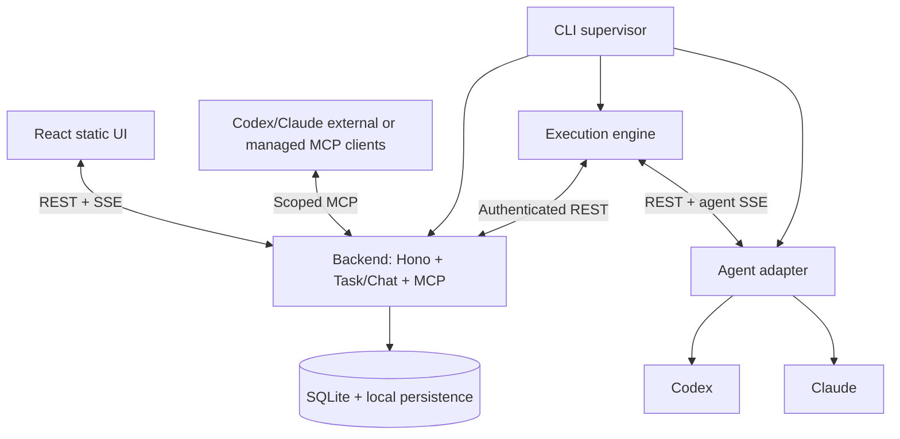

# TaskAside

**Hand off tasks. Stay in flow.**

TaskAside is a planned **local-first task inbox and execution scheduler** for AI coding agents. Queue coding tasks across repositories, let Codex or Claude work when a checkout is safe, and reply to agent questions in a focused task conversation.

> **Project status:** Implemented locally (Bun/TypeScript, three services + supervisor). The repair in
> [specs/2026-10-24-handoff-single-writer.md](specs/2026-10-24-handoff-single-writer.md) closed three
> audited gaps — the engine now actually polls/dispatches/reconciles at startup, `yield_task` is
> asynchronous intent rather than trusted stop proof, and external `create_task` requires an explicit
> `repoId` + `idempotencyKey`. **Not yet true:** cross-machine or multi-process exclusivity (MCP cannot
> revoke a planner's or another tool's direct filesystem access to a checkout), untested Linux/Windows
> support, and npm publishing. See "Planner handoff and current limits" below before relying on this for
> multi-developer use. The CLI examples below describe the target user experience and are not a claim
> that `taskaside` is published on npm.

## Why TaskAside?

Managing agents shouldn't mean managing a pile of terminals. TaskAside centralizes tasks, prioritizes what runs next, serializes writers to a shared repository checkout, lets independent repositories run in parallel, and brings questions back to a small chat interface.

**Primary workflow**

1. Register a local Git repository and select Codex or Claude as the task's agent.
2. Add tasks with a priority from **P0** (highest) to **P3** (lowest).
3. TaskAside schedules work, starting eligible work across different repositories in parallel while guarding each working tree.
4. Follow progress in the sidebar and chat. If a task becomes **HITL**, answer its agent via a normal text message.
5. Agent-created child tasks join the same queue and link back to their parent task.
6. Close the browser and return later. Background service processes continue while your machine/runtime remains running.

## Planned UI

A minimal two-pane web app:

| Sidebar | Main panel |
|---|---|
| Search and New Task | Selected task title, status, priority, repo, parent link |
| **State → Priority** or **Priority → State** nested grouping | Agent/developer conversation in Markdown and code blocks |
| Collapsible `todo`, `hitl`, `processing`, `done`, `error`, `cancelled` groups | Plain message composer |
| Avatar menu → **Settings** modal | No Files/Subtasks/Activity tabs |

No Kanban board, timeline, approval cards, workflow editor or token dashboard in the MVP.

## Planned quick start (after first release)

The target distribution is **one TaskAside npm package** and one startup command:

```bash
npx taskaside
```

Later supported operational commands:

```bash
taskaside start
taskaside status
taskaside stop
```

**Prerequisites:** `npx` requires Node.js/npm. The packaged CLI will provision/select a compatible Bun runtime through its dependency or require Bun when using `bunx`. The developer must separately configure supported Codex/Claude installations and credentials. The program must support macOS, Linux and Windows; native per-OS executables are **not** the TaskAside publication format.

The launcher will install its detached service payload into a stable user data path, start or attach to a persistent local supervisor, run background services, and open the browser. This behavior must be built and tested before release.

## Architecture at a glance



**Responsibilities:**

- **Backend:** The only SQLite accessor. REST APIs, task/chat domain state, MCP tools, UI SSE and static web hosting.
- **Execution engine:** Pull runnable work, choose priority/order, assemble task instructions, dispatch to adapter and reconcile state.
- **Agent adapter:** Manage Codex and Claude runtime/session/process, cancellation, stream events and raw local logs.
- **Supervisor:** Start, monitor and stop those **three independent service processes**.
- **Frontend:** React/Vite static UI, served by the backend; browser need not remain open.

**Streaming is not shared memory.** Provider output streams into the adapter, adapter SSE into the engine, engine POSTs semantic events to backend, backend commits authoritative state and broadcasts through an in-memory event hub to browser SSE. On reconnect, the browser refreshes task/chat snapshots using REST.

## Stack

| Area | Planned choice |
|---|---|
| UI | React, Vite, Tailwind CSS, shadcn/ui |
| Backend | Bun + TypeScript + Hono |
| Persistence | `bun:sqlite` (WAL), local log files |
| Scheduling | TypeScript execution-engine + backend atomic claims |
| Agent support | Codex App Server (candidate) + Claude Agent SDK/CLI (POC-gated) |
| Events | REST + SSE; no Redis/message broker |
| External tool integration | MCP Streamable HTTP with explicit auth scopes |
| Distribution | One npm package with platform-selected Bun runtime dependency |

## Key MVP guardrails

- One managed code-writing run per canonical Git working tree.
- Higher priority runnable tasks are dispatched first; FIFO within equal priority.
- Agents cannot run arbitrary backend admin operations through MCP.
- Session resume and HITL behavior differ by provider and must be validated; TaskAside will surface unsupported capabilities.
- A lost heartbeat **does not** release a repo lock until old process state is confirmed safe.
- Localhost HTTP still needs Host/Origin checks and authentication.
- No mandatory Docker, Redis, PostgreSQL, Temporal, Restate or cloud component.

## Planner handoff and current limits

Planning sessions (Claude/Codex/Agy discussing and approving work) should connect to a running
TaskAside backend as an **external MCP client**, paired via `/api/mcp/pair` +
`/api/mcp/approve-pairing` and scoped to only the tools a planner needs — typically `list_tasks`,
`get_task`, `get_messages`, and `create_task` if the planner is also allowed to hand off approved
work. `yield_task`, `post_message`, and `request_input` are always managed-only (scoped to a live
run) and are never reachable by an external token.

External `create_task` now requires an explicit, authorized `repoId` and an `idempotencyKey`:
omitted `repoId` is a validation error, an unregistered `repoId` is not-found, and a `repoId` outside
the token's `allowedRepoIds` is forbidden. TaskAside never guesses or defaults to "the first allowed
repo." Retrying the same principal/key/payload returns the same task (including across a backend
restart); a changed payload with the same key conflicts.

**What this does *not* give you:** MCP is a task/chat protocol — it has no filesystem tools, so no MCP
scope can grant or prove a *write* capability. But the reverse is also true: pairing a token with only
read-oriented tools gives that MCP *client* no way to edit a checkout through MCP, yet it proves
nothing about whatever direct filesystem access the planner's own process might independently have
(for example, if the same coding-agent session that is MCP-paired as a planner is *also* running with
its own file-editing tools pointed at the same checkout). TaskAside cannot detect or revoke that
independent access — keeping a planning session genuinely read-only is a matter of how you configure
that session/harness, not something this backend enforces. Treat "one local authority per checkout" as
an assumption to review if you run multiple TaskAside instances or hand-rolled agents against the same
repository, and treat cross-machine or arbitrary-external-process exclusivity as an explicit, unsolved
blocker — it needs deployment and OS-level filesystem-isolation decisions that are out of scope here.

## Documentation

| Document | Purpose |
|---|---|
| [PRD.md](PRD.md) | User problem, MVP UX, scope and acceptance criteria |
| [SPECIFICATION.md](SPECIFICATION.md) | Behavior, states, API/MCP/events and tests |
| [CONSTITUTION.md](CONSTITUTION.md) | Non-negotiable engineering principles |
| [ARCHITECTURE.md](ARCHITECTURE.md) | Services, ownership, persistence, streaming and security |
| [AGENTS.md](AGENTS.md) | Repository instructions for Codex/Claude contributors |
| [PLAN.MD](PLAN.MD) | Milestones, POCs, dependencies and release checklist |

## Getting started as a contributor

Install dependencies with `bun install`. Format code with `bun run format`, or check
formatting without changing files with `bun run format:check`. Prettier handles formatting;
Biome handles linting with `bun run lint`. Documentation and generated files are excluded
from formatting.

At this stage the repository is **documentation-first**. The implementation scaffold, package scripts and running server will be introduced in the early milestones of [PLAN.MD](PLAN.MD). Do not copy/paste speculative `bun run dev` commands from third-party examples and assume they already work.

For implementation agents: read [AGENTS.md](AGENTS.md) first, then respect [CONSTITUTION.md](CONSTITUTION.md) and [SPECIFICATION.md](SPECIFICATION.md). Implement the provider and process-lifecycle POCs before expanding the frontend.

## Licensing and contribution status

Open-source intent is part of the product direction, but **a specific license has not been selected**. Do not assume an OSI license or create a license file without the maintainer's decision. Contribution workflow, support policy, and version compatibility matrix will be formalized before public release.
