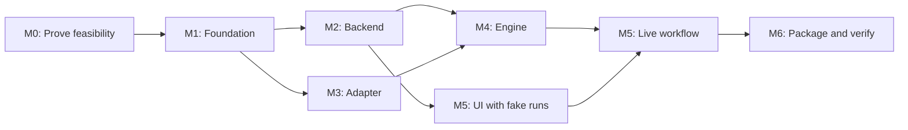

# TaskAside — MVP Implementation Plan

> **Status:** Approved sequence and release gates; implementation not yet started  
> **Version:** 0.4 · **Date:** 2026-10-18  
> **Depends on:** [PRD.md](PRD.md) · [SPECIFICATION.md](SPECIFICATION.md) · [CONSTITUTION.md](../CONSTITUTION.md) · [ARCHITECTURE.md](../ARCHITECTURE.md)

## Implementation handoff

**Current checkout:** documentation only. No application scaffold, provider proof or acceptance check has been completed. The sequence below is planned; it does not mean the POC gates have passed.

**Confirmed delivery decisions:** Develop and prove M0–M5 on macOS first. Linux/Windows evidence is required at T31/M6 before cross-OS release and does not block M1. Use the installed Codex and Claude CLIs with their existing local login/configuration for POCs; no separate API setup is planned. Follow `z-agent-non-interactive` for harness mechanics. Authentication and provider behavior remain unverified until live POCs run.

The [task breakdown](TASKS.md) defines **33 tasks**, explicit prerequisites, owners, acceptance checks and detailed task graphs. Use task IDs when starting implementation; keep milestone gates below as the release criteria.



**Start with T01–T04**, independent feasibility tasks; then T05 records the decisions and closes M0. M2 and M3 may proceed independently after M1. M5 UI work may start after M2; its live acceptance waits for M4. Parallel work still requires isolated checkouts or coordinated edits.

**Verification for this request:** do not write unit tests or use screenshots. Use contract, integration, process, browser interaction and live-provider checks. This follows the current user instruction where older documents prescribe unit tests or screenshots. All checks remain planned until actually executed.

**Out of scope for this planning change:** application code, provider experiments, package installation, publishing and license selection. The project stack remains Bun/TypeScript/SQLite as specified; no stack change is proposed.

## 1. Delivery strategy

Build the smallest end-to-end vertical slices, proving **macOS runtime/process safety and two agent providers** before polishing UI. Preserve cross-platform boundaries and complete Linux/Windows verification in M6 before release. Each milestone leaves an independently testable result. Do not invent calendar estimates; the schedule depends on POC outcomes.

**Guiding delivery invariant:** State is backend-owned; execution engine chooses work; adapter controls agent runtime; frontend is read/write presentation; supervisor keeps processes alive. This separation must remain true as milestones progress.

## 2. Milestone overview

| Milestone | Outcome | Depends on | Gate |
|---|---|---|---|
| M0 — Feasibility spikes | Evidence of installed Codex + Claude CLI behavior, Bun packaging and process control on macOS | None | No unsupported provider/runtime assumptions on macOS |
| M1 — Repo scaffolding & contracts | Bun/TS baseline, shared DTOs, three independent CMD stubs + supervisor skeleton | M0 findings | Typecheck, isolated health checks |
| M2 — Backend Task/Chat | SQLite migrations, transactional task state, REST, MCP foundations, auth | M1 | State machine and data tests pass |
| M3 — Adapter with two providers | Codex and Claude drivers, run REST/SSE, cancel/status, log files | M0, M1 | Both real-provider POC suites pass |
| M4 — Execution engine | Scheduler, instruction builder, repo locks, event forwarding, recovery | M2, M3 | Real and fake E2E task execution safe |
| M5 — Minimal frontend | Task sidebar grouping, chat, settings modal, SSE reconnect | M2, M4 for live wiring | UX test against PRD, no extra tabs |
| M6 — One-command cross-OS release | Stable npx bootstrap, detached supervisor, package, hardening | M1–M5 | macOS/Linux/Windows acceptance matrix |

M2 and M3 can be implemented **in parallel** once M1 contracts are pinned. Do not run competing edits in the same checkout without isolation/coordination, even while implementing TaskAside itself.

## 3. M0 — Architecture feasibility spikes (must happen first)

**M0.1 Codex integration**

- Verify installed CLI version and `codex exec` harness flags using `z-agent-non-interactive`; use existing CLI login/configuration and configured model.
- Probe Codex App Server from the same installed CLI where structured control requires it; select the driver protocol from evidence.
- Start coding task in a temporary registered test repository, receive incremental agent messages and completion/failure.
- Inspect session/thread resume, approval events, MCP configuration and process cancellation.
- Produce a small test fixture set from real JSON messages with sensitive content removed.

**M0.2 Claude integration**

- Use installed Claude Code CLI print mode following `z-agent-non-interactive`; a separate Agent SDK/API integration is not the default POC path.
- Verify existing CLI authentication, Bun subprocess interoperability, streaming, session handling and MCP connection setup.
- Confirm start/message/completion/cancel; test structured HITL or mark exact limitation and safe fallback.
- Record the supported Claude CLI flags and capability limits. Revisit the integration choice only if a required capability fails its gate.

**M0.3 Supervisor/platform experiment**

- Prototype one `npx`-compatible Node launcher starting installed Bun runtime; show one publishable package strategy without TaskAside-owned OS/arch bundles.
- Spawn a detached supervisor from a **stable installed location**, detach original shell, reconnect via `status`, and terminate via `stop`.
- Validate macOS process-tree cancellation and realpath normalization. Track Linux/Windows cases for T31; do not claim their support from macOS evidence.

**M0 exit criteria:** Both installed CLIs have evidence on macOS for baseline start/stream/terminal/cancel; unsupported optional resume/HITL capabilities are documented with a safe path for required behavior. A viable one-package Bun provisioning and detached supervisor path is shown on macOS. Resolve macOS/provider blockers before M1; Linux/Windows verification remains required at T31/M6 before cross-OS release.

## 4. M1 — Foundation and process contracts

- [ ] Initialize single package Bun/TypeScript project with strict TS, lint/format, tests and React/Vite build config.
- [ ] Add `src/cmd/cli.ts`, `backend.ts`, `execution-engine.ts`, `agent-adapter.ts` entrypoints; leave runtime responsibilities isolated.
- [ ] Add `src/contracts` request/response validators, provider capability DTO, event envelope, task/chat status enums and typed error envelopes.
- [ ] Implement internal service auth token provisioning by supervisor; bind all listeners to loopback.
- [ ] Add readiness `/health`, version identifier and process-oriented logs; no command must silently require Docker/cloud.
- [ ] Setup fake agent driver + mock backend for deterministic tests.
- [ ] Decide data/config/log OS paths and stable runtime install root.

**Gate:** Three child CMDs can run independently, health checks work, typed cross-process API contract tests pass and no SQLite access exists outside backend.

## 5. M2 — Backend state and API

- [ ] Create SQLite migrations for Task domain (`repositories`, `tasks`, `runs`, `run_locks`, run-event receipts) and Chat domain (`conversations`, `messages`). Enable FK/WAL.
- [ ] Task CRUD with priority, provider, parent ID, status; repo registration validates and canonicalizes path.
- [ ] Backend state machine, including `todo`, `processing`, `hitl`, `done`, `error`, `cancelled` with internal blocked/uncertain run state.
- [ ] Atomic claim/run creation/lock acquisition and monotonically increasing fencing generation.
- [ ] Heartbeat/finalization/stop verification and idempotent internal event ingestion.
- [ ] Conversation operations and ordinary text reply association with pending HITL input.
- [ ] MCP Streamable HTTP server and six scoped tools (`list_tasks`, `get_task`, `create_task`, `get_messages`, `post_message`, `request_input`).
- [ ] External MCP pairing credentials and managed per-task/run tokens; role-separated internal auth.
- [ ] Backend in-memory Event Hub and browser `/api/events` SSE, with REST snapshot/reconnect design.
- [ ] Static frontend asset hosting route (empty shell initially) without exposing arbitrary files.

**Gate:** Atomic contention test permits one writer for same repo; repeated event/create requests don't duplicate state; malicious origin and unauthorized managed MCP calls rejected; reopen DB preserves tasks/chat/locks.

## 6. M3 — Agent adapter for Codex and Claude

- [ ] One agent-adapter REST server with `GET /capabilities`, start, inspect, event stream, input, cancel endpoints.
- [ ] Codex driver using POC-chosen protocol and installed version validation.
- [ ] Claude driver using installed CLI integration and POC-verified capability mapping.
- [ ] Normalize output to `message.delta`, `message.completed`, `input_required`, `completed`, `failed`, `cancelled`; run ID + monotonically increasing sequence.
- [ ] Maintain provider session identifiers per run; don't forge resume support.
- [ ] Safe subprocess argument passing, cwd validation, platform-aware process tree lifetime and cancellation.
- [ ] Store raw logs in local files with bounded rotation and redaction policy.
- [ ] Adapter SSE with heartbeats, bounded buffers, status inspection and optional best-effort replay.

**Gate:** Both drivers pass real-provider baseline tests: start, meaningful output, completion, failure, cancellation, status. Where structured HITL/session resume is unavailable, document exactly how safe MVP behavior works; do not mislabel unsupported capabilities as supported.

## 7. M4 — Execution engine and recovery

- [ ] Poll/trigger runnable tasks with configurable global concurrency, priority P0–P3, FIFO tie breaks.
- [ ] Use backend atomic claim rather than engine-owned lock table or direct SQLite access.
- [ ] Build bounded instructions from task, parent link, relevant chat context, repo scope and safety guidelines.
- [ ] Start/recover adapter run with idempotent request; collect adapter SSE; POST durable semantic events to backend using sequence deduplication.
- [ ] Coalesce deltas for UI; post control events (failure/input/finish) promptly; never write each token to DB.
- [ ] Heartbeat, cancel, inspect/reconcile after partial network loss and crash; preserve uncertain locks.
- [ ] Structured HITL -> normal chat -> safe continue behavior. Hold repo lock when paused process remains alive.
- [ ] Parent yield to child tasks and explicit blocked wait conditions, no automatic sibling ordering assumption.
- [ ] Add bounded max child count/depth and idempotent create by origin run/key.

**Gate:** Same repo serialized, different repos parallel; priority respected for runnable items; parent/child and HITL scenarios complete; simulated adapter/engine death never yields duplicate live writer.

## 8. M5 — Minimal focused web UI

- [ ] React/Vite and shadcn/Tailwind two-pane responsive application; backend hosts static build.
- [ ] Wide left sidebar with Search, New Task, nested group selector (`State→Priority` and `Priority→State`), collapsible groups and compact rows.
- [ ] Present all six states; default `done`/`cancelled` collapsed; make P0, `hitl`, `error` easy to notice.
- [ ] Selected task header shows title, status, priority, repository, parent link and blocked reason.
- [ ] Chronological Markdown chat including code fences; composer to send text and handle normal HITL reply.
- [ ] Display stream deltas optimistically; reconcile authoritative completed messages; refetch REST snapshot on SSE reconnection.
- [ ] Avatar in sidebar footer -> small menu -> Settings modal; provider selection and registered repos available.
- [ ] No tabs for Files/Subtasks/Activity, no cards for approval, no Kanban/timeline/statistics.

**Gate:** UI works with fake and real agent; grouping two dimensions is a true nested grouping, not a sort; browser close/reopen restores state; users can handle HITL without terminal.

## 9. M6 — Packaging, distribution, cross-platform hardening

- [ ] Build frontend and Bun service bundles; publish a **single** TaskAside npm package (separate Codex/Claude installs may still be required).
- [ ] Node-compatible launcher for `npx taskaside`, select/provision Bun runtime via appropriate upstream npm dependency. Document prerequisites clearly.
- [ ] Stable installation/update path independent from npx cache; one-instance and version/DB compatibility gates.
- [ ] Long-lived supervisor starts backend -> adapter -> engine, checks health, safely restarts services, exposes `start/status/stop`.
- [ ] Bind loopback only; verify Host/Origin/auth and MCP pairing; document user-controlled access.
- [ ] OS-specific smoke tests for macOS, Windows, Linux including open browser, close launch terminal, status/stop, process tree cancellation, data path, repo path normalization.
- [ ] App data backup/migration/upgrade smoke test; logs and secrets lifecycle review.
- [ ] Package publishing dry-run (`npm pack --dry-run`) and clean-machine install simulation; verify no dev source/runtime path needed after launch.

**Gate:** One published package, one command launch, background execution, safe stop and re-open behavior on each supported OS/architecture combination in the declared support matrix.

## 10. Mandatory acceptance matrix

| Scenario | Backend | Engine | Adapter | UI | OS |
|---|---|---|---|---|---|
| Task CRUD survives restart | ✓ | — | — | ✓ | 3 |
| State → Priority and reverse grouping | ✓ | — | — | ✓ | 3 |
| P0 over P2 if both eligible | ✓ | ✓ | fake | ✓ | 3 |
| Same working tree never has 2 writers | ✓ | ✓ | ✓ | — | 3 |
| Parallel work on distinct repos | ✓ | ✓ | ✓ | ✓ | 3 |
| Codex start/stream/finish/cancel | ✓ | ✓ | ✓ | ✓ | Supported OS |
| Claude start/stream/finish/cancel | ✓ | ✓ | ✓ | ✓ | Supported OS |
| HITL question, reply and safe resume | ✓ | ✓ | ✓ | ✓ | Supported OS |
| Child task via managed MCP + parent link | ✓ | ✓ | ✓ | ✓ | 3 |
| External MCP client scoped access | ✓ | — | — | — | 3 |
| Duplicate run event is idempotent | ✓ | ✓ | fake | — | 3 |
| Browser closes/reconnects during run | ✓ | ✓ | ✓ | ✓ | 3 |
| Adapter/engine crash does not double-write | ✓ | ✓ | ✓ | — | 3 |
| One command starts detached supervisor | ✓ | ✓ | ✓ | ✓ | 3 |

`3` means macOS, Linux, Windows (tested on actual supported configurations). Unsupported provider/OS features must be declared rather than silently skipped.

## 11. Risks, owners, and go/no-go

| Risk | Suggested owner module | Action |
|---|---|---|
| Provider SDK protocol drift | adapter | Pin/test version and fixtures |
| Existing CLI auth/runtime compatibility | adapter + distribution | Validate installed Codex/Claude login, flags and Bun subprocess control in M0 |
| HITL retains process and blocks repo | engine + adapter | Capability-aware pause vs safe yield; clear status |
| Lost/repeated event | backend + engine | `(runId, sequence)` idempotency + replay/reconcile |
| Stale process after adapter crash | adapter + supervisor | Process-tree inspection, conservative lock quarantine |
| npx cache removal breaks daemon | launcher/supervisor | Stable installed payload before detach |
| Windows child process cleanup | adapter + supervisor | OS integration tests, not POSIX assumptions |
| Localhost attack surface | backend | Strong local auth, Host/Origin validation, scoped MCP tokens |

**No-go if:** A provider cannot safely run baseline tasks, backend can release locks while an agent might still write, detached supervisor fails after terminal exit, unauthorized MCP caller can mutate tasks, or the released package is not installable as a single TaskAside npm artifact.

## 12. Developer handoff templates

When assigning an implementation task to Codex/Claude, include:

```text
Milestone: Mx / subsection
Requirements: PR-xx and/or T-xx/E-xx/C-xx
Component owner: backend | execution-engine | agent-adapter | frontend | supervisor
Allowed files/modules: ...
Expected behavior: ...
Tests to add/run: ...
Explicit non-goals: ...
Output: concise summary + tests run + unresolved blockers
```

Before work, instruct the coding agent to read [AGENTS.md](../../AGENTS.md). Review against the constitution and acceptance matrix rather than rewarding new abstractions.

## 13. Release checklist

- [ ] PRD and specification requirements implemented and checked.
- [ ] Both providers tested with real CLI/SDK and documented supported versions.
- [ ] All event, lock, cancel, HITL and restart negative-path tests pass.
- [ ] No unmanaged credentials, secret-bearing logs or insecure localhost endpoints.
- [ ] macOS, Linux and Windows launcher/runtime/supervisor smoke tests pass.
- [ ] One npm package dry-run shows only necessary bundled assets and platform runtime dependencies.
- [ ] Documentation updated to reflect actual implemented commands rather than aspirational examples.
- [ ] Product owner explicitly authorizes release and chooses repository license.
