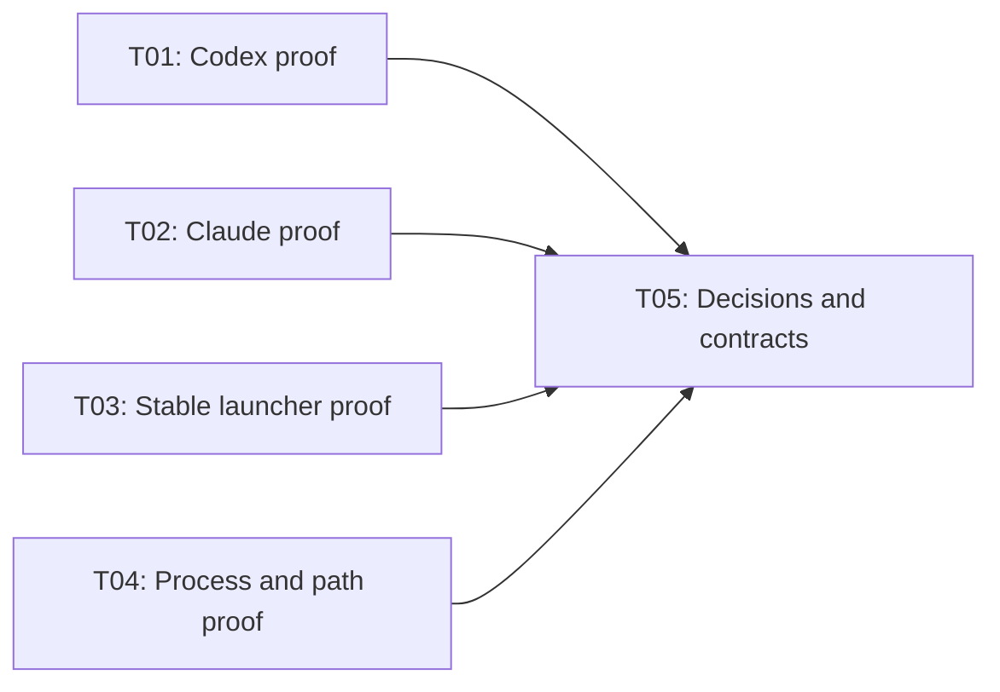
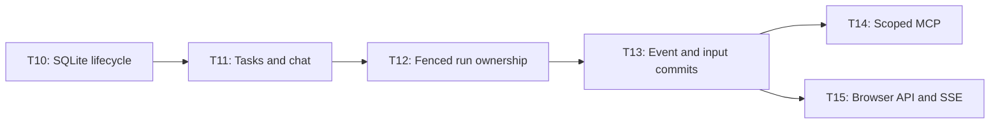
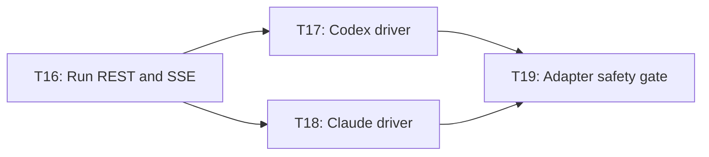
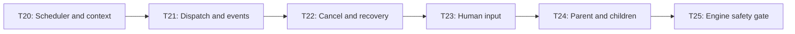
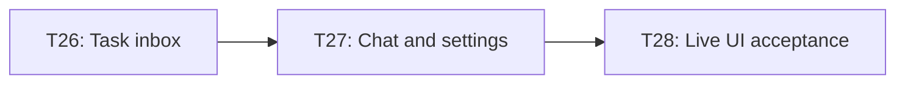
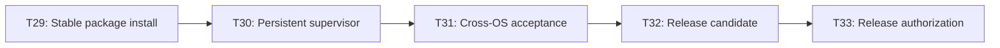

# TaskAside — Implementation tasks

**Status:** Local Implementation Complete (T01–T32 Verified Passed; T33 and Linux/Windows Cross-OS Verification Deferred to Release Gate) · **Date:** 2026-10-20

**Goal:** Deliver the MVP in [PLAN.MD](PLAN.MD) through small, verifiable steps. Each row is an assignable task; dependencies are hard prerequisites. Owners name component responsibilities, not people or permission to delegate.

**Read first:** [PRD](PRD.md), [Specification](SPECIFICATION.md), [Architecture](../ARCHITECTURE.md), [Constitution](../CONSTITUTION.md), [Agent instructions](../../AGENTS.md). The milestone graph is in [PLAN.MD](PLAN.MD#implementation-handoff); detailed graphs below show every task.

**Confirmed decisions:** M0–M5 run on macOS first; Linux/Windows checks move to T31/M6 and remain release gates. POCs use installed Codex/Claude CLIs and existing local login/configuration, following `z-agent-non-interactive`. No separate API credentials are required by this plan; working authentication must still be verified.

## Scope and readiness

| Item | Readiness | Boundary |
|---|---|---|
| T01–T04 feasibility work | Ready | Ready to investigate; capabilities are unverified. Use disposable registered repos. |
| T05 contract decisions | Ready | Record findings and resolve gaps before M1. A failed POC blocks only its dependent branch until resolved. |
| T06–T32 implementation | Assumption — review | The documented architecture is viable if M0 passes. If false, revise affected contracts/tasks before code. Consider this dependency when reviewing. |
| T33 public release | Blocker | License selection and explicit release authorization are still required; local implementation and package dry-runs can proceed without them. |

**In scope:** M0–M6, both providers, local state, safe execution, minimal UI and cross-OS packaging. **Out of scope:** cloud services, generic workflow/DAG engine, worktree management, extra UI tabs, automatic Git publishing. These graphs plan development work; they are not a product DAG feature.

## How to use this backlog

- Start a task only when its prerequisites and prior milestone gate pass. No dates or effort estimates are assumed before M0 findings.
- Finish with the stated observable check and a short evidence record: versions, OS/architecture, result, command or reproduction steps, and remaining limits. Evidence stays under this spec folder; redact secrets.
- Use contract/integration scenarios, fake providers, process checks and browser interactions. **Do not write unit tests or capture screenshots.** Broader requirements in older docs apply through these checks for this work.
- A failed safety check blocks the dependent task. An unavailable provider remains **not verified**, never passed. Linux/Windows evidence is deferred to T31 and does not block M1; macOS results do not prove those platforms work.
- Readiness to start is distinct from completion. Mark tasks done only after checking their acceptance criteria; do not pre-create application placeholders to match this list.

## M0 harness setup

Use the local [z-agent-non-interactive skill](/Users/tungle/Desktop/workspace/libs/skills/z-agent-non-interactive/SKILL.md). Version/help checks on 2026-10-18 found macOS arm64, Bun `1.4.3`, and these CLI flags:

| CLI | Installed version | Confirmed by local help |
|---|---|---|
| Codex | `0.163.0` | `exec`, `--cd`, `--sandbox`, `--ephemeral`, `--json`, `--output-last-message` |
| Claude Code | `2.1.267` | `--print`, `--permission-prompts none`, `--disallowedTools`, `--no-session-persistence`, `--output-format stream-json` |

These checks prove installation and flag availability only, not login, inference or lifecycle support. Keep T01–T04 open until their full acceptance checks pass.

- Use an explicit disposable Git repo and unique per-run scratch directory containing `prompt.md`, result and diagnostic files. Do not run coding experiments in this documentation checkout.
- Start inspection with Codex read-only sandbox or Claude denied write/shell tools. For bounded editing POCs, allow only the workspace and tools needed by that scenario; never use unrestricted permission-bypass flags.
- Use CLI-configured models and credentials. Pass prompts through stdin or safely quoted arguments; close stdin when the prompt is already an argument. Never copy credentials into prompts, evidence or logs.
- Separate final output from diagnostics; streaming POCs additionally retain redacted structured events. Bound each run with a timeout and inspect exit status plus output before declaring success.
- Record authentication/timeout/empty-output failures by provider. Do not silently change provider, auth method or driver. Resume experiments need session persistence; ephemeral/no-persistence flags apply only to independent baseline runs.

## M0 — Prove providers and process safety

| ID | Task / owner | Depends on | Done when |
|---|---|---|---|
| T01 | Prove Codex lifecycle — adapter | None | Installed CLI with existing login/config starts, streams, finishes/fails, cancels and reports status on macOS. Start with the skill's exec harness; probe App Server if structured control needs it. Record approval, MCP, HITL, yield/resume limits and redacted fixtures. |
| T02 | Prove Claude lifecycle — adapter | None | Installed CLI print mode with existing login/config proves Bun subprocess control and baseline lifecycle on macOS. Record MCP, permissions, HITL/yield/resume evidence and limits using the skill's harness rules. |
| T03 | Prove stable npm bootstrap — supervisor | None | On macOS, one-package Node-to-Bun prototype runs from stable app data, survives terminal close and removal of its disposable cache, and answers status/stop. Record runtime strategy and deferred platform cases. |
| T04 | Prove process trees and repo identity — adapter/supervisor | None | macOS experiments verify descendant termination, liveness identity and canonical working-tree aliases. Unknown process state remains blocked. List Linux/Windows cases for T31 without claiming they passed. |
| T05 | Close feasibility and contract gaps — contracts | T01, T02, T03, T04 | A short evidence/decision record selects drivers and launcher strategy; updates specification/architecture for the gaps below; every required capability has a safe supported path. |

**T05 decisions required before M1:**

- **One event envelope:** specification uses `type`/`data`; architecture uses nested `event`. Choose one wire shape and define validation, sequencing and conflicting duplicates.
- **Owner and stop proof:** define owner/fencing fields on start, inspect, events, input and finalization; distinguish provider turn completion from verified absence of a writer. Backend must reject stale ownership and unverified lock release.
- **Durable event gaps:** define how a completed message/outcome is recovered when adapter replay is unavailable or a POST acknowledgment is lost. If it cannot be recovered, preserve an explicit uncertain state; do not invent successful completion.
- **HITL:** define atomic pending-request/reply association, duplicate replies, unsupported input, and retained-process versus safely stopped continuation. Task input never grants provider tool permission.
- **Parent yield:** select an explicit scoped command for waiting on children; the six existing MCP tools do not define it. Define stop verification, wait-all, child failure/cancellation and bounded continuation behavior without a generic DAG API.
- **Local auth:** define browser bootstrap/session, external MCP pairing/revocation and service roles without exposing internal credentials. Terminal tasks stay terminal; only `error` has the currently specified retry transition.

**M0 gate:** T01–T05 pass on macOS. Baseline start/stream/terminal/cancel must work for both installed CLIs. Optional capability gaps need a safe documented path for required HITL/delegation; otherwise the affected feature remains blocked. Linux/Windows verification moves to T31; it does not block M1 or establish cross-OS support early.

## M1 — Establish contracts and service boundaries

| ID | Task / owner | Depends on | Done when |
|---|---|---|---|
| T06 | Initialize one Bun/TS package — foundation | T05 | Strict typecheck, lint/format and service/UI builds work from a clean checkout. Runtime versions match M0 findings; no cloud or Docker is required. |
| T07 | Pin cross-process contracts — contracts | T06 | Validators cover task/chat DTOs, six statuses, priorities, capabilities, ownership, event envelopes, input/yield and typed errors. Contract checks reject invalid payloads and stale generations. |
| T08 | Launch isolated service shells — supervisor/services | T07 | Supervisor starts three independent CMDs in readiness order with loopback listeners, role credentials, checked ports, OS data paths and versioned health/logging. Unauthorized callers fail. |
| T09 | Build deterministic run harness — adapter/contracts | T08 | Fake backend/adapter and disposable repos reproduce success, failure, duplicate events, lost ACKs, pending input, disconnects and uncertain process state without model access. |

**M1 gate:** T06–T09 pass. Verify process boundaries and that only backend can access SQLite. Service shells must not schedule real coding work.

## M2 — Own state in the backend

| ID | Task / owner | Depends on | Done when |
|---|---|---|---|
| T10 | Add database lifecycle — backend | T09 | Migrations create Task/Chat schemas, FKs, indexes, dedup receipts and persistent lock generations. WAL/reopen works; incompatible schema fails before readiness. |
| T11 | Expose repositories, tasks and chat — backend | T10 | Registered paths canonicalize safely; task and conversation creation is atomic. CRUD/filter/chat pagination and parent checks survive restart. Invalid edits, cycles and implicit terminal restart fail. |
| T12 | Implement fenced run lifecycle — backend | T11 | Claim/run/lock is one transaction; concurrent same-tree claims yield one owner. Heartbeat, uncertain state, cancel/finalize and explicit retry enforce fencing and verified stop; generations cannot reset after release. |
| T13 | Commit events and pending input — backend | T12 | Identical retries commit once; conflicting sequence reuse fails. Completed messages, input requests and reply association commit consistently. Active-run user messages wait for a safe turn; lost ACKs can be retried. |
| T14 | Expose scoped MCP — backend | T13 | Six specified tools plus the T05-selected yield contract enforce shared domain rules. Paired external scopes and expiring managed task/run scopes pass separate denial, revocation, child-budget and idempotency scenarios. |
| T15 | Expose browser projection/settings — backend | T13 | Authenticated REST/settings and SSE work with entity versions, post-commit fan-out and bounded clients. Reconnect converges from snapshots; static routes cannot expose DB/logs or arbitrary files. |

**M2 gate:** T10–T15 pass with concurrent claims, reopen, event retry and malicious Host/Origin/auth scenarios. No HTTP or MCP route bypasses backend state guards.

**Requirements:** PR-01/03/07/08/09/10/13/16; T-01, C-01, E-01/02; specification sections 3–7.

## M3 — Run both providers behind the adapter

| ID | Task / owner | Depends on | Done when |
|---|---|---|---|
| T16 | Implement adapter run service — adapter | T09 | Fake runs support idempotent start, inspect, sequenced bounded SSE, scoped input/cancel, capability discovery and safe terminal/process distinction. Repeated start never spawns twice. |
| T17 | Integrate Codex driver — adapter | T16 | T01-pinned protocol maps to shared events, records session/process identity, configures scoped MCP and passes lifecycle checks. Unsupported resume/input returns a typed result. |
| T18 | Integrate Claude driver — adapter | T16 | T02-selected driver passes the same baseline contract with honest capability flags, scoped MCP configuration and safe argument/environment handling. |
| T19 | Verify provider safety and logs — adapter | T17, T18 | Both real providers pass start/output/success/failure/cancel/inspect on macOS. Verify process-tree exit, bounded redacted logs, slow/disconnected consumers, duplicate start and restart uncertainty; retain Linux/Windows cases for T31. |

**M3 gate:** T16–T19 pass for both drivers. Provider fixtures prove mapping; real-provider checks prove integration. A finished turn alone cannot release a writer lock. Full backend MCP round-trips are checked in M4.

**Requirements:** PR-06/16; E-03; specification adapter endpoints and error transport.

## M4 — Schedule, reconcile and delegate safely

| ID | Task / owner | Depends on | Done when |
|---|---|---|---|
| T20 | Select work and bound instructions — engine | T14, T15, T19 | P0–P3/FIFO among eligible tasks, default global limit 3 and one-per-tree hold. Busy/blocked trees do not stall others. Context is bounded to allowed task/chat/repo/parent scope; priority edits do not preempt runs. |
| T21 | Dispatch and forward events — engine | T20 | Backend claim precedes idempotent adapter start. Durable events are acknowledged/retried unchanged; deltas coalesce without delaying control events. Disconnect/status recovery does not spawn a second run. |
| T22 | Handle cancel, crashes and reconciliation — engine | T21 | Faults between claim/start/event/finalize, lost ACKs, TTL expiry and engine/adapter death retain safety. Stopped-process proof permits release; uncertainty blocks reuse. Explicit retry creates a new run only when safe. |
| T23 | Complete HITL through chat — engine | T22 | Structured input reaches the right conversation and request. Reply safely resumes the retained owner or queues after verified stop, using declared capabilities. Provider permissions cannot be approved by ordinary text. |
| T24 | Complete parent/child delegation — engine/backend | T23 | Real managed MCP creates bounded deduplicated children. Explicit yield stops parent before child claim; parent waits for all children and stays blocked on failed/cancelled children. Same-tree delegation cannot deadlock on a retained parent writer. |
| T25 | Verify execution safety end to end — engine | T24 | Fake fault suite and both-provider scenarios prove serialized same-tree writes, parallel distinct repos, HITL, child round-trip, explicit retry and crash quarantine. Record unverified OS/provider combinations. |

**M4 gate:** T20–T25 pass. No scenario grants a second live writer. Missing terminal events/messages follow T05 recovery rules instead of reporting unproved success.

**Requirements:** PR-04/05/08/09/13; E-01/02/03, C-01; state transition contract.

## M5 — Build the focused task UI

| ID | Task / owner | Depends on | Done when |
|---|---|---|---|
| T26 | Build task inbox and task header — frontend | T14, T15 | Two-pane UI supports create/search/select/edit/cancel/retry, all six states, both true nested groupings with counts, saved collapse/group preferences, and parent links. Done/cancelled default collapsed; blocked reasons are visible. |
| T27 | Add conversation and settings — frontend | T26 | Markdown/code chat, queued messages, pending-input replies and avatar/settings modal work against fake runs. Settings cover repos, default provider, concurrency and diagnostics. SSE reconnect replaces transient deltas from authoritative REST state. |
| T28 | Verify live user workflow — frontend | T27, T25 | Browser interaction checks cover both providers, HITL, child links, grouping, settings, browser close/reopen and reconnect races. Keyboard, focus and narrow layout work. No extra tabs, raw log feed or screenshot checks. |

**M5 gate:** T26–T28 pass against fake and live runs. UI does not infer task state from raw output; terminal chat messages cannot silently restart work.

**Requirements:** PR-01/02/07/08/10/14/15; T-02, C-01, public REST/SSE.

## M6 — Package, harden and prepare release

| ID | Task / owner | Depends on | Done when |
|---|---|---|---|
| T29 | Build one installable package — distribution | T28 | Node launcher, Bun service bundles, migrations and built UI install into stable versioned app data using the T03 runtime strategy. Pack/install dry-run works without dev sources or the disposable npx cache. |
| T30 | Harden persistent supervisor — supervisor | T29 | Default/start attaches once, opens browser after readiness, then exits caller. Status/stop, restart backoff, service ordering, concurrent start and safe active-run shutdown work. Adapter restart quarantines runs; supervisor never retries coding work. |
| T31 | Run cross-OS acceptance — distribution/services | T30 | Execute the PLAN acceptance matrix on actual declared macOS/Linux/Windows OS/arch combinations: paths/aliases, auth, detached lifetime, child cleanup, faults, data persistence and both providers. Unsupported combinations are explicit. |
| T32 | Prepare release candidate — distribution/docs | T31 | Backup/migration/upgrade checks preserve tasks/chat/uncertain locks and reject incompatible versions. Package dry-run, log/secret checks and clean install pass; docs match verified commands, provider versions, prerequisites and support matrix. |
| T33 | Obtain license and release decision — maintainer | T32; license choice and explicit release authorization | Maintainer selects a license and authorizes the reviewed release candidate. Publishing is a separate authorized action; this planning request grants no publishing permission. |

**M6 gate:** T29–T32 supply release evidence; T33 records the release decision. Untested OS/arch cells and failed safety checks block a claim of full MVP support. Do not mark the MVP complete by narrowing its required OS/provider coverage silently.

**Requirements:** PR-11/12/13/16; specification sections 8–10; PLAN acceptance matrix and release checklist.

## First implementation batch

1. Start T01–T04 as independent evidence tasks on macOS using installed CLIs and the skill above. Recheck versions and verify actual authentication; Linux/Windows evidence is scheduled at T31.
2. Complete T05, update only affected contracts and record unresolved blockers.
3. Run T06–T09 after M0 passes; then choose M2 or M3, or coordinate isolated work on both.

The path through T05, M1, both M2/M3 gates, M4, T28 and M6 controls release readiness. This is a dependency path, not an elapsed-time estimate.
