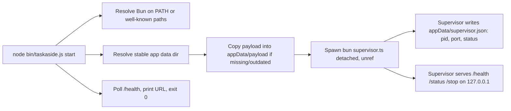

# T03 — Stable npm bootstrap evidence (macOS)

**Date:** 2026-10-18
**Platform:** macOS, Darwin 25.6.0, arm64
**Node:** `v26.9.0` (`/opt/homebrew/bin/node`)
**Bun:** `1.4.3`, resolved via `PATH` to `/Users/tungle/.nvm/versions/node/v25.9.0/bin/bun` (an npm-installed `bun` package shim sitting inside an nvm Node version's `bin/`, not a dedicated Homebrew `bun` install)
**Prototype location:** `.taskaside-implementation/scratch/t03-bootstrap/` (not part of the real TaskAside package; T06 does the real scaffold)
**Disposable test dirs:** `/tmp/taskaside-test-npx-cache`, `/tmp/taskaside-test-appdata`, `/tmp/taskaside-test-clean-invoke` (created and removed during this run)

## 1. Architecture and prototype design



This mirrors ARCHITECTURE.md §10: `npx taskaside` → small Node launcher → stable install/runtime path → long-lived supervisor. The prototype intentionally keeps the launcher and supervisor as two small files; no process manager library, no generic installer framework.

Prototype files:

- `bin/taskaside.js` — Node-only launcher (CommonJS, no dependencies). Commands: `start`, `status`, `stop`.
- `src/supervisor.ts` — Bun-only supervisor. Starts an HTTP server on `127.0.0.1:0` (OS-assigned port), writes the lockfile, exposes `/health`, `/status`, `/stop`, and handles `SIGTERM`/`SIGINT` for cleanup.
- `package.json` — minimal manifest; its `version` field is the payload-freshness marker the launcher compares against the installed copy.

## 2. macOS Bun runtime resolution

Resolution order implemented in `resolveBunPath()`:

1. `TASKASIDE_BUN_PATH` env override (test/CI hook only).
2. `bun` on `PATH` (`spawnSync('bun', ['--version'])`).
3. Well-known install locations: `~/.bun/bin/bun`, `/opt/homebrew/bin/bun`, `/usr/local/bin/bun`.
4. `<package>/node_modules/.bin/bun` — the shim created when the npm `bun` package (https://www.npmjs.com/package/bun) is a declared dependency of the real TaskAside package, per ARCHITECTURE.md A-01 ("upstream npm `bun` runtime dependency resolves platform-specific executable").

On this machine, step 2 succeeded, but the resolved binary lived under an nvm-managed Node version's `bin/` directory rather than a dedicated Bun install — i.e., `PATH`-only resolution is real but not guaranteed to be stable/dedicated. This confirms step 4 (declaring `bun` as an npm dependency of the real package) is the strategy to prefer for T06/T29, not reliance on an operator's ambient `PATH`.

## 3. Stable app data directory

- Default macOS path: `~/Library/Application Support/TaskAside`, computed as `path.join(os.homedir(), "Library", "Application Support", "TaskAside")`. Verified this resolves to `/Users/tungle/Library/Application Support/TaskAside` for the current user.
- Override: `TASKASIDE_DATA_DIR` env var, used for every test in this evidence run to keep all mutation inside `/tmp`.
- Payload install: launcher compares `appData/payload/package.json`'s `version` against the running launcher's own `package.json` version; on mismatch or absence it removes and recopies `src/` and `package.json` into `appData/payload/`. The supervisor always executes from this stable copy (`appData/payload/src/supervisor.ts`), never from the launcher's own (possibly ephemeral) source location.

## 4. Process detachment mechanics

- `child_process.spawn(bunPath, [supervisorEntry, appDataDir], { detached: true, stdio: ['ignore', logFd, logFd] })` followed by `child.unref()`.
- `detached: true` on macOS puts the child in its own process group (new session leader), so it is not killed when the parent's controlling terminal/shell exits.
- `unref()` lets the Node launcher process exit immediately after spawning, without waiting on the child — matching the "`start` exits the caller; supervisor persists" contract in ARCHITECTURE.md §10.
- `stdio` is redirected to an open file descriptor for `appData/logs/supervisor.log` (not `ignore` for both, so the log survives even though no terminal is attached).
- Did **not** need `setsid`/`nohup` shell wrapping — Node's `detached: true` on macOS is sufficient on its own (POSIX `setsid()`-equivalent is already done internally by libuv when `detached` is set).

## 5. Observable test results

Executed via `.taskaside-implementation/scratch/run_t03_checks.sh` (`sh` script, all mutation confined to `/tmp`). Full transcript reproduced below (trimmed of redundant blank lines):

```
=== check 1: start from ephemeral cache path ===
started: pid=39712 port=62114 dataDir=/tmp/taskaside-test-appdata
local URL: http://127.0.0.1:62114
start exit code: 0

=== lockfile after start ===
{
  "pid": 39712,
  "port": 62114,
  "status": "running",
  "startedAt": "2026-10-18T11:06:04.993Z"
}

=== check 2: single-instance guard (second start) ===
already running: pid=39712 port=62114 status=running
ps for bun supervisor before cache purge:
  502 39712     1   0  6:06PM ??         0:00.01 bun /tmp/taskaside-test-appdata/payload/src/supervisor.ts /tmp/taskaside-test-appdata

=== check 3: purge the disposable npx cache entirely ===
ls: /tmp/taskaside-test-npx-cache: No such file or directory

=== check 4: supervisor still alive after cache purge (curl health) ===
port=62114
{"status":"ok"}
{"pid":39712,"status":"running","port":62114,"startedAt":"2026-10-18T11:06:04.993Z","uptimeSeconds":0}

=== check 5: status via a clean launcher invocation (launcher binary no longer exists on disk) ===
status: running pid=39712 port=62114 uptimeSeconds=0 startedAt=2026-10-18T11:06:04.993Z

=== check 6: stop via clean invocation ===
stopped: pid=39712

=== check 7: status after stop ===
status: stopped

=== check 8: no orphaned processes ===
none found

=== check 9: lockfile removed ===
ls: /tmp/taskaside-test-appdata/supervisor.json: No such file or directory
lockfile absent (expected)
```

Interpretation against each acceptance check:

| Check | Result |
|---|---|
| `start` from a path simulating the `npx` cache | Exit code `0`; supervisor spawned detached; local URL printed |
| Delete the entire staged "npx cache" directory (`rm -rf /tmp/taskaside-test-npx-cache`) | `ps` confirms the running supervisor was launched from `appData/payload/...`, not from the deleted cache path, so the process is structurally independent of that directory |
| Supervisor still responds after cache purge | `curl /health` → `{"status":"ok"}`; `curl /status` → full status JSON with correct `pid`/`port`/`uptimeSeconds` |
| `status`/`stop` from a **separate clean invocation** (copied launcher to `/tmp/taskaside-test-clean-invoke`, simulating a brand-new terminal/process with no shared state except the app-data lockfile) | `status` correctly reports `running` with live uptime; `stop` sends `POST /stop`, polls for process exit, removes the lockfile, and reports `stopped` |
| No orphaned processes after stop | `ps -ef | grep supervisor.ts` → empty |
| Single-instance guard | Second `start` while already running printed `already running: pid=... port=... status=running`, exited `0`, and did **not** spawn a second `bun` process (only one `pid` ever appeared in `ps`) |

All items in the task's acceptance checklist (§1–§4) were exercised and passed on this machine.

## 6. Design notes and limits of this prototype

- The supervisor binds port `0` (OS-assigned) and publishes the actual port via the lockfile; this avoids a fixed-port conflict but means `status`/`stop` always require reading the lockfile first — there is no well-known fixed port to assume.
- Stale-lock handling: if the lockfile exists but `process.kill(pid, 0)` throws (process gone), the launcher deletes the stale lockfile and treats the state as `stopped`, allowing a fresh `start`. This was not exercised by a *kill -9* kind of crash test in this task (T04 covers process-tree/liveness proof more deeply); this prototype's stale-lock path is implemented but only unit-level reasoned about here, not adversarially tested.
- If a lockfile's PID is alive but the control port does not respond within 1s, `start`/`status` report an **uncertain** state and refuse to spawn a second writer, rather than guessing. This matches CONSTITUTION.md IV.3/IV.5 (treat a dead heartbeat/unresponsive port as unproven, not as "safe to retry") even though this prototype has no real task/run state to protect yet.
- `stop` tries `POST /stop` first and falls back to `SIGTERM` to the recorded PID only if the HTTP call itself fails (not exercised in this run, since the HTTP path always succeeded).
- This prototype has no readiness ordering (backend → adapter → engine) and no real health/version compatibility checks; it proves only the launcher/payload/detachment/lock mechanics requested by T03, not the full supervisor scope in ARCHITECTURE.md §2.5 (that is T08/T30).

## 7. Cross-platform differences deferred to T31

Not implemented or tested here; recorded as explicit gaps per SPECIFICATION.md §8 and PLAN.MD T31:

- **Linux:** app data path should be `${XDG_DATA_HOME:-~/.local/share}/taskaside` (lowercase, per SPECIFICATION.md §8, differing from macOS's `TaskAside` capitalization). `detached: true` + `unref()` is expected to behave the same under Node on Linux (same libuv primitives), but was not verified on any Linux machine. systemd user-unit integration (as an alternative/optional stable-restart mechanism) is an open option, not decided.
- **Windows:** app data path should be `%LOCALAPPDATA%\TaskAside`. Windows process spawning needs `windowsHide: true` and does not have POSIX process groups — `detached: true` has different semantics (new console vs. true detachment), and killing a process tree requires `taskkill /pid <pid> /T /F` rather than `SIGTERM`/`process.kill`. Handle inheritance for redirected stdio also has documented Windows-specific caveats (e.g., pipes held open keeping the "detached" process from being treated as fully independent by some tools). None of this was exercised; Windows evidence remains a T31 gate.
- Both deferred platforms need their own clean-machine smoke test (install → start → close terminal → verify survival → status → stop → verify no orphan) before any claim of cross-OS support, per CONSTITUTION.md VIII.3.

## 8. Changed/created files

- `specs/2026-10-18-initialize-project/evidence/T03-stable-bootstrap.md` (this report)
- `.taskaside-implementation/scratch/t03-bootstrap/package.json`
- `.taskaside-implementation/scratch/t03-bootstrap/bin/taskaside.js`
- `.taskaside-implementation/scratch/t03-bootstrap/src/supervisor.ts`
- `.taskaside-implementation/scratch/run_t03_checks.sh`

All mutating test activity ran under `/tmp/taskaside-test-npx-cache`, `/tmp/taskaside-test-appdata`, and `/tmp/taskaside-test-clean-invoke`, all removed by the end of the check script. No files in the TaskAside git workspace were modified by the experiments themselves.
