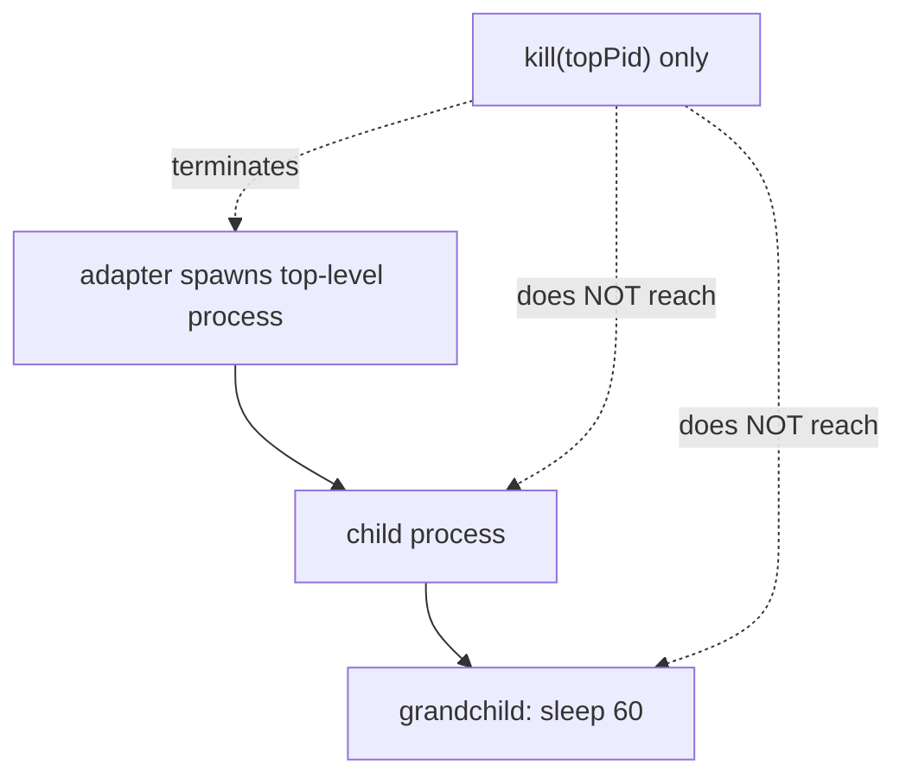
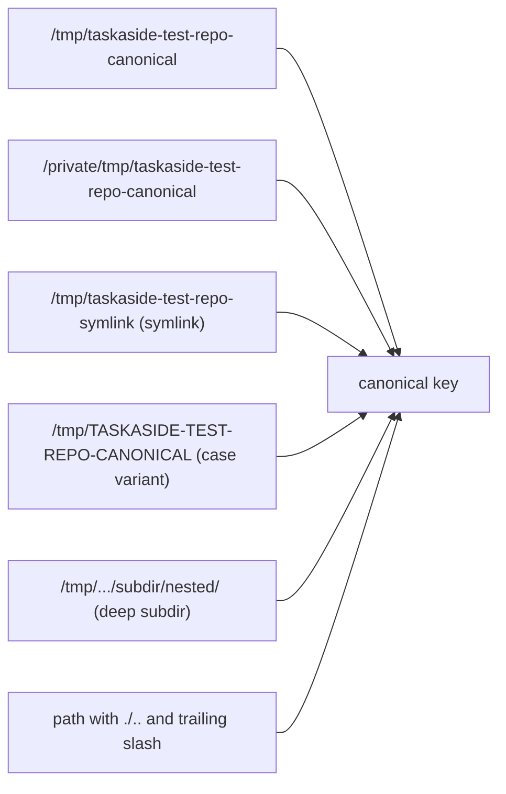
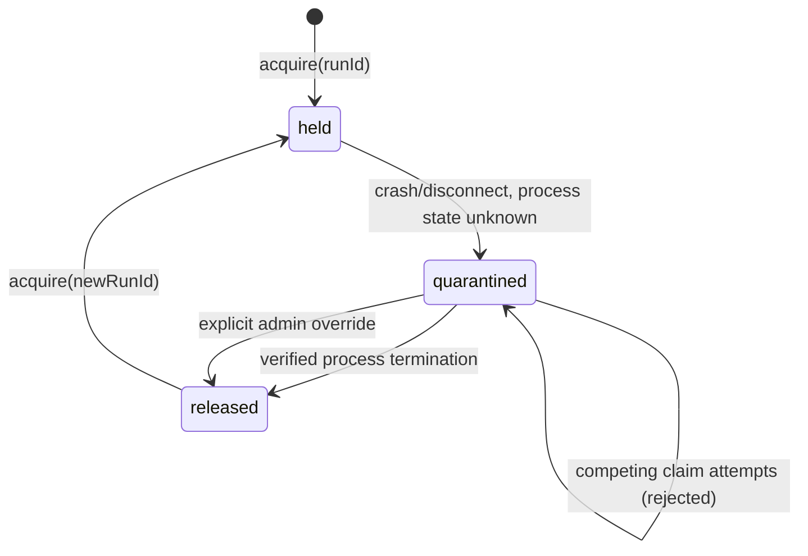

# T04 — Process trees and repo identity evidence (macOS)

**Date:** 2026-10-18
**Platform:** macOS, Darwin 25.6.0, arm64
**Node:** `v26.9.0`
**Bun:** `1.4.3`
**Git:** `2.50.1`
**Prototype location:** `.taskaside-implementation/scratch/t04-process-repo/` (throwaway, not part of the real adapter/backend; T16/T17/T18/T11 do the real implementation)
**Disposable test dirs:** `/tmp/taskaside-test-repo-canonical`, `/private/tmp/taskaside-test-repo-canonical`, `/tmp/taskaside-test-repo-symlink`, `/tmp/TASKASIDE-TEST-REPO-CANONICAL` (created and removed during each run)

This evidence addresses PLAN.MD T04 and the process-tree/lock parts of CONSTITUTION.md IV and ARCHITECTURE.md §5 ("Lease/fencing and recovery"), §6 (agent adapter owns subprocess/session handles). Run via `.taskaside-implementation/scratch/run_t04_checks.sh`.

## 1. Descendant termination

**Hazard:** `agent-adapter` spawns a provider CLI, which itself spawns child tool subprocesses (e.g. a shell command, which spawns a further child). Killing only the top-level PID does not kill descendants that have already forked.



Test script `termination_test.ts` spawns a 3-level tree (`parent sh -c` → `child sh -c` → `grandchild sleep 60`, each a real `fork+exec`, not a bash `()` subshell — macOS `/bin/sh` is bash 3.2, which caches `$$` to the top-level pid across `()` subshells, so a naive script would have misreported child/grandchild PIDs as identical to the parent's).

### 1a. Naive kill (hazard reproduced)

```
parent pid=41075
child pid=41076
grandchild pid=41077
calling process.kill(41075) only (no group)

--- full ps for captured pids ---
  PID  PPID  PGID STAT COMM
41076     1 41068 S    sh       <- reparented to PPID 1 (orphaned), still running
41077 41076 41068 S    sleep    <- reparented, still running
```

Result: the top-level process (41075) died; child (41076) and grandchild (41077) survived, reparented to `PPID=1` (macOS `launchd`). Confirmed with `ps -p <pid>` after the kill and with a system-wide `ps -ef` scan at the end of the full run — both leftover processes were still alive and had to be manually reaped. **This is the exact hazard CONSTITUTION.md IV.3-5 exists to prevent**: a lock release gated only on "I killed the pid I remember" would release the working-tree lock while a descendant still writes to the repo.

### 1b. Safe termination: process group + escalation

`termination_test.ts safe` spawns the same tree with `detached: true` (Node/Bun on POSIX: new session, new process group where `pgid == topPid`), confirmed separately:

```
spawned pid=40590
  PID  PPID  PGID COMM
40590 40589 40590 sleep
```

Termination path: `process.kill(-pgid, 'SIGTERM')`, wait a grace period, then `process.kill(-pgid, 'SIGKILL')` if anything remains.

```
parent pid=41087
child pid=41088
grandchild pid=41089
calling process.kill(-41087, 'SIGTERM') on the process group
escalation kill error (likely ESRCH = all gone): ESRCH: No such process

--- full ps for captured pids ---
  PID  PPID  PGID STAT COMM
(empty)
```

Result: `SIGTERM` to the negative pgid reached all three processes; by the time the escalation `SIGKILL` ran (1.5s later), the group was already empty (`ESRCH`), and `ps` for all three captured PIDs returned nothing. **100% of descendants (parent, child, grandchild) terminated, zero orphans**, confirmed by both a targeted `ps -p` check and a filtered `ps -ef` scan.

**Lock-release gating implication:** the adapter/engine must not release the working-tree lock on "I sent SIGTERM" — it must poll (or waitpid-equivalent) until the process-group is confirmed empty (as this test did via `ps -p`), matching CONSTITUTION.md IV.4 ("Cancellation never releases a lock until stopped-process verification").

## 2. Liveness identity and anti-PID-recycling

**Hazard:** `kill(pid, 0)` only proves "some process currently holds this numeric pid." PIDs are reused by the OS once freed. If the adapter stores only a bare pid and later finds that pid alive, it cannot distinguish "our original process is still running" from "an unrelated later process was assigned the same recycled pid."

`liveness_test.ts` implements and tests a robust check: record an identity fingerprint (`ps -o lstart=,comm=`, i.e. absolute process start time + command name) at launch time, and require both pid existence **and** fingerprint match on every subsequent liveness check.

```
launched pid=41097, recorded fingerprint="Sun Oct 18 18:14:21 2026     sleep"

--- naive check: kill(pid, 0) only ---
pidAlive(41097) = true   <- insufficient alone, proves nothing about identity

--- robust check: pid + fingerprint, while running ---
{ alive: true, reason: "pid exists and fingerprint matches recorded launch identity" }

--- after real SIGKILL termination ---
{ alive: false, reason: "pid does not exist (kill(pid,0) -> ESRCH)" }
PASS: liveness check correctly reports 'stopped' immediately once the process is gone.
```

The liveness check correctly flipped to `stopped` immediately after verified termination.

**On forcing an actual PID-reuse collision:** deliberately forcing the OS to reassign a specific freed pid is non-deterministic and not safe to script in a shared machine (depends on kernel pid-allocator state, which cannot be controlled from user space). We ran a best-effort empirical probe (`recycle_probe.ts`) that spawned 400 short-lived processes in a tight loop watching for a pid repeat:

```
No pid reuse observed across 400 short-lived spawns in this run (kernel pid allocator
did not wrap back into our observed range during this short test).
```

No reuse occurred in this short window — that is expected on a lightly loaded macOS box with a large pid space, and it does **not** disprove the hazard. The fingerprint comparison is retained as the correctness mechanism; the reasoning (not a forced repro) is: if a later unrelated process is assigned the recorded pid, its `lstart` will differ from the recorded launch time, and the comparison will correctly reject it rather than reporting a false "alive."

## 3. Canonical working-tree aliases and lock collisions

**Algorithm implemented and tested** (`canon_test.ts`), per SPECIFICATION.md E-01 ("Canonicalize repository path... before deriving lock key"):

1. `fs.realpathSync` — resolves symlinks and macOS's `/tmp` → `/private/tmp` system symlink.
2. `git rev-parse --show-toplevel` (run with cwd at the resolved path) — collapses any subdirectory to the repository root.
3. `path.normalize` — collapses trailing slashes and `.`/`..` segments.
4. Case normalization — probe the target filesystem for case-insensitivity (write a lowercase-named file, check if an uppercase-named lookup finds it); if case-insensitive (APFS default), lowercase the key for comparison purposes only. The display path shown to users is never altered — only the internal lock key.



Result — all six alias forms resolved to the identical key:

```
plain /tmp path                            -> /private/tmp/taskaside-test-repo-canonical
/private/tmp alias                         -> /private/tmp/taskaside-test-repo-canonical
explicit symlink                           -> /private/tmp/taskaside-test-repo-canonical
case variant (APFS case-insensitive)       -> /private/tmp/taskaside-test-repo-canonical
deep subdirectory                          -> /private/tmp/taskaside-test-repo-canonical
trailing slash + relative segments         -> /private/tmp/taskaside-test-repo-canonical

distinct canonical keys across 6 aliases: 1
PASS: all aliases canonicalize to the exact same working-tree lock key.
```

**Lock collision demonstration** using the resolved key as the map key for an in-memory lock table (standing in for `run_locks.working_tree_key`):

```
acquire(run-A, plain path) = {"ok":true}
acquire(run-B, case-variant alias) = {"ok":false,"reason":"working-tree lock conflict:
  key=\"/private/tmp/taskaside-test-repo-canonical\" already held by run=run-A"}
PASS: alias B correctly rejected as a working-tree lock conflict against alias A's lock.
```

This confirms SPECIFICATION.md E-01's requirement that a raw path string is not a safe equivalence key, and that `/tmp` vs `/private/tmp`, symlinks, case variants, and subdirectory targeting must all collapse to one lock key before `maxPerWorkingTree=1` can be enforced correctly.

## 4. Unknown process state stays quarantined

`quarantine_test.ts` models the `run_locks` state machine described in ARCHITECTURE.md §5 and CONSTITUTION.md IV.3/IV.5: `held → quarantined → released`, where `quarantined` is reachable only from an inconclusive process-state check and is clearable only by verified termination or an explicit administrative action — never by heartbeat expiry alone.



```
--- simulate crash/disconnect: adapter lost the run, process state unknown ---
{ status: "quarantined", ownerRunId: "run-A", generation: 1,
  reason: "adapter process died; heartbeat stopped; process-tree inspection inconclusive" }

--- subsequent claim attempt by run-B while quarantined ---
{ ok: false, reason: "QUARANTINED ... Requires verified termination or admin override." }
PASS: claim correctly rejected while quarantined.

--- attempt to clear quarantine while process is still (falsely) reported alive ---
{ cleared: false, reason: "process still verified alive; quarantine remains" }

--- attempt to clear quarantine with verified termination ---
{ cleared: true, reason: "verified process termination; lock released" }
PASS: quarantine cleared only after verified termination.

--- separate scenario: admin override path ---
claim while quarantined: { ok: false, reason: "QUARANTINED ..." }
admin override: { cleared: true, reason: "explicit administrative override by operator@local,
  prior owner=run-C gen=2" }
```

Both clearance paths (verified-stop and admin override) were exercised independently; a false-positive "alive" check correctly refused to clear the quarantine, and a competing claim during quarantine was rejected, not silently queued or granted.

## 5. Changed/created files

- `specs/2026-10-18-initialize-project/evidence/T04-process-and-repo-identity.md` (this report)
- `.taskaside-implementation/scratch/t04-process-repo/termination_test.ts`
- `.taskaside-implementation/scratch/t04-process-repo/liveness_test.ts`
- `.taskaside-implementation/scratch/t04-process-repo/recycle_probe.ts`
- `.taskaside-implementation/scratch/t04-process-repo/canon_test.ts`
- `.taskaside-implementation/scratch/t04-process-repo/quarantine_test.ts`
- `.taskaside-implementation/scratch/run_t04_checks.sh`

All mutating activity ran under `/tmp/taskaside-test-repo-canonical` and its aliases, plus transient `sleep`/`sh` child processes, all removed/reaped by the end of each run. No files in the TaskAside git workspace were modified by the experiments themselves. One run of the full script (`run_t04_checks.sh`) intentionally leaves orphaned descendants after check 1a to demonstrate the hazard; the script reaps them with a targeted `pkill` before check 1b runs, and a final `ps -ef` scan in this session confirmed no leftover `sleep`/`sh` test processes remained on the machine after the last run.

## 6. Linux and Windows — deferred to T31, not claimed as passed

Per PLAN.MD T04 ("List Linux/Windows cases for T31 without claiming they passed") and SPECIFICATION.md §8. None of the following was executed or verified on this task; they are the known mechanism differences the adapter/supervisor must address before cross-OS release claims.

### Linux (deferred)

- **Process groups:** POSIX process groups and `setpgid`/`killpg` exist on Linux the same as macOS (both are POSIX), so the `detached: true` + `kill(-pgid, SIGTERM/SIGKILL)` approach is expected to carry over, but was not run on any Linux kernel here.
- **cgroups v2:** a more robust descendant-containment option than process groups alone — place the launched process in a dedicated cgroup and use `cgroup.kill` (or freeze-then-kill-all-PIDs) to guarantee every process in the cgroup (including ones that escaped the process group via `setsid`) is terminated. Not implemented or tested; recorded as the preferred Linux-specific hardening over bare process groups.
- **`PR_SET_PDEATHSIG`:** Linux-only `prctl` flag that asks the kernel to signal a child automatically if its direct parent dies, as a belt-and-suspenders measure against adapter-crash orphaning. Not implemented or tested; no macOS equivalent exists, so this is not part of the macOS-verified design.
- **Liveness identity:** `/proc/<pid>/stat` field 22 (`starttime`, in clock ticks since boot) is the Linux-native analog to this evidence's `ps -o lstart=` fingerprint, and is cheaper to read (no subprocess spawn). Not implemented or tested.
- **Filesystem case sensitivity:** ext4 (the common default) is case-sensitive, unlike APFS. The case-normalization step in the canonicalization algorithm must be conditional on a filesystem probe (as implemented here), not a hardcoded macOS assumption — this was built that way in `canon_test.ts`'s `isCaseInsensitiveFs`, but only exercised against APFS, not ext4.

### Windows (deferred)

- **Process trees:** no POSIX process groups. The documented mechanism is Win32 **JobObjects**: `CreateJobObject`, assign the spawned process with `AssignProcessToJobObject`, set `JOB_OBJECT_LIMIT_KILL_ON_JOB_CLOSE`, and terminate the whole tree with `TerminateJobObject`. Node's `child_process` does not expose JobObjects directly; this needs either a native addon/FFI or shelling out to `taskkill /PID <pid> /T /F` as a lower-fidelity fallback (as T03's evidence also flagged). Not implemented or tested.
- **Liveness identity:** `GetProcessTimes` (via a native call, not exposed by plain Node APIs) returns an exact process creation timestamp, the Windows analog to `lstart`/`starttime`. Not implemented or tested.
- **Filesystem case sensitivity:** NTFS is case-insensitive by default (per-directory case sensitivity can be toggled on recent Windows builds, but is not the default), so the same conditional case-normalization applies, but was not tested on NTFS.
- **8.3 short names and volume GUIDs:** NTFS can expose a path by both a long name and an 8.3 short name (e.g. `PROGRA~1`), and `\\?\Volume{GUID}\...` paths are another alias form; `realpath`-equivalent resolution on Windows must normalize through these before hashing/keying, which this evidence does not test.
- **Junctions:** NTFS junctions/reparse points are a closer analog to POSIX symlinks for directories; Windows path resolution must follow junctions the way `realpathSync` follows POSIX symlinks here. Not implemented or tested.

None of the Linux/Windows items above were run; they remain explicit T31 gates, not passed checks. Only the macOS results in sections 1–4 are claimed as verified in this task.
