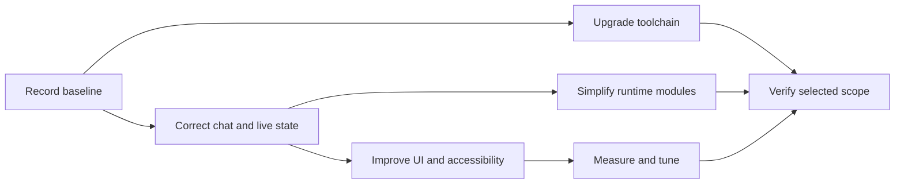

# TaskAside refactor: approved scope and handoff

## TL;DR

- **Goal:** Improve UI quality, data correctness, responsiveness, and maintainability.
- **Key decision:** Modernize the existing stack in small slices; retain local state and execution ownership.
- **Impact:** Frontend first; backend, engine, adapter, and packaging only through separately selected work.

**Status: full R0–R7 scope approved by the user on 2026-10-24.** The user requested an implementation handoff for Antigravity. This session changes planning files only. Ready means scoped, not implemented or verified.

**Start here:** [execution order and task tracker](03-execution-plan.md), [small task cards](04-task-cards.md), and [Antigravity handoff prompt](05-antigravity-prompt.md).

**Code organization follow-up (2026-10-25):** [whole-repository layer plan](../2026-10-25-layered-code-organization.md). The user confirmed all owners are in scope and simple reads may skip services. This extends R4; implementation has not started and prior task statuses are unchanged.

Hand off through the new [47-task tracker](../2026-10-25-layered-code-organization/01-execution-plan.md) and [Antigravity prompt](../2026-10-25-layered-code-organization/03-antigravity-prompt.md); resume the new queue at LC-01a rather than restarting RF tasks.

## Delivery order

## Scope

### In scope

All rows are selected. **R0 and the relevant verification gate remain mandatory.** See [acceptance details](01-delivery-and-acceptance.md). Performance implementation remains evidence-driven: assess every candidate, implement only justified changes, and record the reason for any no-op.

| ID | Work | Readiness | Value / effort / risk | Recommendation |
|---|---|---|---|---|
| R0 | Baseline, current docs, repeatable checks | **Ready** | High / S / Low | First |
| R1 | Safe Markdown and browser token cleanup | **Ready** | High / S / Low–medium | Early |
| R2 | Correct task/chat data and SSE handling | **Ready** | High / L / Medium | Core |
| R3 | Consistent UI, forms, accessibility, themes | **Ready** | High / L / Medium | Compact desktop direction selected |
| R4 | Clear runtime responsibilities and imports | **Ready** | High / L / High | Separate from UI; after baseline |
| R5 | Performance tuning beyond R2 | **Ready** | Unknown until measured / M–L / Medium | Measurement and justified tuning selected |
| R6 | Dependency and toolchain upgrades | **Ready** | Medium / M / Medium | Compatibility task selects exact versions |
| R7 | CI and install/upgrade verification | **Ready** | High / M / Medium | Required before release |

S = one review slice; M = two or three; L = four or more. Sizes are provisional, not dates.

### Out of scope

- Application changes during this planning session; publication, new provider capabilities, or provider protocol migration. Implementation checks include both existing providers in disposable repos.
- Go rewrite, PostgreSQL/Redis/GCP migration, SSR, hosted services, or process consolidation.
- New task states, scheduling policy, providers, tabs, Kanban, analytics, or approval cards.
- Unit tests and screenshot-based verification; use integration, process, contract, and browser interaction checks.

## Accepted direction

| Decision | Proposed choice | Trade-off |
|---|---|---|
| Technology | Keep Bun, TypeScript, Hono, SQLite, React, Vite | Avoid data/runtime migration; still needs dependency maintenance |
| Server data in UI | TanStack Query; local state for composer, selection, and dialogs | Adds a cache dependency; removes manual request coordination |
| UI foundation | Tailwind v4 + selected shadcn/Radix primitives | Consistent controls; copied components need local maintenance |
| Markdown | React renderer with raw HTML disabled | Raw HTML in existing messages displays differently; Markdown/code remain |
| Refactor depth | Full UI, runtime, tooling, performance assessment, and delivery scope | Small tasks and separate runtime safety gates |

[Query cancellation](https://tanstack.com/query/latest/docs/framework/react/guides/query-cancellation) requires passing its signal to fetch. [shadcn](https://ui.shadcn.com/docs) distributes editable components; local upkeep remains required.

The full scope corresponds to the earlier **package C**. Compact desktop UI, light/dark themes, React 19 as the upgrade target, TanStack Query v5, Tailwind v4, selected shadcn/Radix controls, and raw-HTML-disabled React Markdown are the accepted defaults. Exact compatible package versions are an implementation output. Hosted or multi-user deployment remains outside scope.

## Required behavior

- **Data correctness:** Changing tasks, receiving concurrent streams, or reconnecting never mixes conversations or duplicates committed messages.
- **UI:** Preserve two panes, both nested group modes, six statuses, plain chat, and settings in a modal.
- **Execution:** Atomic claims, fencing, idempotency, verified-stop release, and quarantined uncertainty remain intact.
- **Delivery:** Every selected slice has evidence, a rollback path, and no unreviewed expansion into another scope.

See [acceptance and rollout](01-delivery-and-acceptance.md) and [audit evidence](02-audit-and-technology.md). This proposal does not amend original requirements.
