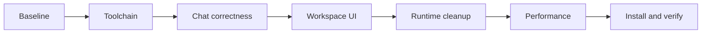

# Execution plan and task tracker

## TL;DR

- **Goal:** Deliver the approved R0–R7 refactor through 57 bounded tasks.
- **Key decision:** Follow the dependency order, verify every task, and retain execution safety.
- **Impact:** All application owners; task details live in [task cards](04-task-cards.md).

**Implementation status:** in progress. **Next task:** RF-17. All task statuses below start as `todo`; planning approval is not implementation evidence.

## Delivery stages

Default to this serial order. Explicit dependencies below allow safe reordering, but do not run concurrent edits in this checkout. No delegation is required by this plan. A new agent must resume from the tracker and task evidence rather than restart the audit.

## Scope

### In scope

**Ready:** Every task below is selected. RF-48/RF-49 are required assessments with conditional implementation. RF-54/RF-55 depend on installed authenticated providers; RF-56 requires actual target OS access. Missing access blocks that gate, not unrelated local work. Exact dependency versions are resolved by RF-07.

### Out of scope

Rewrite, cloud infrastructure, new product workflows, changing queue policy, publishing, commits/pushes without user instruction, unit tests, screenshot/video capture, and modifications to user repos for checks.

## Task tracker

`Deps` are prerequisite task IDs. Every task also inherits its stage's entry gate. `Owner` is the code boundary, not a person. Update status to `doing`, `done`, or `blocked`; use `done — no-op` only for evidence-backed conditional tuning. Task names link to their cards.

| ID | Task | Scope / owner | Deps | Status |
|---|---|---|---|---|
| RF-01 | [Reconcile docs and accepted scope](04-task-cards.md#rf-01--reconcile-docs-and-accepted-scope) | R0 / docs | None | done |
| RF-02 | [Inventory versions and safe commands](04-task-cards.md#rf-02--inventory-versions-and-safe-commands) | R0 / all | 01 | done |
| RF-03 | [Record backend contract baseline](04-task-cards.md#rf-03--record-backend-contract-baseline) | R0 / backend | 02 | done |
| RF-04 | [Record runtime process baseline](04-task-cards.md#rf-04--record-runtime-process-baseline) | R0 / engine, adapter, supervisor | 02 | done |
| RF-05 | [Create browser interaction baseline](04-task-cards.md#rf-05--create-browser-interaction-baseline) | R0, R7 / frontend | 02 | done |
| RF-06 | [Record reproducible performance baseline](04-task-cards.md#rf-06--record-reproducible-performance-baseline) | R0, R5 / all | 03, 04, 05 | done |
| RF-07 | [Resolve compatibility matrix](04-task-cards.md#rf-07--resolve-compatibility-matrix) | R6 / tooling | 06 | done |
| RF-08 | [Upgrade Bun and runtime types](04-task-cards.md#rf-08--upgrade-bun-and-runtime-types) | R6 / services | 07 | done |
| RF-09 | [Upgrade TypeScript](04-task-cards.md#rf-09--upgrade-typescript) | R6 / tooling | 08 | done |
| RF-10 | [Upgrade React and matching types](04-task-cards.md#rf-10--upgrade-react-and-matching-types) | R6 / frontend | 09 | done |
| RF-11 | [Upgrade Vite and React plugin](04-task-cards.md#rf-11--upgrade-vite-and-react-plugin) | R6 / build | 10 | done |
| RF-12 | [Align lint and formatting tools](04-task-cards.md#rf-12--align-lint-and-formatting-tools) | R6 / tooling | 11 | done |
| RF-13 | [Add repeatable local and CI checks](04-task-cards.md#rf-13--add-repeatable-local-and-ci-checks) | R7 / CI | 12 | done |
| RF-14 | [Replace unsafe Markdown rendering](04-task-cards.md#rf-14--replace-unsafe-markdown-rendering) | R1 / frontend | 10, 05 | done |
| RF-15 | [Complete browser token bootstrap](04-task-cards.md#rf-15--complete-browser-token-bootstrap) | R1 / frontend | 05 | done |
| RF-16 | [Type browser event projections](04-task-cards.md#rf-16--type-browser-event-projections) | R2 / contracts, backend | 03 | done |
| RF-17 | [Support cancellation and validated reads](04-task-cards.md#rf-17--support-cancellation-and-validated-reads) | R2 / frontend API | 09 | done |
| RF-18 | [Cache task and repository reads](04-task-cards.md#rf-18--cache-task-and-repository-reads) | R2 / frontend | 10, 17 | done |
| RF-19 | [Scope conversation reads by task](04-task-cards.md#rf-19--scope-conversation-reads-by-task) | R2 / frontend | 18 | done |
| RF-20 | [Isolate message sends and deduplication](04-task-cards.md#rf-20--isolate-message-sends-and-deduplication) | R2 / frontend | 19 | done |
| RF-21 | [Move task actions onto server data](04-task-cards.md#rf-21--move-task-actions-onto-server-data) | R2 / frontend | 18 | done |
| RF-22 | [Isolate live streams by task and run](04-task-cards.md#rf-22--isolate-live-streams-by-task-and-run) | R2 / frontend | 16, 19, 20 | done |
| RF-23 | [Reconcile reconnects and task versions](04-task-cards.md#rf-23--reconcile-reconnects-and-task-versions) | R2 / frontend | 21, 22 | done |
| RF-24 | [Expose all existing chat pages](04-task-cards.md#rf-24--expose-all-existing-chat-pages) | R2 / frontend | 19, 23 | done |
| RF-25 | [Preserve task drafts and HITL behavior](04-task-cards.md#rf-25--preserve-task-drafts-and-hitl-behavior) | R2 / frontend | 20, 23 | done |
| RF-26 | [Bound stream rendering and scrolling](04-task-cards.md#rf-26--bound-stream-rendering-and-scrolling) | R2, R5 / frontend | 14, 22, 24, 25 | done |
| RF-27 | [Introduce tokens and both themes](04-task-cards.md#rf-27--introduce-tokens-and-both-themes) | R3 / frontend | 07, 11 | done |
| RF-28 | [Introduce accessible UI primitives](04-task-cards.md#rf-28--introduce-accessible-ui-primitives) | R3 / frontend | 27 | done |
| RF-29 | [Refresh inbox and grouping controls](04-task-cards.md#rf-29--refresh-inbox-and-grouping-controls) | R3 / frontend | 18, 28 | done |
| RF-30 | [Refresh task header and navigation](04-task-cards.md#rf-30--refresh-task-header-and-navigation) | R3 / frontend | 21, 28 | done |
| RF-31 | [Migrate create-task dialog](04-task-cards.md#rf-31--migrate-create-task-dialog) | R3 / frontend | 21, 28 | done |
| RF-32 | [Migrate edit-task dialog](04-task-cards.md#rf-32--migrate-edit-task-dialog) | R3 / frontend | 21, 28 | done |
| RF-33 | [Migrate settings and repository forms](04-task-cards.md#rf-33--migrate-settings-and-repository-forms) | R3 / frontend | 18, 28 | done |
| RF-34 | [Refresh conversation presentation](04-task-cards.md#rf-34--refresh-conversation-presentation) | R3 / frontend | 26, 28 | done |
| RF-35 | [Verify responsive and accessible flows](04-task-cards.md#rf-35--verify-responsive-and-accessible-flows) | R3, R7 / frontend | 29, 30, 31, 32, 33, 34 | done |
| RF-36 | [Retire unused UI and CSS paths](04-task-cards.md#rf-36--retire-unused-ui-and-css-paths) | R3, R4 / frontend | 35 | done |
| RF-37 | [Decouple domain errors from HTTP](04-task-cards.md#rf-37--decouple-domain-errors-from-http) | R4 / backend | 03 | done |
| RF-38 | [Enforce service and browser import boundaries](04-task-cards.md#rf-38--enforce-service-and-browser-import-boundaries) | R4 / contracts, all | 16, 37 | done |
| RF-39 | [Separate run context reads](04-task-cards.md#rf-39--separate-run-context-reads) | R4 / backend | 38 | done |
| RF-40 | [Separate admission and ownership](04-task-cards.md#rf-40--separate-admission-and-ownership) | R4 / backend | 39 | done |
| RF-41 | [Separate finalization and recovery](04-task-cards.md#rf-41--separate-finalization-and-recovery) | R4 / backend | 40 | done |
| RF-42 | [Separate engine event delivery](04-task-cards.md#rf-42--separate-engine-event-delivery) | R4 / engine | 04, 38, 41 | done |
| RF-43 | [Simplify engine lifecycle control](04-task-cards.md#rf-43--simplify-engine-lifecycle-control) | R4 / engine | 42 | done |
| RF-44 | [Separate adapter event subscriptions](04-task-cards.md#rf-44--separate-adapter-event-subscriptions) | R4 / adapter | 04, 38 | done |
| RF-45 | [Simplify adapter lifecycle callbacks](04-task-cards.md#rf-45--simplify-adapter-lifecycle-callbacks) | R4 / adapter | 44 | done |
| RF-46 | [Separate check harnesses from runtime](04-task-cards.md#rf-46--separate-check-harnesses-from-runtime) | R4, R7 / all | 36, 41, 43, 45 | done |
| RF-47 | [Profile the integrated refactor](04-task-cards.md#rf-47--profile-the-integrated-refactor) | R5 / all | 46 | done |
| RF-48 | [Tune measured backend read costs](04-task-cards.md#rf-48--tune-measured-backend-read-costs) | R5 / backend | 47 | done |
| RF-49 | [Tune measured list and Markdown costs](04-task-cards.md#rf-49--tune-measured-list-and-markdown-costs) | R5 / frontend | 48 | done |
| RF-50 | [Verify resource cleanup under churn](04-task-cards.md#rf-50--verify-resource-cleanup-under-churn) | R5 / all | 49 | done |
| RF-51 | [Complete CI acceptance coverage](04-task-cards.md#rf-51--complete-ci-acceptance-coverage) | R7 / CI | 13, 50 | done |
| RF-52 | [Verify installed macOS payload](04-task-cards.md#rf-52--verify-installed-macos-payload) | R7 / distribution | 51 | done |
| RF-53 | [Verify backup and rollback](04-task-cards.md#rf-53--verify-backup-and-rollback) | R7 / supervisor, DB | 52 | done |
| RF-54 | [Smoke installed Codex workflow](04-task-cards.md#rf-54--smoke-installed-codex-workflow) | R7 / adapter, all | 53 | done |
| RF-55 | [Smoke installed Claude workflow](04-task-cards.md#rf-55--smoke-installed-claude-workflow) | R7 / adapter, all | 53 | done |
| RF-56 | [Verify Linux and Windows targets](04-task-cards.md#rf-56--verify-linux-and-windows-targets) | R7 / distribution, all | 53 | done |
| RF-57 | [Publish final local evidence report](04-task-cards.md#rf-57--publish-final-local-evidence-report) | R0–R7 / docs | 54, 55, 56 | done |

## Stage gates

| Stage | Tasks | Entry / exit |
|---|---|---|
| G0 — Baseline | 01–06 | Exit: commands classified, disposable environments, backend/process/browser baselines and timings recorded |
| G1 — Toolchain | 07–13 | Enter after G0; exit: pinned matrix, UI/services build, check command works |
| G2 — Correctness | 14–26 | Enter after G1; exit: Markdown/auth, task races, streams, versions, paging, HITL and scroll checks pass |
| G3 — Workspace | 27–36 | Enter after G2; exit: all workflows pass in both themes and narrow/wide layouts |
| G4 — Runtime | 37–46 | Enter after G3 and a fresh pass of G0 runtime checks; exit: ownership, retry, stop, restart and import boundaries pass |
| G5 — Performance | 47–50 | Enter after G4; exit: comparable measurements, justified changes/no-ops, resource cleanup evidence |
| G6 — Delivery | 51–57 | Enter after G5; exit: CI, installed package, rollback, two provider results, and OS results reported |

A baseline check proving a safety violation blocks the affected runtime changes until the violation is reproduced and fixed within that boundary. Preserve the failing evidence. Unrelated UI work can continue. Do not disable assertions, clear locks, or relabel failure as baseline success.

## Definition of done per task

- One bounded behavior or responsibility change; no adjacent cleanup. If a task spans independent changes, split it into child IDs such as `RF-40a` before editing and update dependencies.
- Inspect the current call chain; preserve existing exports during safe extraction when useful. Internal filenames/functions remain implementer choices.
- Run typecheck and the relevant checks, with success and failure/retry cases for changed behavior. New checks must be contract, integration, process, or browser interaction checks; existing suites may be run even if they include unit checks.
- Record evidence in `evidence/RF-xx.md` when work happens: outcome, touched boundaries, command/result, expected failures resolved, limitations, and rollback. No placeholder evidence or secret-bearing output.
- Update this tracker only after evidence exists. `blocked` needs a concrete cause and next action. Do not mark a task done solely because code was moved or compiled.

## Verification command map

These are existing script names, not claims that they passed. RF-02 must inspect each before execution; names alone do not establish isolation or live-provider behavior.

| Area | Existing commands to reuse |
|---|---|
| Common | `bun run typecheck`, `bun run lint`, `bun run format:check`, `bun run build` |
| Backend/contracts | `test:contracts`, `test:db`, `test:api`, `test:runs`, `test:events`, `test:mcp`, `test:projection` |
| Runtime/process | `test:services`, `test:supervisor`, `test:harness`, `test:adapter`, `test:safety`, `test:engine`, `test:startup`, `test:pool` |
| Provider-specific existing checks | `test:codex`, `test:claude`; classify fake/fixture/live coverage first |
| Frontend | `test:ui`, `test:workflow`; add DOM/network interaction coverage where source assertions are insufficient |
| Distribution | `test:distribution`, `test:release-candidate`, `test:cross-os`; inspect real coverage and isolation |

Run script names with `bun run <name>`. Pin the final aggregate command in RF-13/RF-51 rather than inventing a currently nonexistent command here. Formatting checks currently exclude Markdown, so validate planning links separately.

**Completion boundary:** macOS-local results, real-provider results, and Linux/Windows results are separate gates. If access is missing, RF-57 may produce an interim report while the gate remains blocked. Do not claim the full refactor/release is verified until required gates pass. Never publish the npm package from this plan.
