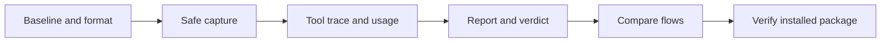

# Run review: execution plan and task tracker

## TL;DR

- **Goal:** Implement automatic run records and a usable local review loop through 19 tasks.
- **Key decision:** Deliver capture first, then usage, review, comparison, and installed verification.
- **Impact:** Engine, adapter, local CLI/launcher, and diagnostics; backend state ownership stays unchanged.

**Status: implementation plan prepared; no feature code implemented. Next task: RR-01.** Read the [behavior specification](../2026-10-24-run-review-plan.md) and [task cards](01-task-cards.md). Task status starts at `todo`; this document is not evidence of completed checks.

## Delivery order

Use the order below. Dependencies permit reordering when useful, but this plan does not call for parallel agents or concurrent edits in the shared checkout.

## Scope and readiness

### In scope

| Work | Readiness | Result |
|---|---|---|
| RR-01–09, RR-11–15 | **Ready** | Automatic archives, safe traces, usage, reports, verdicts, comparison, and deterministic/install checks. |
| RR-10 | **Assumption — review** | Include bounded Git evidence when attribution is safe. If unavailable, record that limit; capture/report remain usable. |
| RR-16–17 | **Ready** | Separate live-provider gates using installed login and disposable repos. Missing access blocks that provider gate. |
| RR-18 | **Ready** | Actual Linux/Windows checks; unavailable target access blocks only that target. |
| RR-19 | **Ready** | Final evidence report; full completion depends on all required gates. |
| Storage defaults | **Assumption — review** | Propose 30 days, 10 MiB/run, 1 GiB total; retain the earlier spec's protected-run rules. Consider these reversible defaults. |

### Out of scope

New providers, provider protocol migration, hidden reasoning, auto grading/tuning, cloud services, task-state changes, new REST/MCP/browser events, UI analytics/tabs, unrelated refactoring, unit tests, screenshots, and publishing/commit/push.

## Task tracker

`Owner` means system boundary. Dependencies use full IDs. Sizes are review slices, not elapsed-time promises: **S** is one small slice; **M** is two or three. Split a card further if its implementation exceeds that size.

| ID | Task | Owner | Deps | Size | Status |
|---|---|---|---|---|---|
| RR-01 | [Record baseline and artifact contract](01-task-cards.md#rr-01--record-baseline-and-artifact-contract) | Docs / runtime | None | S | todo |
| RR-02 | [Close secret logging paths](01-task-cards.md#rr-02--close-secret-logging-paths) | Adapter | RR-01 | S | todo |
| RR-03 | [Add bounded archive storage](01-task-cards.md#rr-03--add-bounded-archive-storage) | Local storage / paths | RR-01, RR-02 | M | todo |
| RR-04 | [Capture engine input and lifecycle](01-task-cards.md#rr-04--capture-engine-input-and-lifecycle) | Engine | RR-03 | M | todo |
| RR-05 | [Capture adapter lifecycle and output](01-task-cards.md#rr-05--capture-adapter-lifecycle-and-output) | Adapter | RR-03 | M | todo |
| RR-06 | [Capture Codex trace and usage](01-task-cards.md#rr-06--capture-codex-trace-and-usage) | Codex driver | RR-05 | S | todo |
| RR-07 | [Capture Claude trace and usage](01-task-cards.md#rr-07--capture-claude-trace-and-usage) | Claude driver | RR-05 | S | todo |
| RR-08 | [Reconcile usage across records](01-task-cards.md#rr-08--reconcile-usage-across-records) | Adapter / report data | RR-04, RR-06, RR-07 | M | todo |
| RR-09 | [Add retention and pin protection](01-task-cards.md#rr-09--add-retention-and-pin-protection) | Local storage / supervisor | RR-03, RR-04, RR-05 | S | todo |
| RR-10 | [Capture bounded Git evidence](01-task-cards.md#rr-10--capture-bounded-git-evidence) | Adapter | RR-05 | S | todo |
| RR-11 | [Add local report command](01-task-cards.md#rr-11--add-local-report-command) | CLI / launcher | RR-04, RR-05, RR-08, RR-09 | M | todo |
| RR-12 | [Add human verdict and review template](01-task-cards.md#rr-12--add-human-verdict-and-review-template) | Local review | RR-11 | S | todo |
| RR-13 | [Add matched flow comparison](01-task-cards.md#rr-13--add-matched-flow-comparison) | CLI / review | RR-12 | M | todo |
| RR-14 | [Verify runtime failure and overhead](01-task-cards.md#rr-14--verify-runtime-failure-and-overhead) | Engine / adapter / storage | RR-08, RR-09, RR-10, RR-12, RR-13 | M | todo |
| RR-15 | [Verify installed macOS commands](01-task-cards.md#rr-15--verify-installed-macos-commands) | Distribution / CLI | RR-14 | S | todo |
| RR-16 | [Verify live Codex capture](01-task-cards.md#rr-16--verify-live-codex-capture) | Adapter / installed runtime | RR-15 | S | todo |
| RR-17 | [Verify live Claude capture](01-task-cards.md#rr-17--verify-live-claude-capture) | Adapter / installed runtime | RR-15 | S | todo |
| RR-18 | [Verify Linux and Windows records](01-task-cards.md#rr-18--verify-linux-and-windows-records) | Distribution / local storage | RR-15 | M | todo |
| RR-19 | [Close docs and evidence handoff](01-task-cards.md#rr-19--close-docs-and-evidence-handoff) | Docs | RR-16, RR-17, RR-18 | S | todo |

## Milestone gates

| Gate | Required tasks | Pass condition |
|---|---|---|
| G0 — Defined | RR-01 | Current baseline, artifact version/ownership, scope rules, and safe verification commands recorded. |
| L1 — Captured | RR-02–05 | A fake success and pre-launch failure both leave useful redacted records where writable. No state or provider behavior change. Disposable pilot only. |
| L2 — Accounted | RR-06–09 | Both traces and usage reconcile without duplicates; limits, gaps, and retention are enforced. RR-10 supplies optional Git evidence independently. |
| L3 — Reviewable | RR-11–12 | Offline report and human verdict work with complete, partial, and legacy records; reviewer can identify outcome and one improvement in two minutes. |
| L4 — Comparable | RR-13 | Matched comparison works and accounts for failed/retried attempts; missing data cannot imply a win. |
| G1 — Runtime qualified | RR-14 | Concurrency, recovery, secrets, storage failures, and overhead pass; suitable for default capture in a local candidate build. |
| G2 — Installed macOS | RR-15–17 | Installed commands work offline; both real providers have separate capture evidence. |
| G3 — Cross-OS / handoff | RR-18–19 | Actual target results and final docs agree. Missing target access leaves that gate open. |

Reports and comparison are implemented in L3/L4; useful live-provider data arrives in G2. A passing fixture comparison proves the tool works, not that a proposed coding flow improves quality.

## Coordination with current work

The [approved refactor](../2026-10-24-refactor-plan/00-overview.md) also touches engine dispatch, adapter callbacks, CLI packaging, and verification. Recheck its tracker before each runtime edit. Finish or coordinate the overlapping slice before starting another; do not require the entire UI refactor as a prerequisite.

Preserve current repository-bound provider selection, P0–P3 strings, eight-slot cap, deadlines, fencing, idempotency, and verified-stop release. Any reproduced baseline safety defect gets a separate repair with its own evidence. Archive files must never be used to bypass that defect or clear ownership.

## Completion rule per task

- Inspect the current call chain and any active edits. Keep one bounded behavior change; simple modules, no generic logger/plugin framework or driver factory.
- Add contract, integration, or process checks for new behavior and failure paths. No new unit tests or image capture. Classify existing suites before running them: some provider suites include real CLI calls.
- Save actual evidence under `evidence/RR-xx.md`: change, commands/results, limits, and rollback. Create evidence only when work occurs; omit secrets and full provider payloads from Git.
- Update this tracker to `doing`, `done`, or `blocked`. A blocked status names the missing access/fact and next action. Compilation or file creation alone does not close a task.
- RR-10 may finish as `done — unavailable` only after a safe assessment proves the limitation and report behavior is verified. It must not invent a diff or attribution.

## Verification and rollout

RR-01 classifies existing `typecheck`, `lint`, `format:check`, `build`, `test:contracts`, `test:adapter`, `test:safety`, `test:engine`, `test:startup`, `test:pool`, and distribution checks. Add clearly named deterministic archive/report checks to the existing check setup. Do not call a provider suite deterministic merely because it includes fixtures.

Use a disposable `TASKASIDE_DATA_DIR` and registered disposable repos. Preserve the user's live install, old logs, and uncommitted work. Do not run checks while another agent is editing the same runtime files.

Ship additive archive schema versions. Old logs stay available; old incomplete records show missing coverage. Unsupported versions receive a clear error, never silent field loss. No database migration or public API change is expected. If implementation requires either, stop that slice and document the concrete delta first.

After G1, enable capture in a candidate local build. After G2, document validated macOS/provider behavior; claim Linux/Windows support only after G3. Roll back code to a compatible payload while preserving archives; readers must not mutate newer records. RR-19 can save an interim report while gates are blocked, but full completion stays open.
