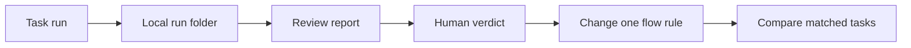

# Run records and flow review

## TL;DR

- **Goal:** Save each run's input, output, actions, and token usage for later review.
- **Key decision:** One local folder per `runId`; judge quality separately from execution status.
- **Impact:** Engine instruction/lifecycle records, adapter provider records, and local review commands.

**Status: proposed; no code changes or provider runs.** Extends M3 logging, M4 dispatch evidence, and M6 diagnostics. Requirements: SPECIFICATION E-03, §6–7; CONSTITUTION VII. Backend remains the state owner.

**Implementation handoff:** [Execution plan and tracker](2026-10-24-run-review-implementation/00-execution-plan.md) · [19 task cards](2026-10-24-run-review-implementation/01-task-cards.md). Start with RR-01. Tasks are planned, not implemented.

## From a run to an improved flow

## Scope

### In scope

| Item | Readiness | Outcome / basis |
|---|---|---|
| Per-run records | **Ready** | Link task, attempt, input, provider output, and lifecycle evidence. |
| Tool trace and usage | **Ready** | Existing fixtures expose both; runtime currently discards much of it. Unknown fields remain unknown. |
| Explanations | **Ready** | Save public plans, explanations, and provider-exposed reasoning summaries when emitted. |
| Local review | **Ready** | Markdown report and a separate human verdict with evidence references. |
| Storage policy | **Assumption — review** | Propose reversible defaults: 30 days, 10 MiB/run, 1 GiB total. Consider before implementation. |
| Provider field coverage | **Assumption — review** | Start with fixtures, then probe installed versions. Missing fields remain unavailable; basic capture can proceed. |

### Out of scope

- Hidden chain of thought, every model request's full context, or exact reproducibility.
- Cloud upload, analytics dashboard, new UI tabs, automatic model grading, or automatic prompt changes.
- Provider protocol migration, session-resume changes, scheduler changes, unit tests, or screenshots.

## Decisions to review

| Decision | Why / trade-off |
|---|---|
| Files in app data, outside target repos | Easy to inspect; no logs mixed with code changes. |
| Provider trace stays separate from chat | Preserve useful evidence without filling conversations with terminal output. |
| Keep provider counters and their scope | Cache and session totals differ; a single invented total would mislead. |
| Capture failure does not finalize or retry work | Logging cannot release locks, spawn replacement agents, or turn errors into success. Report incomplete capture explicitly. |

## Required behavior

- **Every claimed attempt** gets a folder, including pre-launch failures. Retries get new folders; same-run continuation preserves prior input.
- **Input** includes the task snapshot, selected context, and actual TaskAside instruction after redaction. Record omissions and template version; this excludes provider-internal prompts.
- **Trace** includes emitted tool calls/results, commands, file-change events, public explanations, errors, HITL, cancellation, and resume links. Preserve timestamps and source IDs; unsupported or missing data is labelled.
- **Usage** includes reported input/output, cache, reasoning counters, and estimated cost when available. Deduplicate before aggregation; absent values are `null`, never zero.
- **Review** shows provider outcome, last backend outcome observed, capture completeness, verification evidence, and human verdict separately. `done` alone does not mean the work is correct.
- **Safety** requires redaction before disk, bounded capture, and explicit gaps. Files never become task-state authority or a recovery replay log.

## Delivery sequence

| Step | Deliverable | Gate |
|---|---|---|
| L1 — Capture the basics | Run folder, input/prompt, lifecycle, output, and capture warnings; close direct logging bypasses | A completed and a failed fake run can both be reviewed from disk. |
| L2 — Explain usage and actions | Provider trace, stderr, usage with source/scope, optional Git evidence | Fixtures reconcile without double counting; cancellation and missing usage remain honest. |
| L3 — Make review quick | Proposed local `taskaside runs report <runId>`, Markdown summary, editable `review.json` | Reviewer can identify result, evidence, waste, and one suggested change in two minutes. |
| L4 — Compare flow versions | Proposed local `taskaside runs compare <baselineDir> <candidateDir>` | Matched tasks show correctness, intervention, duration, and usage together. |

Land L1 before broad flow tuning and L2–L3 before judging token data. L4 follows a reviewed baseline; it never reruns tasks. These commands are proposed.

## Verification and rollout

Use disposable data/repos and contract, integration, and process checks. Cover concurrency, duplicates, reconnect, crash, timeout, secrets, quota, and stale ownership. Probe both providers separately; report unverified OS cases.

Preserve old `.log` files without inventing history. Update architecture/storage and CLI docs with implementation. L1–L3 leave public APIs, task-state schemas, browser SSE, and UI unchanged.

## Advanced

### Inspected baseline and limitations

Source observations on 2026-10-24; recheck the current checkout before implementation because other work may be in progress.

| Evidence | Current behavior / gap |
|---|---|
| [Adapter manager](../src/agent-adapter/manager.ts) | Creates `logs/runs/<runId>.log`; saves normalized events. No structured input/output/usage archive. |
| [Logger](../src/agent-adapter/logging.ts) | 1 MiB rotation with one backup; strings truncated after 2,000 characters; write errors swallowed. Too lossy for an unqualified complete-review claim. |
| [Codex driver](../src/agent-adapter/drivers/codex.ts) | Parses usage fields but does not save them. Most non-message item events are ignored. |
| [Claude driver](../src/agent-adapter/drivers/claude.ts) | Maps text and terminal results; tool blocks and usage are not archived. |
| Both drivers above | Launch arguments and stderr use direct writes that bypass the redacting logger. Claude arguments can include MCP authorization. Close these paths before enabling richer capture. No live logs inspected for this plan. |
| [Instruction builder](../src/execution-engine/instruction-builder.ts) | Builds instructions with bounded history; selected/omitted context must be captured at assembly time. |
| [Dispatcher](../src/execution-engine/dispatcher.ts) | Owns forwarding/ACK/recovery evidence. Adapter completion alone cannot show whether backend accepted finalization. |
| [Data paths](../src/supervisor/paths.ts) | Uses OS app data with `TASKASIDE_DATA_DIR` override. Reuse this resolution. |

The initial PLAN.MD is historical; inspect current source and evidence before assuming milestone completion. This proposal does not change unrelated milestone status.

### Folder contents and ownership

Proposed root: `<dataDir>/run-reviews/<runId>/`. On macOS the default is `~/Library/Application Support/TaskAside/run-reviews/`. `TASKASIDE_DATA_DIR` remains the override. Use validated IDs, not task titles or arbitrary user paths, as folder names.

| Artifact | Writer | Content |
|---|---|---|
| `run.json` | Engine | Immutable identity: schema version, task/parent/run IDs, attempt linkage, claim time, generation, flow version. |
| `input.json`, `prompt.md` | Engine | Redacted input and assembled instruction; selected message IDs, omission counts, repo identity, input digest. |
| `engine.jsonl` | Engine | Dispatch, ACKs, disconnect/reconcile, HITL, yield, stop/finalize results, and observed backend state with observation time. |
| `provider.json` | Adapter | CLI/version, requested and reported model, session ID, safe launch settings, provider capability coverage. Unknown actual model stays `null`. |
| `provider-events.jsonl` | Adapter | Provider-emitted records after redaction, before lossy message mapping. Not byte-for-byte raw output. |
| `events.jsonl`, `stderr.log` | Adapter | Normalized events and sanitized diagnostics, including bounded malformed stdout records. |
| `usage.json`, `output.md` | Adapter | Usage accounting and source references; final answer when emitted. If absent, mark it missing rather than reuse an earlier message as a final answer. |
| `capture.json` | Each service, in its own segment | Coverage, dropped/truncated data, write failures, flush state, and reason for incompleteness. |
| `repo-before.json`, `repo-after.json`, `changes.patch` | Adapter, L2 | Bounded read-only Git evidence when collection is safe; otherwise record why unavailable. |
| `summary.md` | Local report command | Derived report, source timestamps, backend freshness, and evidence references. Works with partial folders. |
| `review.json` | Human reviewer | Versioned verdict, evidence, root cause, and proposed flow change. Report regeneration never overwrites it. |

These are artifact contracts, not prescribed application module names. Each artifact has one writer. Restart/continuation creates a distinct writer segment with its own files; reports combine segments by run and generation. Never reopen an old segment for truncation or permit stale writers to replace another segment. Initial identity is create-once and checked on duplicate dispatch.

Snapshots use atomic replacement within the same filesystem; JSONL is append-only. Flush periodically and at terminal process close, not only at a provider's terminal message. Interrupted trailing records are recoverable and explicitly marked. A report cannot call capture complete until expected writer segments are closed and required artifacts are present. Crashes may lose the unflushed tail; no durable token replay is promised.

The engine records the input it builds; the adapter records provider runtime. Report commands read files only and never open SQLite, launch agents, or apply recorded events. No telemetry event is added to backend ingestion just to persist review data. Any later cross-process contract change needs its own versioned delta before implementation.

### Token accounting rules

Retain original counters alongside normalized fields. Each usage record includes provider/version, model if known, source event/message ID, scope (`request`, `turn`, `session`), timestamp, and completeness. Derive run usage only when those scopes are established.

| Source | Accounting rule |
|---|---|
| Codex `turn.completed.usage` | Count a unique turn once. Keep cache/reasoning fields separately; do not add counters that are subsets of input/output. |
| Claude assistant usage | Deduplicate repeated blocks by provider session/message identity. Reconcile finalized usage updates rather than summing every block. |
| Claude terminal result | Establish whether each counter is per turn or cumulative. Never add a terminal aggregate to the message totals it already includes. |
| Resumed session | Record prior baseline and counter scope. Use a delta only if comparable; otherwise retain session total and mark run attribution unavailable. |
| Cancel/crash/missing terminal | Keep observed usage as partial; `null` for unavailable totals. Do not estimate token usage from characters by default. |

Probe exact field semantics against each installed CLI before deriving totals. Parent and child runs keep separate usage; an optional task-family total lists included run IDs and flags missing coverage. Provider-managed subagent usage must disclose whether already included, excluded, or unknown.

The current generic redactor matches keys containing `token`; applying it unchanged would erase numeric usage counters. Use typed usage allowlists while still redacting access tokens everywhere, including free text, nested tool results, launch settings, and stderr. Unknown numeric fields are retained only in validated provider records.

Store provider-reported cost as an estimate with source/scope. Do not equate it with subscription quota or an invoice. Do not add a pricing service or invent cost when absent.

### What “thinking” means here

Save emitted plans, progress explanations, reasoning summaries, and exposed thinking blocks when available. Label the source and whether content is empty/redacted. Signatures and opaque/encrypted reasoning blobs are not useful review text and should be omitted with a reason. Do not request or reconstruct hidden reasoning, or label an explanation as the complete internal thought process.

### Review rubric and improvement loop

`summary.md` should answer five questions: what was asked, what changed, what evidence supports the result, where time/tokens went, and what needs review. Link each claim to an event or captured verification result. Separate checks actually observed from checks merely claimed by the agent; missing evidence is `unverified`.

| Review field | Allowed assessment |
|---|---|
| Correctness | `pass`, `partial`, `fail`, `unverified`; requirement/evidence references required. |
| Scope | `within_scope`, `extra_changes`, `unverified`. |
| Verification | `passed`, `failed`, `not_run`, `unverified`; include commands and observed exit/results. |
| Efficiency | Human notes on repeated reads, repeated failures, unused context, avoidable retries, and oversized output. |
| Intervention | HITL count and reason, manual fixes, and repeated attempts. |
| Verdict | `accept`, `rework`, `reject`, `unreviewed`; reviewer and timestamp. |
| Improvement | Root cause category, one proposed change, expected benefit, and linked evidence. |

Use root causes such as missing context, unclear task, tool failure, permission limit, provider failure, or capture gap. A model's self-reported success never becomes a human `accept` verdict.

Start with a small fixed set of 5–10 representative tasks: clear code change, ambiguous requirement/HITL, tool failure, retry, and delegation. For comparison, use equivalent disposable repo baselines, the same task inputs, and recorded model/config versions. Do not replay destructive tools from trace files. Change one prompt/context/flow rule at a time and version it.

Compare acceptance and verification rates first, then intervention, elapsed time, and tokens per accepted task. Report total tokens spent across failed/retried attempts as well. Include sample count and missing data; a small sample is directional evidence. A candidate flow is better only if reviewed correctness and scope do not regress. Do not infer a win from lower token counts alone.

Git evidence must record pre-existing dirty/untracked state and before/after HEAD. A final diff alone cannot attribute user edits to the agent. Do not copy the whole repo or blindly ingest ignored/binary files. If evidence cannot safely distinguish baseline changes, mark attribution uncertain. No automatic commit, reset, or worktree creation is part of capture.

### Storage and failure policy

- **Defaults to review:** 30 days of unpinned terminal records, 10 MiB per run, 1 GiB total. Count all segments and derived files. Enforce limits across concurrent writers, with bounded per-writer queues and fixed reserved metadata space. Drop verbose bodies first; record omitted bytes/events and retained ranges.
- **Retention:** Delete oldest eligible records first when over quota. Never delete active, uncertain, or explicitly pinned runs. If protected records exhaust the budget, stop verbose capture and warn; do not exceed bounds silently. Retention is local policy, not permission to delete outside the validated archive root.
- **Secrets:** Redact before the first write, including current direct driver writes. Do not dump environment variables, bearer credentials, MCP config secrets, `.env` content, or authentication files. Use restrictive local permissions and the corresponding Windows protections; record redaction/truncation markers and sanitizer version. Automated redaction is not a guarantee that all sensitive prose is detectable; sharing remains a separate manual action.
- **Write failure:** Surface one warning per affected run in service diagnostics; continue safe process supervision. Mark capture partial when possible. If the disk is unavailable, absence of records itself means unknown coverage. Never claim that every run has a complete archive in this case.
- **Performance:** Capture must not block heartbeat, cancel, or event forwarding on synchronous large writes. Measure overhead at the configured concurrency ceiling; any gap or dropped event is explicit.

### Implementation acceptance matrix

These are planned checks, not results from this session. No unit tests or screenshot checks.

| Case | Pass criterion |
|---|---|
| Success, failure, pre-launch error | Linked folder/input exists where writable; final answer and outcomes are accurate or explicitly missing. |
| Same task retry / supported continuation | New run gets a new folder; same-run continuation preserves previous segments and links. |
| Concurrent runs and duplicate delivery | No cross-run content, overwritten writer files, duplicate usage, or corrupt JSONL. |
| Terminal usage after final text / no trailing newline | Final record is processed; usage is flushed or marked partial. |
| Repeated Claude blocks and cumulative resume totals | No double counting; unknown attribution remains unknown. |
| Engine/adapter crash and SSE reconnect | Partial trace survives; backend state remains authoritative; no replay or replacement writer is launched by logging. |
| Cancel, timeout, yield, stale owner | Outcomes remain distinct; logging cannot release ownership or report verified stop by itself. |
| Injected secrets split across stream chunks | Sanitized input, args, stdout, stderr, and tool output contain no fixture secret; numeric usage stays readable. |
| Full/unwritable disk, huge tool output, total quota | Bounded memory/disk, explicit gaps, responsive controls, no log-driven retries. |
| Existing dirty repo and unavailable diff | Existing work is preserved; change attribution is honest. |
| Report regeneration and old `.log` files | Human verdict remains; missing history is not fabricated; no new public/static log exposure. |
| Provider and OS evidence | Run supported installed Codex/Claude smoke cases on macOS; report Linux/Windows unverified until exercised. |

After implementation, run typecheck/lint/build and affected existing adapter, provider, engine, contract, and distribution checks. Measure capture overhead against capture disabled on the same workload; define the acceptable budget from that baseline before release.

### Sources and provider gates

- Existing [Codex fixture](2026-10-18-initialize-project/evidence/fixtures/codex/events-readonly.jsonl) includes usage and command results; the [Claude fixture](2026-10-18-initialize-project/evidence/fixtures/claude/events-readonly.jsonl) includes repeated assistant usage, tool results, and a terminal aggregate. These are historical evidence, not a live verification performed today.
- Official [Codex non-interactive documentation](https://learn.chatgpt.com/docs/non-interactive-mode) describes JSONL events, reasoning/tool items, and terminal usage. Pin behavior to the installed CLI when implementing.
- Official [Claude CLI documentation](https://code.claude.com/docs/en/headless) describes structured output and notes that resumed cost estimates include earlier spend. The [usage guide](https://code.claude.com/docs/en/agent-sdk/cost-tracking) explains repeated message IDs and cumulative counters. SDK guidance informs the accounting design; verify exact CLI fields before mapping them.

No live provider calls, billing checks, implementation checks, or cross-OS checks were run while writing this plan.
