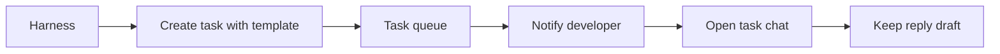

# Developer workflow: templates, notifications, and drafts

## TL;DR

- **Goal:** Make delegation clearer, surface tasks needing attention, and retain unsent work.
- **Key decision:** Design templates for MCP first; notifications and drafts serve the browser.
- **Impact:** Backend task creation and MCP contracts, browser live state, Settings, and local browser storage.

## One workflow, three improvements

**Status:** Specification and implementation proposal, 2026-10-25. No application implementation or runtime verification is part of this change. The user confirmed browser-open notifications and built-in templates only. Other defaults below are proposed, not new approval gates.

## Scope

### In scope

| Item | Readiness | Outcome |
| --- | --- | --- |
| [MCP-first templates](01-task-templates.md) | **Ready** | Three built-in templates; optional structured creation; existing free-form creation remains valid. |
| [Browser notifications](02-task-notifications.md) | **Ready** | Notify for HITL, completion, and failure while Dashboard or Workspace is open, including background tabs. |
| [Persistent drafts](03-persistent-drafts.md) | **Ready** | Restore unsent chat/HITL replies and the New Task form after navigation or reload. |
| Browser delivery defaults | **Assumption — review** | In-app notices enabled; desktop notices opt-in; silence duplicate desktop notices across same-origin tabs. See notification spec. |
| Draft storage defaults | **Assumption — review** | Store locally in this browser, with no device sync or automatic expiry. See draft spec for limits and failure behavior. |

### Out of scope

- Custom template editor, repository-specific templates, mandatory templates, automatic task classification, and template analytics.
- Notifications after all app pages close, native tray apps, service workers, push services, email, and webhooks.
- A notification inbox, new routes, task states, approval actions, provider switching per task, or queue policy changes.
- Server-side drafts, edit-form drafts, automatic draft submission, unit tests, screenshots, and application code in this planning change.

## Decisions and tradeoffs

| Decision | Reason and consequence |
| --- | --- |
| **MCP is the primary creation path** | User expects over 95% of creation through harnesses. Ship and verify MCP before the UI template picker. |
| **Backend renders task descriptions** | MCP and REST produce the same stored Markdown. The engine still owns execution instructions; a template cannot add runtime permissions. |
| **Templates are optional and immutable by ID** | Old clients keep working. Revisions use a new ID, so retries are stable across upgrades. |
| **Reuse committed browser events** | Notifications do not add a queue, persistent event history, or execution dependency. Delivery remains best effort. |
| **Prioritize chat drafts** | MCP creation makes chat/HITL the main browser writing surface. New Task form persistence is the smaller secondary slice. |

## Delivery and review map

Read one feature spec at a time. [Execution plan](04-execution-plan.md) defines dependencies, task cards, rollout, and rollback. [Acceptance matrix](05-acceptance.md) defines concrete integration and browser scenarios.

Requirements extend **T-01, T-02, C-01, and SPECIFICATION §3–4/§7–8**; delivery extends **M2/M5**, with regression checks against M4 safety. Owners are backend and frontend. Engine/adapter/supervisor behavior is preserved.

The active R0–R7 and LC layer plans remain separate. Rebase these slices on the actual implementation at handoff; do not require completion of every refactor task or replay completed extraction work. Coordinate MCP and frontend edits with the active owner.

## Defaults to consider

1. Desktop notices include the task title, but never question text, repository paths, or credentials. OS delivery requires an explicit enable action.
2. A browser draft survives until successful submission or explicit discard. Storage failure keeps the editor usable and displays an unsaved hint.
3. Managed MCP replay retains its existing first-result semantics; external MCP retains payload-conflict detection. The template spec makes this distinction explicit.

No blocking product question remains after the two user confirmations. Desktop delivery still needs a browser/OS capability probe before it can be claimed as supported.

## Advanced: inspected evidence

- [Current task schemas](../../src/contracts/task.ts), [MCP schemas](../../src/contracts/mcp.ts), [MCP definitions](../../src/backend/mcp/handler.ts), and [MCP creation](../../src/backend/mcp/tools.ts): seven tools; no template catalog; external receipts hash title, description, priority, and repo; managed creation has a separate path.
- [Workspace](../../src/frontend/pages/WorkspacePage.tsx): SSE is mounted only here; drafts are component state. [App shell](../../src/frontend/components/AppShell.tsx) spans Dashboard and Workspace.
- [Router](../../src/frontend/router.tsx): observes pathname only; same-path query navigation needs explicit support for task links.
- [Input-required publication](../../src/backend/usecases/request-input-usecase.ts): one HITL request emits both input-required and status-change events. They must produce one notification.
- [Event hub](../../src/backend/events/hub.ts): process-local sequence resets; it cannot serve as a durable deduplication ID.
- [Browser interaction runner](../../src/frontend/browser-interaction-checks.ts) already supports interaction checks without screenshots.
- Older specification text still mentions numeric priorities, per-task provider selection, and default concurrency 3. Apply the corrections in [AGENTS.md](../../AGENTS.md): P0–P3, repository provider, eight global slots. This proposal does not reopen those decisions.
