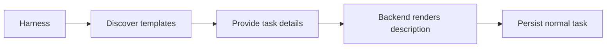

# Built-in templates for MCP task creation

## TL;DR

- **Goal:** Let a harness create a clear task without rebuilding its structure each time.
- **Key decision:** Optional structured template input becomes stored Markdown; free-form input keeps its current contract.
- **Impact:** MCP discovery, task creation via MCP/REST, and a secondary UI picker; no database migration.



## Contract changes

| Interface | Additive change | Compatibility |
| --- | --- | --- |
| MCP `list_task_templates` | Read-only catalog with optional exact `templateId` filter | New tool scope; no task or repo data returned. |
| MCP `create_task` and REST `POST /api/tasks` | Optional `templateId` and `templateInputs` | Existing free-form requests and Task responses unchanged. |
| REST `GET /api/task-templates` | Same catalog, browser-authenticated | Must use existing browser auth and Host/Origin protection. |

Catalog response: `catalogVersion` (positive integer starting at 1), `templates: [...]`. Bump the catalog version when entries change. Each entry contains `id`, `name`, `summary`, `inputSchema`, and `markdownSkeleton`. The three initial immutable IDs are `bug-fix-v1`, `feature-v1`, and `code-review-v1`. The skeleton and renderer must agree; clients do not execute template content.

`templateInputs` has required nonblank `goal`, nonempty `scope` and `acceptanceCriteria` string arrays, and optional `context`. Both template fields must appear together. A nonempty `description` and template fields are mutually exclusive; an omitted or blank description is allowed. Reject unknown template IDs and unknown template input keys with `VALIDATION_ERROR` and field details. Never fall back to free-form creation after a template error.

## Scope

### In scope

| Item | Readiness | Outcome |
| --- | --- | --- |
| Catalog, rendering, and MCP discovery | **Ready** | Harness discovers all required fields and creates a task through the existing tool. |
| Free-form compatibility and receipts | **Ready** | Existing requests, repo selection, authorization, and deduplication are preserved. |
| UI picker | **Ready** | Optional structured fields in New Task; same backend rendering as MCP. |

### Out of scope

Custom templates, conditional template languages, files/commands in templates, mandatory task types, new task properties, and runtime permission changes.

## Review decisions

- **Use immutable IDs, not a template database.** Store the rendered description once. An ID marker in that Markdown aids inspection but is editable task text, not immutable provenance.
- **Keep one input structure.** Template guidance differs by task type; there is no generic workflow or form engine.
- **Separate discovery permission.** New external pairings may explicitly include `list_task_templates`; existing tokens gain no scope automatically. A caller with only `create_task` can still discover supported IDs and inputs in its tool schema and create a templated task.

## Behavior

- **Optional use:** No template means existing creation behavior, including optional description and P2 default. Templates never select repo, priority, provider, parent, or permissions.
- **Deterministic description:** Render a template marker, fixed task-type guidance, Goal, Scope, Acceptance Criteria, and optional Context in that order. Preserve user text as text; omit empty Context. Validate before creating any task, conversation, or receipt.
- **Type guidance:** Bug fix asks for observed/expected behavior and reproduction in Context. Feature asks for user behavior and exclusions. Review asks for findings with locations and no edits by default; that instruction is not a sandbox guarantee.
- **Safe retries:** External receipts retain their existing hash over effective title, rendered description, priority, and repo. Identical retry returns the same task after restart; changed effective payload uses the existing `SEQUENCE_CONFLICT` error. Immutable renderers keep retries stable across upgrades.
- **Managed creation:** Parent/repo inheritance and depth/count bounds remain. Same valid key returns its original child, including at the child ceiling; existing first-result behavior does not gain payload-conflict detection. Replays publish no new creation event.
- **UI:** Free-form is the default. Selecting a template never overwrites nonempty work without a local Replace/Keep choice. Template fields remain editable; submit sends the same structured input as MCP. Catalog failure leaves free-form creation usable.

## Impact and risks

Backend owns catalog and description normalization; engine still builds full execution instructions. No new table, task status, run event, or provider feature is needed. Task edits and retries use the stored description, not a newly rendered template.

**Old-server risk:** Older validators may ignore unknown template fields. A harness must verify template support from `tools/list` before sending structured input; it must not treat silent field stripping as successful template support.

## Advanced: input limits and examples

For template inputs only: `goal` at most 4,000 characters; each array has 1–20 nonblank entries, each at most 2,000 characters; Context at most 12,000 characters; rendered description at most 32,000 characters. Trim boundary whitespace, preserve internal whitespace, and reject over-limit values. Do not impose these new limits on legacy free-form requests in this change.

Illustrative MCP tool arguments, within the existing JSON-RPC or direct-call envelope:

```json
{
  "title": "Fix stale HITL reply handling",
  "repoId": "registered-repo-id",
  "idempotencyKey": "hitl-reply-fix-001",
  "templateId": "bug-fix-v1",
  "templateInputs": {
    "goal": "Reject a reply to an already resolved input request",
    "scope": ["Task chat reply flow"],
    "acceptanceCriteria": ["A stale reply cannot resume the agent twice"],
    "context": "Expected: REQUEST_ALREADY_RESOLVED; observed: duplicate resume"
  }
}
```

Tool errors and successful response wrappers stay consistent with the current MCP endpoint; this spec does not migrate its protocol. Missing external repo/key, unauthorized repo, expired managed token, and child-limit errors retain their existing meanings.

Catalog filter: `{}` returns all three initial entries; `{templateId: "bug-fix-v1"}` returns one; unknown ID is `VALIDATION_ERROR`. REST uses the same optional query parameter. Newly minted managed tokens include this read-only scope; existing tokens are not rewritten. Retain published IDs and their exact rendering rules in later releases; changes require a new ID. Cache the catalog within an MCP connection/session and refresh after reconnect.

**Inspected prerequisite:** Managed creation currently checks child count before key replay. Correct replay ordering in the touched creation path before claiming the child-ceiling acceptance case. Do not extend this slice into unrelated MCP refactoring or change managed payload-conflict policy.
