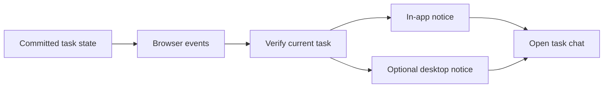

# Task notifications while the app is open

## TL;DR

- **Goal:** Tell the developer when a task needs input, completes, or fails.
- **Key decision:** Use existing committed events across Dashboard and Workspace; desktop delivery is optional and best effort.
- **Impact:** Browser live-state lifetime, Settings preferences, and task deep links; no durable notification service.

## Contract changes

- Reuse `/api/events`, REST task snapshots, `task.status_changed`, and `input_required`. No new public event or backend settings field.
- Support `/app/workspace?taskId=<encoded-id>` on direct load, internal navigation, and Back/Forward. Query-only changes on the same path must update selection.
- Browser-local preferences cover in-app enablement, desktop enablement, and each category: `hitl`, `done`, `error`. Category defaults and in-app delivery are on; desktop delivery is off until explicitly enabled.

## Scope

### In scope

| Item | Readiness | Outcome |
| --- | --- | --- |
| Open-page delivery and deep links | **Ready** | User confirmed Dashboard/Workspace, including background tabs. |
| Desktop delivery | **Assumption — review** | Enable only where permission, capability, and same-origin coordination pass a browser probe; otherwise use in-app notices. |
| Local preferences and quiet behavior | **Assumption — review** | No sound, no notice for `cancelled`, and no durable inbox. |

### Out of scope

Closed-page delivery, service workers, OS daemons, guaranteed replay, question/approval actions in notifications, and cross-browser-profile deduplication.

## Review decisions

- **One live subscription per mounted app page.** Dashboard and Workspace share event ownership. Do not keep a second Workspace subscription when adding app-wide delivery; route changes must not leak listeners.
- **State is authoritative.** A notice never changes task state, resumes an agent, or approves a provider tool action.
- **Coordination is for notices only.** Same-origin browser locks must never be confused with backend working-tree locks.

## Behavior

- **Eligible transitions:** Notify on entry into `done`/`error`, and once per new pending HITL request. Status-preserving edits, token deltas, initial snapshots, ordinary chat, and other statuses are silent. A task created through MCP qualifies exactly like a UI-created task.
- **Current-state check:** Confirm the task through REST before presenting a notice. Suppress stale versions and an already resolved HITL request. Both HITL events share one request identity. A failed lookup produces no desktop notice and cannot disrupt live state.
- **Startup/reconnect:** Establish a REST baseline on connection. Events during baseline refresh only invalidate state; they do not generate notices. Resume live notices after refresh. Existing HITL/error task rows remain visible; do not announce historical tasks or promise missed-event recovery.
- **Foreground:** For the focused, visible task conversation, suppress its transient notices. For another task, show a dismissible in-app text notice with an Open action. Use an accessible live region without stealing focus.
- **Background:** Desktop delivery requires user opt-in and browser permission. Ask permission only from the Enable button in Settings. Denied/unsupported permission shows a short status; never reprompt automatically. Use task title and status, never question text, local paths, tokens, or raw logs.
- **Open action:** Focus the existing app page and select the task; an active search/group collapse cannot hide it. Loading, unauthorized, and missing IDs have clear UI states. Notification URLs contain only a task ID; they never carry authentication credentials.
- **Repeated events/tabs:** Deduplicate HITL by request ID and terminal notices by task ID/status/task version. Coordinate desktop delivery across same-origin tabs, then persist a bounded deduplication record before attempting delivery. Crash gaps remain possible; no exactly-once claim.

## Impact and risks

Backend remains unchanged unless a contract regression is found. Preference storage is browser-local, separate from server Settings. Notification failure never affects task creation, chat, scheduling, locks, or execution.

Browser suspension, Do Not Disturb, permissions, and OS policy can delay or hide a notice. User confirmed that closing all app pages ends delivery. The public landing page does not subscribe or request permissions.

## Advanced: coordination, retention, and support

Use task version/request ID for identity, never the event hub sequence, which resets on restart. Dedup records retain at most 200 identities for 24 hours; pruning has no effect on task state. Preferences may persist without expiry. If storage or cross-tab coordination is unavailable, disable desktop delivery and keep in-app behavior; explain the limitation in Settings without adding a recovery wizard.

Hold a same-origin exclusive Web Lock while checking/recording one desktop notice attempt. Recheck current state after acquiring it. It is a short operation, not a background leader that must remain responsive while suspended. Each page may retain its own SSE connection; the restriction is one per page, not one per browser.

Validate the running loopback origin with `window.isSecureContext`, Notifications capability, and `navigator.locks`. Probe real desktop presentation on macOS with the target browser before declaring support. Other browser/OS combinations remain unverified until recorded.

Browser references: permission requests require a user gesture and supported secure context ([MDN Notifications API](https://developer.mozilla.org/en-US/docs/Web/API/Notifications_API)); Web Locks coordinate same-origin contexts ([MDN Web Locks](https://developer.mozilla.org/en-US/docs/Web/API/Web_Locks_API)). These references establish API constraints, not TaskAside runtime evidence.
