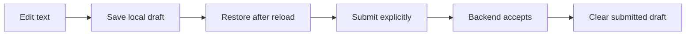

# Persistent chat and task-form drafts

## TL;DR

- **Goal:** Retain unsent text when navigating, reloading, or reopening the app.
- **Key decision:** Drafts remain local browser data and never become chat or tasks until submitted.
- **Impact:** Chat/HITL composer, New Task form, and browser storage; no backend contract change.

## Contract changes

No REST, MCP, Task, or chat schema change. Versioned browser-local records contain a draft key, content, revision, and saved timestamp. Chat records also retain the input request ID they were composed against. New Task records retain the selected repository, parent ID, priority, free-form/template mode, and entered fields.

## Scope

### In scope

| Item | Readiness | Outcome |
| --- | --- | --- |
| Chat and HITL drafts | **Ready** | Restore independently for each task; prioritize this slice. |
| New Task draft | **Ready** | Restore the last unsent creation form; UI creation is secondary to MCP. |
| Browser-local retention | **Assumption — review** | Same origin/profile only, no automatic expiry, bounded storage; clear on explicit discard or acknowledged submission. |

### Out of scope

Server/device sync, harness prompt drafts, edit-task form drafts, autosubmit, encrypted storage, version history, and automatic merging of parallel editors.

## Review decisions

- **Use local storage, not authentication storage.** Auth remains session-scoped. No bearer token, SSE URL, provider credential, or whole Task object is written into a draft.
- **Latest saved record wins on restore.** Active text is not replaced by another tab's storage event. Multiple editors do not gain collaborative merge semantics.
- **Keep text when success is uncertain.** A timeout can occur after backend acceptance. Retain the draft and do not resend automatically; message submission gains no new idempotency guarantee.

## Behavior

- **Isolation:** Key chat drafts by origin and task ID; keep New Task drafts separate. Task switching, stream updates, Dashboard navigation, and status changes never mix text between tasks. Restore only after the destination task is available and authorized.
- **Saving:** Persist edits within 300 ms while the page runs. Flush pending edits on blur, modal close, task/route switch, and page hide. A sudden crash before saving may lose the last debounce window; do not claim crash-proof storage. Display Saved only after storage succeeds.
- **Restore:** Parse and validate the local record; corrupt/unknown-version entries do not crash the page or auto-submit. Show a small recoverable hint and allow discard. Missing repositories/templates preserve entered text and require reselection before task submission.
- **Submit:** Capture task/request ID, text, and revision at send time. Acknowledged success clears only that submitted revision. Text typed during the request stays available. Failed or timed-out sends keep text. A late result for task A cannot clear task B's draft.
- **HITL safety:** Associate a reply draft with its original request ID. If pending input changes or resolves, preserve the text and show “The input request changed; review your reply.” Block sending it to a different request until an explicit Use for current conversation action; never silently retarget or auto-resume.
- **Discard:** Provide a small Discard draft action for nonempty chat/form drafts. Closing or cancelling the New Task modal retains the draft; only explicit discard or successful creation clears it. Selecting/replacing a template follows the template spec's Replace/Keep rule.
- **Storage failure:** Keep the editor functional and its current in-memory text; show “Draft could not be saved in this browser.” Never truncate, evict another draft, block normal submission, or silently claim persistence.

## Impact and risks

No database migration or engine/provider change. Drafts contain unsent user text and stay in the browser until sent/discarded or browser data is cleared. Successful submission is still governed by backend authorization and current task state.

Storage is scoped by scheme/host/port; switching between localhost and 127.0.0.1, changing ports, clearing site data, or private browsing can prevent restoration. This is a local convenience guarantee, not a backup service ([MDN localStorage](https://developer.mozilla.org/en-US/docs/Web/API/Window/localStorage)).

## Advanced: bounds and conflict rules

- Limit one serialized record to 64 KiB and total TaskAside draft storage to 2 MiB. These are persistence bounds, not new submission limits. Above a bound, preserve full editor content and show the unsaved hint; never truncate it. Count all stored drafts when checking the total.
- A revision must distinguish different writers, not rely only on millisecond timestamps. Other-tab updates do not alter active input. Reload restores the latest stored value; concurrent edits can replace an older stored value, and no merge/history is promised.
- Serialize draft storage writes and compare/delete operations under a short same-origin storage lock, including the total-size check. Before removing a stored draft after success, verify it still matches the submitted revision. If another tab saved newer text, retain it. Without coordination, retain single-editor save/restore behavior but make no cross-tab conflict guarantee; show a parallel-edit warning if another writer is detected. Active input must remain intact in either mode.
- New Task restoration validates repository and template availability against the live catalog. Do not silently select a different repo or clear fields because a list is still loading. A new prefilled parent that differs from the stored form requires a Keep saved draft / Start new task choice.
- On HITL mismatch, explicit reuse updates the draft's reply target only after refreshing task state; normal backend stale-request validation still applies. If task retrieval returns forbidden/not-found, do not display or submit its stored draft; retain it until explicit discard.
