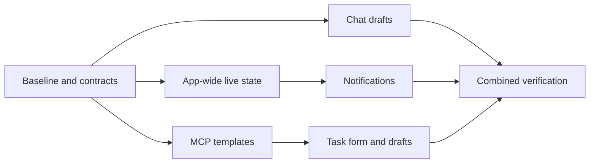

# Implementation plan and task cards

## TL;DR

- **Goal:** Deliver all three features in small slices with MCP as the primary acceptance path.
- **Key decision:** Freeze contracts first, deliver MCP templates and chat drafts early, then app-wide notices and the smaller form UI.
- **Impact:** Backend/MCP, frontend, browser interaction checks, and documentation. All tasks below are **todo**.

## Delivery order

Branches show independent dependencies, not authorization to run parallel editing agents. Keep work sequential unless the user requests delegation.

## Scope

### In scope

| Item | Readiness | Outcome |
| --- | --- | --- |
| Contracts and baseline | **Ready** | Record current behavior, existing failures, and proposed deltas. |
| Template implementation | **Ready** | MCP catalog and creation pass before UI polish. |
| Draft implementation | **Ready** | Chat first; New Task after template form integration. |
| Notifications | **Ready** | Open-page scope confirmed; desktop presentation is capability-gated. |
| Release verification | **Ready** | Contract, integration, browser interaction, and recorded manual OS checks. |

### Out of scope

Application edits during this planning request, broad layer refactors, provider protocol changes, publishing, unit tests, screenshot/video checks, and promises of cross-OS support without evidence.

## Tracker

| ID | Outcome | Owner | Depends on | Size | Status |
| --- | --- | --- | --- | --- | --- |
| DW-01 | Baseline and settle contract details | backend/frontend | — | S | todo |
| DW-02 | Built-in catalog and creation schemas | backend/contracts | DW-01 | S | todo |
| DW-03 | Render descriptions on all creation paths | backend | DW-02 | M | todo |
| DW-04 | MCP discovery, scopes, and retry compatibility | backend/MCP | DW-03 | M | todo |
| DW-05 | MCP contract/integration gate and harness guidance | backend/docs | DW-04 | M | todo |
| DW-06 | Persistent chat drafts | frontend | DW-01 | M | todo |
| DW-07 | Draft send races, HITL changes, and storage failures | frontend | DW-06 | M | todo |
| DW-08 | One app-wide live-state subscription per page | frontend | DW-01 | M | todo |
| DW-09 | Task deep links and navigation | frontend | DW-08 | S | todo |
| DW-10 | In-app notices and preferences | frontend | DW-09 | M | todo |
| DW-11 | Desktop permission, deduplication, and capability probe | frontend | DW-10 | M | todo |
| DW-12 | UI template picker | frontend | DW-05 | S | todo |
| DW-13 | New Task form drafts | frontend | DW-07, DW-12 | S | todo |
| DW-14 | Combined integration/browser acceptance | backend/frontend | DW-05, DW-07, DW-11, DW-13 | M | todo |
| DW-15 | Final docs, support evidence, and handoff | docs | DW-14 | S | todo |

S = one focused review slice; M = likely two slices. These are scope sizes, not dates. Suggested sequential order: **01–05 → 06–07 → 08–11 → 12–15**. This prioritizes the dominant MCP path, then the primary browser writing surface.

## Task cards

### DW-01 — Baseline and freeze deltas

Record the current working-tree state and active refactor owner before editing. Inspect the actual MCP/REST schemas, both creation roles, live-state lifetime, task links, and send lifecycle. Use existing runtime versions; no dependency upgrade. Run the targeted baseline checks listed below and separate pre-existing failures from new failures.

**Exit:** A short baseline evidence record; contract names, immutable template IDs, browser preference defaults, and storage limits agree across the three specs. Record the user-confirmed notification/template scope. **Boundary:** No unrelated cleanup or new product choices hidden in implementation.

### DW-02 — Define catalog and input contracts

Deliver the three fixed templates and typed validation for the shared input/catalog response. Keep exact limits, error fields, supported IDs, and legacy compatibility observable. The catalog is static application data, not SQLite-managed configuration.

**Exit:** Contract checks cover malformed inputs, unknown IDs, excessive sizes, mutually exclusive description/template mode, and old free-form requests. These checks exercise public contracts, not isolated helper tests.

### DW-03 — Normalize creation consistently

Accept optional templates through REST, external MCP creation, and managed child creation. Persist only the normalized description with the normal task/conversation transaction. Return the existing Task shape. Keep template content below execution policy; do not move instruction building into backend.

**Exit:** All paths produce identical description snapshots from equal inputs; invalid input creates no task, conversation, or receipt. Existing edits/retries use the stored snapshot. **Boundary:** No schema migration, dynamic template engine, new provider selector, or scheduling change.

### DW-04 — Discovery and safe retries

Expose catalog through the browser-authenticated endpoint and the scoped MCP tool. Update tool discovery schemas so a harness with `create_task` alone can see the supported template arguments. New external grants are explicit; do not rewrite existing tokens. Add the catalog tool to newly minted managed grants.

Preserve external receipt hash compatibility over effective task fields. Ensure managed key replay works at the child ceiling by resolving a valid existing replay before applying the new-child budget check. Preserve the existing managed first-result policy; do not introduce a new conflict table or change free-form hashes.

**Exit:** Authorization, JSON-RPC/direct envelopes, duplicate delivery, concurrent identical external requests, restart replay, immutable-ID upgrade retry, changed external payload, and child-limit cases pass. No duplicate task/conversation/event is produced.

### DW-05 — Prove the MCP-first workflow

Use a disposable repo/data directory and a real backend HTTP endpoint with a simulated external harness. Exercise `tools/list`, catalog read, structured `create_task`, `get_task`, and repeated creation. Include a caller granted only `create_task`. Exercise managed child creation separately with run-scoped credentials.

Document one worked example per template, the optional catalog grant, old-server capability detection, correct key reuse, and the managed/external retry distinction. Do not require an extra model request to fetch the catalog for every task; allow caching by catalog version for the current server instance.

**Exit:** The feature is useful with no UI creation. Both catalog transport shapes and persisted description content have integration evidence. A paid/live model is not required to prove this local contract.

### DW-06 — Save and restore chat text

Deliver task-scoped local drafts, safe parsing/versioning, saved/unsaved hints, persistence bounds, and explicit discard. Preserve text across task changes, Dashboard navigation, stream updates, reload, and reopen. Flush pending saves at the documented lifecycle points.

**Exit:** Browser interaction scenarios restore A/B independently and keep all current chat behavior. No message is posted by saving/restoring. **Boundary:** No server draft API, full Task persistence, or auth-storage change.

### DW-07 — Protect in-flight edits and HITL replies

Capture send target/revision and clear only the acknowledged submitted content. Keep newer edits and other-tab revisions. Retain uncertain/failed submissions. Restore the original HITL reply identity and require explicit reuse if it changes. Handle corrupt records, unavailable storage, quota, and missing tasks without losing active text.

**Exit:** A late success cannot clear another task or newer text; stale HITL drafts cannot target a different request automatically. Browser checks cover the failure matrix without unit tests or screenshots.

### DW-08 — Extend live-state ownership to the app

Ensure Dashboard and Workspace both receive committed events, without a second Workspace subscription. Retain task/run/message isolation, REST reconciliation, bounded delta batching, token handling, and cleanup. Establish a silent baseline on each connection; no historical notification replay.

**Exit:** Repeated route switching leaves one connection per app page, zero on the public landing page, and no duplicated messages. Disconnect/backend-restart checks still pass. **Boundary:** No new broker, backend event history, or raw provider stream access.

### DW-09 — Open the right task

Support query-based task selection on direct load, notification action, same-path navigation, and browser history. Preserve query parameters when stripping bootstrap tokens. Resolve task ID through the authenticated API; show missing/forbidden states. Temporarily reveal the selected task despite filtering/collapsed groups without erasing saved grouping choices.

**Exit:** A notice from Dashboard opens the exact task conversation; query-only changes and Back/Forward work. No token is placed in a deep link and no new route is added.

### DW-10 — In-app notices and local preferences

Deliver three categories with independent switches in Settings. Gate notices on fresh committed task state; collapse duplicate HITL events. Suppress notices for the visible, focused conversation and status-preserving edits. Provide accessible transient text, dismiss, and Open without taking focus.

**Exit:** MCP-created tasks notify; initial snapshots and message deltas do not. Preferences persist and stay outside server scheduling settings. A burst cannot create an unbounded notice list: show at most three transient notices, with later ones replacing the oldest; existing task rows remain available.

### DW-11 — Desktop delivery with honest support

Probe secure context, permission, API support, and Web Locks at the actual loopback origin. Enable permission only through Settings. Coordinate attempts by semantic identity across same-origin pages; bound dedup records and degrade to in-app on missing storage/coordination. Focus the existing page on click and retain its existing auth session.

**Exit:** Granted/denied/default/revoked permission paths, two-tab delivery, duplicate events, status changes before presentation, lock contention, and storage failure pass browser checks. Record one real macOS/browser presentation check and Do Not Disturb conditions. If unavailable, label desktop delivery unsupported in that environment; do not claim the stubbed browser check proved OS delivery.

### DW-12 — Secondary UI template creation

Add an optional picker and direct fields for goal, scope, acceptance criteria, and Context. Keep free-form creation as default. Consume the same catalog; preserve user text on mode switches and failures. Do not build a schema-driven form framework.

**Exit:** UI and MCP creation produce the same description; keyboard use, errors, Replace/Keep, and catalog-unavailable fallback work. No new route or template management screen.

### DW-13 — Keep the New Task form

Persist complete unsent form state, including template inputs. Restore after modal close/reopen and page reload. Handle late-loaded/missing repo/catalog entries and different prefilled parent IDs. A successful create clears only the submitted revision; failure retains fields.

**Exit:** Restored forms never silently change the target repo or create a task; submit/discard behavior matches the draft spec.

### DW-14 — Run combined acceptance

Use the [acceptance matrix](05-acceptance.md). Start with targeted checks; run the full deterministic regression gate only after all slices settle. Cover a complete **MCP create → HITL notice → task link → draft/reload → explicit reply → completion notice** workflow using deterministic provider behavior.

**Exit:** Contract/integration/process/browser evidence distinguishes mocked capability checks from actual OS delivery. Existing task grouping, six statuses, retry/cancel, fencing, and single-writer checks pass or are explicitly recorded as pre-existing blockers.

### DW-15 — Synchronize docs and hand off

Update the canonical behavior specification and architecture to describe the new optional template contracts, app-wide live subscription, and local browser preferences/drafts. Add user-facing MCP setup/examples and delivery/storage limitations. Keep this proposal's status distinct from implemented/verified status.

**Exit:** Every task has evidence or an explicit remaining gate; user changes are preserved; no application publish, commit, or push occurs without a separate request.

## Verification commands and evidence

At baseline, run `bun run typecheck`, `bun run test:contracts`, `bun run test:mcp`, `bun run test:api`, `bun run test:projection`, `bun run test:workflow`, and the existing browser interaction check when its prerequisites are available. Record commands, exit status, environment, and failures under this feature's `evidence/` during implementation; no evidence is fabricated now.

After each slice, run relevant existing checks plus its new integration/browser scenarios. At DW-14, run `bun run check:deterministic`, `bun run typecheck`, `bun run lint`, `bun run build`, and `bun run test:browser`. Limit formatting checks to the changed files when unrelated working-tree changes exist. No unit tests, screenshots, video, or live coding runs against the user's real repos.

## Rollout and rollback

1. Ship catalog/creation support before enabling structured requests in harness guidance. Old harnesses keep free-form creation. New harnesses check the tool schema, not just a server version string.
2. Enable local drafts and in-app notices after their browser gates. Desktop notices remain off until the user enables them and the capability probe passes.
3. Roll back template clients before rolling back backend support; old servers can silently ignore unknown fields. Existing rendered descriptions remain ordinary task data.
4. Roll back browser features without deleting saved drafts/preferences. Unsupported record versions remain recoverable by explicit discard. No DB downgrade is needed.

**No schedule claim:** Re-estimate after DW-01, especially the current refactor overlap and browser/OS probe. Do not make completion of every R/LC task a prerequisite for these small feature slices.
