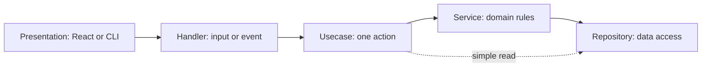

# Code organization: presentation → handler → usecase → service → repository

## TL;DR

- **Goal:** Separate transport, application actions, business rules, and SQL.
- **Key decision:** Organize every component by responsibility; simple reads may skip services.
- **Impact:** Frontend, backend, execution engine, adapter, supervisor/CLI, and shared build/check boundaries.

**Confirmed on 2026-10-25:** whole-repository scope; simple reads may use `usecase → repository`. **Implementation:** in progress; tracker/evidence record LC-01a–LC-05a done. The 2026-10-28 update changes planning documents only.

**Implementation handoff:** [execution tracker](2026-10-25-layered-code-organization/01-execution-plan.md), [task cards](2026-10-25-layered-code-organization/02-task-cards.md), and [Antigravity prompt](2026-10-25-layered-code-organization/03-antigravity-prompt.md). Resume with the [2026-10-28 continuation](2026-10-28-layered-refactor-continuation/00-overview.md): next extraction **LC-05b**, with named safety prerequisites. The original 47 IDs remain; Linux/Windows release gates are dropped under the current Darwin arm64 scope. Lettered IDs break down parent LC-01–LC-12 groups below.

This extends **R4**, following the extractions recorded under RF-37–RF-46 in the [existing roadmap](2026-10-24-refactor-plan/03-execution-plan.md). It preserves M2–M6 requirements **T-01, T-02, C-01, E-01–E-03**, internal contracts, MCP scopes, and distribution rules in the [specification](2026-10-18-initialize-project/SPECIFICATION.md).

## Target flow



This is a responsibility model, not a chain of processes. Background components have no UI. HTTP clients, provider drivers, and process control remain explicit I/O modules rather than artificial repositories. REST/MCP/SSE boundaries remain intact.

## Scope

### In scope

| Item                                           | Readiness | Outcome                                                                                                                                         |
| ---------------------------------------------- | --------- | ----------------------------------------------------------------------------------------------------------------------------------------------- |
| All application owners                         | **Ready** | Separate responsibilities within frontend, backend, engine, adapter, and supervisor/CLI.                                                        |
| Usecase/service split and read path            | **Ready** | Usecases coordinate; services hold rules. Simple reads may call repositories directly.                                                          |
| REST/internal REST/MCP extraction              | **Ready** | Handlers use application actions; SQL belongs to repositories.                                                                                  |
| Atomic writes and post-commit events           | **Ready** | Shared transaction scope covers Task, Chat, runs, locks, and receipts where required.                                                           |
| Contracts, infrastructure, build/check support | **Ready** | Keep shared contracts independent; place concrete shared infrastructure outside supervisor ownership; preserve packaging and check entrypoints. |

### Out of scope

- Product features, API/schema migrations, new providers, runtime protocol changes, and stack changes.
- New unit tests, screenshot checks, generic repositories, factories, a dependency injection framework, or a generic unit-of-work framework.
- Implementing the plan in this session.

## Responsibilities and decisions

| Layer        | Owns                                                                        | Must not own                                               |
| ------------ | --------------------------------------------------------------------------- | ---------------------------------------------------------- |
| Presentation | React views, local view state, CLI rendering                                | Authoritative task state or server imports in browser code |
| Handler      | UI actions, REST/MCP validation, SSE input, timer/signal entrypoints        | SQL, workflow policy, transaction orchestration            |
| Usecase      | One action, resource authorization, coordination, backend transaction scope | Framework contexts, SQL, direct provider spawn             |
| Service      | Domain rules, scheduling/instructions, session and lifecycle policy         | Transport responses or low-level I/O details               |
| Repository   | Data access, SQL/row mapping, concrete file or browser preference storage   | Workflow policy, auth decisions, event publication         |

**Keep domain folders.** Task and Chat stay independent. Cross-domain actions coordinate them at the usecase boundary; neither service imports the other domain's service. Runs and locks remain part of the Task domain. Access control owns MCP credentials, pairing, and scope policy.

**Keep I/O explicit.** Frontend/engine use HTTP clients; adapter uses provider drivers; supervisor uses process/file modules. No SQLite outside backend. No empty layers, generic repositories, new packages, or new service processes.

**Usecases define transaction scope; database code executes it.** Participating repositories use the same backend connection. Keep transactional work synchronous. Publish only after the outer transaction commits; rollback publishes nothing. Preserve immediate transactions for ownership-sensitive writes.

## Required behavior

- **Compatibility:** Preserve REST/MCP payloads, errors, cursor order, versions, provider capabilities, CLI behavior, installed paths, and build outputs.
- **Ownership:** Backend alone opens SQLite. Engine schedules; adapter controls providers; supervisor manages services. Retain P0–P3, repository-bound provider configuration, the eight-slot ceiling, and one writer per canonical working directory.
- **Atomicity:** Task/conversation creation, HITL pairing, event receipts/effects, and claim/run/lock acquisition remain atomic. Stale ownership and missing stop proof cannot mutate state or release locks.
- **Authorization:** Browser, internal, managed MCP, and external MCP callers retain distinct permissions. Reused usecases enforce resource scope as well as handler authentication.
- **Events:** Committed state precedes browser events. Preserve best-effort deltas, idempotent durable writes, and snapshot reconciliation on reconnect.
- **UI/lifecycle:** Retain the two-pane UI, drafts, paging, themes, and task/run stream isolation. Preserve timer/subscription cleanup, startup reconciliation, bounded shutdown, and verified process-stop evidence.

## Delivery order

Each row is a work group. Deliver one complete action per PR; migrate all of that action's affected callers together. Do not move the entire tree first.

| ID    | Work                                                                                                      | Exit check                                                                                                               |
| ----- | --------------------------------------------------------------------------------------------------------- | ------------------------------------------------------------------------------------------------------------------------ |
| LC-01 | Record whole-repo contracts, imports, checks, and known failures                                          | Disposable DB/repo/data-dir baseline; stable entrypoint inventory                                                        |
| LC-02 | Pilot settings and registered Git repository actions across the layers                                    | Settings responses, canonical paths, duplicate registration, and invalid input remain compatible                         |
| LC-03 | Extract task reads/create/update/cancel/retry and context reads                                           | Conversation creation, live cancel intent, retry guards, and read projections remain correct                             |
| LC-04 | Extract chat, HITL, and event ingestion, including affected MCP actions                                   | Duplicate/stale replies, lost ACK, event conflicts, and forced rollback preserve state and event guarantees              |
| LC-05 | Extract admission, heartbeat, finalization, yield, and recovery                                           | Contention, fencing, quarantine, retained HITL ownership, and verified-stop release pass                                 |
| LC-06 | Finish MCP tool dispatch, credentials, pairing, and authorization extraction                              | Managed/external scopes, child limits, durable deduplication, and token lifecycle remain correct                         |
| LC-07 | Separate frontend views, action/query hooks, client actions, live-state rules, and transport/storage      | Task switching, send races, paging, drafts, reconnect, grouping, and themes pass interaction checks                      |
| LC-08 | Separate engine tick/signal handlers, execution actions, scheduling/instruction rules, and clients        | Stable admission retry keys, eight slots, startup recovery, ACK retries, timeout/cancel, and shutdown remain safe        |
| LC-09 | Separate adapter REST/SSE handlers, run actions, session rules, run registry, drivers, and log I/O        | Duplicate starts never spawn twice; fencing, sequence order, disconnect cleanup, provider limits, and stop evidence pass |
| LC-10 | Separate CLI parsing/rendering, supervisor actions, lifecycle policy, lock/token storage, and process I/O | Start/status/stop, health order, restart, single-instance checks, failed-start cleanup, and isolated data paths pass     |
| LC-11 | Extract concrete shared HTTP/path helpers; finish launcher and build/check organization                   | Service auth/Host/Origin checks stay compatible; Node bootstrap and stable install work without development paths        |
| LC-12 | Remove old forwarding exports; enforce dependencies; update architecture, guidance, and evidence          | Full regression/build/install checks; no reverse imports or duplicate state owners                                       |

Follow LC-01 through LC-12 serially. LC-11 is final consolidation; move shared helpers with their consumers earlier when needed. A failed baseline safety check blocks the affected flow until resolved explicitly.

## Verification and rollback

Reuse **contract, integration, and process** suites. Run `bun run typecheck`, `bun run lint`, and `bun run build` for each slice, plus relevant scripts below. Add integration cases only for missing guarantees; do not write unit tests.

| Work                                  | Existing scripts                                                                                       |
| ------------------------------------- | ------------------------------------------------------------------------------------------------------ |
| Settings, registered repos, Task/Chat | `test:db`, `test:api`, `test:projection`                                                               |
| Events, HITL, MCP, run ownership      | `test:events`, `test:mcp`, `test:runs`, `test:contracts`                                               |
| Frontend actions and live projection  | `test:ui`, `test:workflow`, `test:browser`                                                             |
| Engine/process compatibility          | `test:harness`, `test:engine`, `test:startup`, `test:pool`                                             |
| Adapter lifecycle and providers       | `test:adapter`, `test:safety`; `test:codex`/`test:claude` for changed driver paths                     |
| CLI, supervisor, launcher             | `test:services`, `test:supervisor`, `test:distribution`; `test:cross-os` on actual target environments |
| Final regression                      | `check:deterministic`, `format:check`, build and installed-payload checks                              |

Inspect suite isolation before execution. Use temporary databases, app-data directories, and disposable repos. Run fake-provider/process checks first. Changes to provider drivers or platform process behavior require corresponding live-provider/native-OS evidence; unavailable environments leave that gate unverified. Previous evidence is not a fresh pass.

**Rollback:** revert only the affected refactor commit or patch. No database migration is planned. Preserve user work and stored data; never clean the checkout or reset it wholesale.

## Advanced: proposed layout and inspected evidence

### How layers map to each owner

| Owner          | Presentation / handlers                               | Usecases / services                                                                      | Data and I/O boundary                                                               |
| -------------- | ----------------------------------------------------- | ---------------------------------------------------------------------------------------- | ----------------------------------------------------------------------------------- |
| Frontend       | Components; named UI/SSE/query hooks                  | Create/edit/cancel/retry/send actions; grouping and stream reconciliation rules          | Existing HTTP client and browser token/preference storage; Query remains the cache  |
| Backend        | REST, internal REST, MCP, SSE handlers                | Task/Chat/settings/access actions; state, fencing, scope, and child rules                | Domain SQL repositories, backend transaction mechanism, event hub                   |
| Engine         | No UI; startup, timer, signal, adapter-event handlers | Admit/dispatch/resume/cancel/reconcile actions; scheduling, instructions, event delivery | Backend/adapter HTTP clients; transient active-run registry                         |
| Adapter        | No UI; REST/SSE handlers and typed driver callbacks   | Start/inspect/input/cancel actions; session/fencing/sequence rules                       | In-memory run registry, Codex/Claude drivers, process control, local logs           |
| Supervisor/CLI | CLI output and command/signal handlers                | Start/status/stop actions; health/start/stop policy                                      | Lock/token files, OS paths, process/browser/health I/O; Node installation bootstrap |

Frontend actions coordinate client state only; backend remains the authority for business decisions. Query hooks may bind view lifecycle and cache operations without a forwarding usecase for every selector. Provider protocol parsing stays in drivers. Ephemeral registries remain ephemeral and do not become new persistent repositories.

### Proposed folders

Add folders only when moving real logic. Each owner keeps its root; no repository-wide `services/` or `repositories/` mixing unrelated owners.

```text
src/
  cmd/                 # composition, config, startup only
  frontend/            # components/, handlers/ (hooks), usecases/, services/, data/
  backend/             # api/, mcp/, usecases/, domains/, db/, events/
  execution-engine/    # handlers/, usecases/, services/, clients/, state/
  agent-adapter/       # handlers/, usecases/, services/, drivers/, state/, logging/
  supervisor/          # presentation/, handlers/, usecases/, services/, storage/, process/
  infrastructure/      # concrete shared http/ and paths/ modules; server-only
  contracts/           # runtime-neutral wire schemas/types; no application imports
  harness/             # disposable environments and fake providers
  benchmarks/          # standalone measurement tools
  distribution/        # installed-package and platform acceptance checks
bin/                   # Node bootstrap; runnable before Bun app starts
.github/workflows/     # existing build/check entrypoints
```

Backend `domains/{task,chat,settings,access}/` contain domain models and concrete `services/` and `repositories/`; Task includes runs/locks. Cross-domain application actions live under backend `usecases/`. Existing `api/` and `mcp/` are handler boundaries; avoid duplicate controller folders.

Existing check files may stay beside their owners; they do not belong to application layers. Update imports, package scripts, CI, build entries, launcher declarations, and architecture scanner roots in the same slice if a path moves. Keep Node launcher dependencies Node-compatible; do not import Bun-only or browser code into bootstrap.

**Dependency rules:** presentation binds handlers; handlers invoke usecases; usecases coordinate services and explicit data/I/O dependencies. Services never import handlers/usecases. Backend repositories depend on DB types/domain models, not workflow or event publication. Simple reads may bypass services. Shared infrastructure imports no application owner; browser code imports neither infrastructure nor server implementations. No cross-owner private imports: use existing HTTP contracts. Backend SQL is restricted to repositories and DB/schema setup; integration fixtures are excluded.

### Inspected migration targets

| Inspected source                                                                    | Current concern                                                                                                             | Migration target                                                                                                        |
| ----------------------------------------------------------------------------------- | --------------------------------------------------------------------------------------------------------------------------- | ----------------------------------------------------------------------------------------------------------------------- |
| `src/backend/api/tasks.ts`                                                          | Chooses live versus queued cancellation                                                                                     | Task cancellation usecase                                                                                               |
| `src/backend/api/runs.ts`                                                           | Direct SQL lookup for managed MCP token creation                                                                            | Access usecase with Task repository lookup                                                                              |
| `src/backend/domains/task/tasks.ts`                                                 | Mixes SQL, transitions, conversations, and publication                                                                      | Task usecases, domain services, explicit repositories                                                                   |
| `src/backend/domains/chat/messages.ts`                                              | Writes Chat, Task, and run state for a HITL reply                                                                           | Cross-domain reply usecase sharing one transaction                                                                      |
| `src/backend/domains/task/{admission,recovery,events,context}.ts`                   | Responsibility extractions exist; SQL and application logic are still combined                                              | Preserve these responsibilities while separating storage from coordination                                              |
| `src/backend/domains/task/runs.ts`                                                  | SQL helpers and policy coexist with re-exports of modules that import it                                                    | Repositories, domain rules, application actions; remove cyclic barrel dependencies                                      |
| `src/backend/mcp/tools.ts`                                                          | Transport dispatch, scope checks, SQL, and multi-domain writes coexist                                                      | Thin MCP handlers and scoped usecases                                                                                   |
| `src/backend/mcp/tokens.ts`                                                         | Credential persistence and permission rules coexist                                                                         | Access usecases/services/repositories                                                                                   |
| `src/frontend/App.tsx`                                                              | View composition, queries, mutations, drafts, event parsing, batching, and reconnect share one component                    | View composition plus focused action/query hooks, client actions, and live-state rules; named event callbacks           |
| `src/frontend/{api,queries,grouping,theme}.ts`                                      | HTTP, token storage, query config, grouping, and preference/theme storage are spread across mixed modules                   | Keep one Query cache; separate transport and browser storage from view rules without duplicating server data            |
| `src/execution-engine/{runtime,dispatcher,scheduler,reconciler,event-forwarder}.ts` | Existing lifecycle, dispatch, scheduling, reconciliation, and delivery extractions still coordinate clients/timers directly | Explicit execution actions and entry handlers; preserve instruction, scheduling, delivery rules and run-scoped cleanup  |
| `src/execution-engine/client.ts`                                                    | Backend and adapter clients share one module                                                                                | Separate concrete clients by target; retain authentication, timeout, SSE and retry semantics                            |
| `src/agent-adapter/service.ts`                                                      | App composition, inline REST actions, and SSE queue lifecycle coexist                                                       | Composition plus REST/SSE handlers invoking run actions                                                                 |
| `src/agent-adapter/manager.ts`                                                      | Run registry, driver selection, callbacks, deadlines, scenario execution, and logs coexist                                  | Run actions/services, transient registry, event stream, driver and log I/O; keep fake scenarios in check support        |
| `src/supervisor/{process-manager,auth,paths,service-app}.ts`                        | Lifecycle policy, lock/token files, process calls, and reusable HTTP helpers share supervisor ownership                     | Supervisor actions/policy with file/process modules; shared HTTP/path infrastructure extracted with all consumers       |
| `src/cmd/{cli,execution-engine}.ts`                                                 | CLI rendering and actions coexist; engine startup and signal handling live in its entrypoint                                | Thin composition roots and named command/signal handlers                                                                |
| `bin/taskaside.js`                                                                  | Node runtime resolution, payload installation, argument dispatch, and CLI spawn share one launcher                          | Keep a thin Node entrypoint; extract concrete install/runtime modules only when useful, and include them in the package |
| `src/contracts/contract-checks.ts`                                                  | Existing cross-owner scanner matches import strings                                                                         | Extend architecture checks to resolved relative paths, aliases, and re-exports; verify forbidden paths with fixtures    |

**Specific transaction risk:** external MCP creation wraps task creation in a transaction; the inner action publishes before the outer receipt write commits. MCP input requests similarly wrap message append, which publishes internally. These inspected call paths need outer-commit publication and rollback integration checks during LC-04/LC-06. This is a code finding, not a reproduced runtime failure.

**Documentation conflicts:** original specs retain numeric priorities, per-task provider input, and concurrency three; [AGENTS.md](../AGENTS.md) explicitly resolves them to string priorities, repository configuration, and the eight-slot cap. The old tracker also says “Next task: RF-17” while listing all tasks as done. Treat this plan as a new proposal; do not infer fresh verification or reset earlier task status.

**Planning validation:** source and contract inspection only. Application suites and live-provider/OS checks have not been run for this document.
