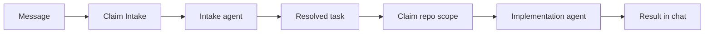

# Message-first tasks and Intake

## TL;DR

- **Goal:** Create tasks with one required Markdown Message and support work across repositories.
- **Key decision:** Intake resolves intent before any code writer starts; repository locks follow the resolved scope.
- **Impact:** Task/chat contracts, REST/MCP, engine admission, adapter permissions, and task forms.

**Status:** Implementation proposal, 2026-10-25. This change writes planning documents only. Provider support and runtime behavior are not verified by this proposal.

**Completion follow-up (2026-10-26):** The [Intake runtime completion plan](../2026-10-26-intake-runtime-completion/00-overview.md) covers the reported startup/pool failures, explicit run contracts, recovery, provider permissions, multi-repo enforcement, and release evidence. The user accepts major implementation changes. Its tracker starts planned; earlier implementation reports do not close the remaining gates.

**Confirmed by the user:** One harness may edit multiple repos. Submitted repos are hints. History comes only from the task's conversation. Delegation ends the parent; optional verification is a new task in that same conversation.

## Contract changes

- **Create task:** `message` is the only required business field. `title`, `repoIds` hints, `priority`, and `parentId` are optional. REST and MCP accept the same business input.
- **Message:** Stored once as the task's initial user message. An authorized follow-up may reuse a conversation; its Message is a new entry there. Remove Description / Context from create/edit forms, new task contracts, and execution instructions.
- **Resolved task:** Adds repository scope, selected execution provider, Intake revision and outcome. Before resolution, title and priority have display defaults; unresolved repository/provider values remain absent.
- **Compatibility:** A supplied `repoId` can be accepted as a single-repo shorthand for `repoIds`. A bounded legacy input adapter maps old `description` requests to Message; see [contracts and lifecycle](01-contracts-and-lifecycle.md).

## Scope

### In scope

| Item | Readiness | Outcome |
|---|---|---|
| Message-only creation through UI, REST and MCP | **Ready** | No title or repository is required to submit. |
| Intake between admission and implementation | **Ready** | Global default headless provider returns validated JSON from Message and scoped history. |
| Generated title, priority, repo scope and execution provider | **Ready** | Engine resolves metadata; backend validates and persists it. |
| Cross-repo execution and child tasks through MCP | **Ready** | One harness may cover several repos; all writers remain fenced and exclusive. |
| Repository hints and conversation-only history | **Ready** | Intake may select other authorized repos; no history from other conversations is loaded. |
| Terminal delegation and a new verification task | **Ready** | Parent becomes `done` after verified handoff; verification reuses its conversation with a new task/run lifecycle. |
| Explicit title and priority | **Assumption — review** | Keep supplied title/priority fixed. Repository input is a hint, not a constraint. |
| Routing and input defaults | **Assumption — review** | Codex for planning, Claude for logic, Agy for UI; 120-second Intake deadline; 32 KiB Message limit. These are policy defaults. |
| Provider permission and multi-repo support | **Blocker — live enablement** | Probe each enabled CLI for scoped tools, JSON output, MCP and permitted write roots. Unsupported routes remain disabled. |

Please consider the two proposed defaults above during review. They do not prevent contract and deterministic integration work.

### Out of scope

- Automatic registration/cloning, arbitrary filesystem paths, worktree creation, commits or pushes.
- New task statuses, routes, tabs, provider models, dependency DAGs, or an agent workflow editor.
- Application implementation, unit tests, screenshots, package publication, or live provider runs in this planning change.

## Review decisions

| Decision | Reason / consequence |
|---|---|
| Separate Intake admission from writer admission | Repository is unknown at initial claim. Intake must not reserve a guessed repo or block its writers. |
| Two attempts on one task: Intake, then implementation | Verified Intake completion returns the task to `todo`, ready for repo admission. Busy scopes consume no worker slot. Adds a safe queue boundary, not another user task. |
| Acquire the whole write scope atomically | A harness editing multiple repos must own every canonical path before it starts. No partial locks or lock upgrades during execution. |
| Intake uses the global default provider | It runs before repository/provider resolution. Implementation uses its validated provider choice. |
| Stage Intake-created children until gate acceptance | Invalid JSON, a cancelled Intake or a lost response must not start partial delegated work. |
| Complete parent when delegation is committed | `done` means handoff succeeded. Child failure does not reopen the parent; optional verification has its own task ID. |

## Behavior

- **Message:** Required, nonblank Markdown. Creation atomically stores task, conversation and initial message. The task is immediately visible with a short display title and provisional P2 unless the user provided values.
- **Intake:** Uses Message, bounded history from the same conversation, authorized repository metadata and routing instruction. It has no repository write or unrestricted shell tools. Missing scope or intent becomes HITL.
- **Resolution:** Validates title, P0–P3, registered repo IDs and a capable provider. Repo hints may be changed or expanded within existing authorization, with a short reason in chat.
- **Delegation:** MCP sets child `parentId` to the current task ID. After verified stop, activate children and finish the parent as `done`. No parent wait, requeue or resume follows child completion. Optional verification is a separate queued task in the parent's conversation.
- **Implementation:** Starts only after Intake has stopped and every scope lock is held. Pass Message/history, resolved goal, all repo paths and the selected agent's instructions to the headless harness.
- **Recovery:** Persist decisions before dispatch; reuse accepted Intake after restart. No duplicate child, duplicate writer, or automatic retry after an unverified stop.

## Impact and existing contract changes

This extends T-01, C-01 and E-01–E-03: optional repo/title, multi-repo scope, per-task provider, shared conversations and terminal delegation. It supersedes repository-bound provider, same-repo managed-child and waiting-parent rules **for this feature**. Record these changes in governing docs during implementation.

Document a narrow constitution exception for non-writing Intake in an app-owned scratch directory. Implementation still uses registered repos. Service ownership, eight-slot cap, six public statuses and verified-stop rules remain binding.

Read [contracts and lifecycle](01-contracts-and-lifecycle.md), [delivery and acceptance](02-delivery-and-acceptance.md), [routing instruction](03-agent-routing.md), and [delegation and follow-up](04-delegation-and-follow-up.md).
