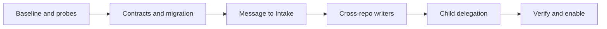

# Intake delivery plan and acceptance

## TL;DR

- **Goal:** Deliver Message-only creation through safe Intake and cross-repo implementation.
- **Key decision:** Prove lifecycle and provider limits before enabling automatic execution.
- **Impact:** Coordinated contracts and migration, followed by small vertical delivery slices.

## Scope

### In scope

| Work | Readiness | Basis |
|---|---|---|
| MI-01–MI-07 below | **Ready** | Contracts and observable acceptance defined in this proposal; provider integration remains conditional on MI-01 evidence. |
| Live release for each provider/OS | **Blocker — live enablement** | Requires recorded permission, structured output, multi-root and stop evidence. |

### Out of scope

- Unit tests, screenshots, unrelated refactors, another queue service, cloud setup, production task creation or package publication during planning.

## Delivery slices

Every slice uses contract, integration or process checks in disposable registered repos/data. Existing suites can be extended; do not write unit tests. Work from the current checkout, preserving uncommitted user changes. This plan adds a feature after the relevant LC/refactor changes; it does not restart or mark those tasks complete.

| ID | Outcome | Owners | Depends on | Acceptance / exit |
|---|---|---|---|---|
| MI-01 | Record baseline, lifecycle repairs and provider proof | Engine, adapter, backend | None | Prove deadlines reach adapter, stop proof waits for process-tree verification, failed reconciliation disables admission, and uncertain attempts retain capacity. Record each installed provider's Intake and multi-root limits without assuming flags. |
| MI-02 | Contract and migration foundation | Contracts, backend | MI-01 | Message-only creation is atomic; allow authorized conversation reuse and persist message origins/prerequisites. Distinguish repo hints from permissions. Preserve legacy data/lifecycles and version fences. Synchronize governing docs. |
| MI-03 | Message-only UI, REST and MCP | Frontend, backend/MCP | MI-02 | One required Markdown Message, collapsed optional fields; no auto-selected repo/P2 override. Handle hints, shared conversation history and exact task/request attribution. Update delegating skill/script and examples. |
| MI-04 | End-to-end Intake gate | Engine, adapter, backend | MI-02, MI-03 | Default provider + routing file produce a validated persisted result; process stops; same task queues for implementation. Support input questions, invalid JSON, stale inputs, cancellation and restart without duplicate Intake. |
| MI-05 | Safe implementation across repos | Backend, engine, adapter | MI-04 | Acquire all locks and one slot atomically, dispatch chosen provider with exact allowed roots, release/quarantine all owned locks correctly. Waiting scopes do not hold slots. Single-repo path still works. |
| MI-06 | Terminal delegation and new verification task | MCP, engine, backend | MI-05 | Atomic parent `done` and staged-child activation after verified stop. New verification task shares the parent's conversation, waits for its prerequisites, then gets a fresh Intake/run. No parent wait/resume; enforce depth/count and dedup. |
| MI-07 | Upgrade, package and enablement evidence | All owners, supervisor/distribution | MI-06 | Relevant deterministic suites pass; bundled routing file matches source; supported real-provider/OS paths pass, unsupported paths stay disabled and documented. |

MI-01 records capability failures as well as passes. Failed provider probes block that route's live enablement, not contract, migration or deterministic work. MI-03 must not expose a Message-only submission to the old repo-required dispatcher. Keep activation gated until MI-04/MI-05 are safe; unfinished migration/runtime combinations reject incompatible clients or stay disabled. Each slice records its own evidence, supported configurations and rollback limits.

## Acceptance matrix

| ID | Scenario | Required evidence |
|---|---|---|
| A01 | UI, REST and external MCP submit only Message | Task has one own initial user message; optional conversation reuse appends it once to an authorized conversation. Title/repo/priority/parent are not required. |
| A02 | Blank, oversized or malicious Markdown | Proposed Message/chat limits apply consistently; raw HTML is not executed; failed creation leaves no orphan conversation/task. |
| A03 | Optional title, P0, repo hints and parent supplied | Keep title/priority overrides. Intake may replace/expand hints within authorization; unauthorized repos/parents and cycles fail. P2 default is not an override. |
| A04 | Default provider differs from selected provider | Intake uses global default; implementation uses validated choice. Missing/disabled provider fails clearly without silent fallback. |
| A05 | Valid and invalid JSON; normal stream envelopes | Only one schema-valid final payload is accepted; prose/fenced JSON/mixed outcomes/unknown repos cannot start a writer. |
| A06 | Input before admission and during execution | Only same-conversation history is loaded; own initial Message remains present. Targeted new input invalidates its resolution; sibling output does not. No live injection. |
| A07 | Intake has tool access attempts outside scope | Repository files stay unchanged; shell/ambient MCP denied; scoped create/request_input work. Record actual provider restrictions. |
| A08 | Missing/ambiguous repo, no registered repos or unclear intent | Submission succeeds; plain HITL question, no guessed repo/writer. Stopped Intake releases its slot; one matching reply queues one fresh Intake. |
| A09 | Two cross-repo tasks overlap on one canonical path | Measured writer intervals never overlap; no partial held set, alias bypass or deadlock. Unrelated eligible repos progress. |
| A10 | Eight running/uncertain attempts and a ninth task | Shared count never exceeds cap across engines/connections; Intake and implementation both consume slots, scope-waiting tasks do not. |
| A11 | Concurrent bulk admission and direct claim | One task owner, complete fenced lock set and one durable receipt; precondition checks cannot race outside transaction. |
| A12 | Lost create/result/child/start ACK; engine or backend restart | Identical retry returns same object/result/child; accepted Intake survives; no duplicate harness. Unkeyed external create limitations are explicit. |
| A13 | Default Intake timeout, 60-minute writer timeout, cancellation or surviving descendant | Deadlines survive restart/HITL; no signal-only stop proof; uncertain work retains its slot and all affected repo locks. |
| A14 | Restricted external token; scope revocation between stages | Catalog/context and all affected repos are authorized; no full-conversation leak via one matching repo. No stale permission dispatch. |
| A15 | Intake creates children then fails or crashes | Children remain staged; retry deduplicates; cancel/supersede cannot activate old children. Depth one and five-child limit hold. |
| A16 | Parent delegates to API/UI tasks, with optional verification | Parent becomes `done`, releases slot/locks and stays terminal even if children fail. Verification is a new task in the same conversation, eligible only after every prerequisite is terminal. |
| A17 | Upgrade old tasks with/without Description, active runs and existing chat | Exactly one migrated initial Message per task; no lost chat/FK/receipt/lock generation; active/terminal tasks are not rerouted. |
| A18 | Browser reconnect/task switch with a shared conversation | REST/SSE converge on common history and each task's own state. Origin IDs stay correct; two simultaneous HITL replies cannot resume the wrong task. No new route/tab. |
| A19 | Installed Codex, Claude and Agy | Record start/structured-result/MCP/tool-scope/multi-root/cancel evidence separately for every enabled route. Fake checks do not prove live support. |
| A20 | Packaged install and OS matrix | Routing instruction loads from stable installed payload; macOS evidence first; Linux/Windows remain unverified until separately exercised. |
| A21 | Lost delegation commit ACK or last-child completion event | Parent finalization, child activation and verification eligibility are durable/idempotent; restart admits verification exactly once. |
| A22 | Conversation reuse by a restricted token | Foreign conversation IDs cannot disclose history or widen grants. Delegation/child summaries expose only authorized facts already recorded in that conversation. |
| A23 | Verification with failed/cancelled prerequisite or no verification requested | Terminal failures are available for diagnosis; no parent resurrection. No verification task is created unless explicitly requested by the user or agent's structured delegation. |

## Required checks and evidence

Run typecheck, lint, format checks, build and the affected existing contract, DB, API, run, event, MCP, adapter safety, engine, startup, pool, UI/workflow and distribution checks. Use the smallest meaningful subset per slice and the full applicable deterministic gate at final integration. Browser verification uses interactions, not screenshots.

For provider probes, follow the installed `z-agent-non-interactive` skill, pinned local help and disposable repositories. Do not change user model/auth configuration. Record versions, actual permissions, result envelopes, filesystem writes, writer start/stop intervals and capability failures. Do not infer support from binary availability or a successful `--help`.

This planning change runs no application test suite or provider process. All rows above are required future evidence, not reported passes.

## Rollout and recovery

1. Stop old processes, capture baseline/backup, migrate, and deploy compatible services/contracts/UI together.
2. Enable Message + Intake only for capability-proven default providers; enable multi-root execution per supported provider/OS. Keep unsupported attempts visible with a clear reason.
3. Validate single-repo, cross-repo, terminal delegation and same-conversation verification smoke cases before broader use. Compare dispatch delay, Intake duration and pool occupancy with baseline; no performance target is invented here.
4. On a safety failure, stop admission, preserve run/lock evidence and reconcile processes. Use the documented stopped-instance backup restore for binary rollback; never run old services against incompatible state.
