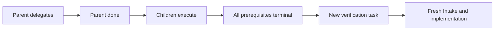

# Terminal delegation and same-conversation verification

## TL;DR

- **Goal:** Finish a parent when it hands off work; verify later through a new task.
- **Key decision:** Task lifecycle and conversation lifecycle are independent. A conversation can contain several task lifecycles.
- **Impact:** Delegation finalization, scoped task creation, chat attribution, HITL and scheduler eligibility.

**Confirmed:** One harness may edit multiple repos. Repo input is a hint; history is limited to the current conversation. Delegation ends the parent. Verification, when needed, is a new task in the same conversation.

The verification task is created with the handoff, but becomes eligible only at the prerequisite boundary. The parent remains `done` throughout.

## Scope

### In scope

| Item | Readiness | Outcome |
|---|---|---|
| Parent ends after delegation | **Ready** | Verified handoff sets `done`; no `Pending`, waiting-parent, requeue or automatic resume. |
| Verification in the same conversation | **Ready** | Distinct task ID, Message, priority, provider resolution, attempts and result. |
| Conversation-only history | **Ready** | Intake reads the current conversation, not related conversations. |
| Exact chat/HITL attribution | **Ready** | Shared history does not merge task ownership, runs or pending questions. |
| Verification admission | **Assumption — review** | Wait for all listed work tasks to be terminal, including failure/cancel, so verification cannot run early and may diagnose failures. |
| Child conversation defaults and limits | **Assumption — review** | Ordinary children keep separate conversations unless explicitly authorized to reuse one. Verification shares the parent's conversation and counts toward the existing five-child limit. |

### Out of scope

- Parent resurrection, a new public status, automatic replacement loops, arbitrary dependency graphs, new pages or a conversation-management UI.

## Handoff is terminal for the parent

On an accepted `delegate` outcome, backend atomically completes the parent's run/task as `done`, releases its reservations and locks, activates its staged work children, and records any verification task and its prerequisite set. Require verified process-tree stop first. Duplicate commits return the original handoff; a crash cannot activate work without completing that same handoff.

Parent `done` means **delegation completed**, not that the delegated implementation succeeded. Record that distinction in a short conversation message. Later child failure/cancel never changes the parent or queues it again. New tasks follow this lifecycle; pre-existing waiting parents keep their legacy recovery policy until resolved safely.

For implementation agents using the existing `yield_task` signal, new-feature tasks interpret it as a delegation-completion intent, finalized only after verified stop. It must not enter the old waiting-parent path. Legacy tasks retain the old versioned semantics. Creating a child alone does not authorize early parent completion; the structured delegation outcome/signal closes the handoff.

## Verification is an ordinary new task with a bounded prerequisite

When needed, the agent uses MCP to create a verification task with a self-contained Message, `parentId` equal to the delegating task, the same `conversationId`, and `waitForTaskIds` containing the work children to check. Other optional metadata follows normal Intake rules. The result includes a distinct `verificationTaskId`; it cannot also appear as a work child or prerequisite.

Keep the total at five children including verification, and depth one. Verification references only work children from the same delegation, not itself, unrelated tasks or another verification task. This is one bounded follow-up rule; do not add a general dependency editor or graph scheduler.

Before prerequisites finish, verification stays `todo` with a visible prerequisite reason. It holds no slot, run or repository lock. After all prerequisites reach `done`, `error` or `cancelled`, it becomes normally eligible under priority/FIFO and runs fresh Intake followed by implementation. The completed parent is not involved. Child failures are available for diagnosis; verification does not assume success. No verification is created unless the user or agent explicitly requests it in the structured handoff.

Eligibility and dependency reconciliation are durable and idempotent. A restarted engine discovers the same verification task; it never synthesizes a duplicate. Cancelling verification while queued cancels only that task. It does not cancel siblings or reopen the parent.

## Shared conversation does not mean shared task state

New task creation accepts optional authorized `conversationId`. Without it, create a conversation as before. With it, append exactly one Message for the new task and preserve the existing history. Each task keeps its own initial-message reference; do not reuse the parent's Message as the verification request.

Persist message origin task/run identity. Task-scoped posting targets that task; conversation-scoped posting needs an explicit target for task-directed instructions and HITL. Conversation-only general messages do not silently select a task. A HITL reply must match conversation, target task and pending request; reject ambiguous/stale targets rather than selecting the first task linked to the conversation. UI supplies these identifiers without adding a user input field.

Intake reads bounded history from its current conversation only. Ordinary children may keep separate conversations. Their terminal status/reason can be recorded as a short authorized completion receipt in the delegating conversation, attributed to the source task and deduplicated by terminal event identity. That receipt and the bounded prerequisite statuses let verification see outcomes without fetching another conversation's chat. Do not import full child histories. Write these receipts before admitting verification.

Task rows keep separate statuses. Selecting the parent or verification task may show the same history with task links on messages; the header/composer still targets the selected task. REST/SSE and caches use conversation identity for messages and task/run identity for state, deltas and replies.

Reuse requires access to the whole conversation, checked against its associated task scopes and current grants. A known `conversationId`, parent link or terminal parent does not widen an MCP token. A task-scoped token may read shared history only when its authorization covers that conversation. Unauthorized reuse and disclosure fail closed.

## Impact and compatibility

Current chat lookup, message projection and HITL pairing assume one task per conversation. Replace that assumption before enabling reuse; backfill legacy message origins from their run/task or single-task conversation. Preserve message order, cursors and receipt identities.

The old waiting-parent E-02 rule and C-01 one-conversation-per-task assumption are superseded for this feature. Document the new completion meaning, optional conversation reuse, task/request routing and bounded follow-up eligibility in the shared contracts and governing docs. This planning change does not alter runtime code.
