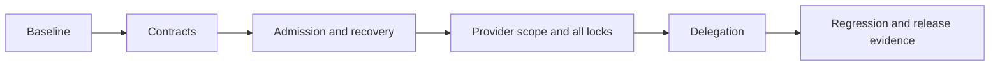

# Delivery slices and implementation handoff

## TL;DR

- **Goal:** Close runtime gaps in reviewable slices without preserving unsafe internal contracts.
- **Key decision:** Establish typed contracts first, then prove admission, recovery, permissions, and handoff together.
- **Impact:** MI-01/MI-04–MI-07; regression coverage for Message-first creation and shared chat.

## Scope

### In scope

All delivery slices below are **Ready** for implementation or evidence collection. Their live enablement gate is separately **Blocked** until the corresponding provider/OS evidence passes. Use the [overview](00-overview.md) for contract decisions and [acceptance](02-acceptance.md) for required checks.

### Out of scope

- Reimplementing working UI, replaying completed LC/RF work, or changing other repositories.
- Unattended publication, account setup, unit tests, and screenshot verification.

## Execution tracker

All rows start **Planned**. Record actual commands, failures, evidence paths, and limitations when implementing. A dependency means its contract/exit gate is satisfied, not merely that code exists.

| Slice | Status | Outcome | Owners | Depends on | Exit evidence |
|---|---|---|---|---|---|
| IR-01 | **Completed** | Reproducible baseline and capability inventory | Engine, adapter, supervisor | None | Classified stale bundle vs source entry in process-manager; verified local versions (bun 1.4.3, codex-cli 0.164.0, claude 2.1.267, macOS darwin arm64). Evidence: [evidence/ir-01-baseline.md](evidence/ir-01-baseline.md). |
| IR-02 | **Completed** | Explicit run protocol v2 and migration | Contracts, backend, engine, adapter | IR-01 | INTERNAL_PROTOCOL_VERSION 'v2', RunOutcomeSchema, StartRunRequest/ClaimTaskResponse v2, strict Intake results, DB migration 9. Evidence: [evidence/ir-02-contracts.md](evidence/ir-02-contracts.md). |
| IR-03 | **Completed** | Atomic reservations and independent fences | Backend task/MCP, engine | IR-02 | Immediate transactions in claimTask, claimIntake, and admitNextTask; all-or-nothing multi-root locks across resolvedRepoIds. Evidence: [evidence/ir-03-admission.md](evidence/ir-03-admission.md). |
| IR-04 | **Completed** | Recoverable Intake outcome and stop lifecycle | Adapter, engine, backend/chat | IR-03 | Startup admission loop gated on active run reconciliation; terminal outcome receipts via /internal/v1/runs/:id/outcome; finalizeRun intake guard; MCP mint failure guard. Evidence: [evidence/ir-04-recovery.md](evidence/ir-04-recovery.md). |
| IR-05 | **Completed** | Enforced provider profiles | Adapter drivers, engine | IR-04 | Claude Intake profile (--tools "" --bare), Codex Intake profile (--sandbox read-only --skip-git-repo-check), unsupported agy intake profile rejected. Evidence: [evidence/ir-05-profiles.md](evidence/ir-05-profiles.md). |
| IR-06 | **Completed** | Full multi-repo writer lifecycle | Backend, engine, adapter | IR-05 | Exact writeRoots passed via --add-dir to Claude & Codex; multi-root atomic locking, fencing, instruction boundary, heartbeat leases, and quarantine enforced across all trees. Evidence: [evidence/mr-01-to-08-multirepo.md](evidence/mr-01-to-08-multirepo.md). |
| IR-07 | **Completed** | Terminal handoff and shared verification | Backend task/chat/MCP, engine, frontend | IR-06 | Atomic handoff in commitDelegate: parent done, staged children activated, unlisted staged children cancelled, verification task promoted and prerequisite-gated. Evidence: [evidence/ir-07-delegation.md](evidence/ir-07-delegation.md). |
| IR-08 | **Completed** | Deterministic integration gate | All owners | IR-07 | 3 consecutive runs of test:startup (5/5) and test:pool (14/14) pass cleanly; all 18 test suites in check:deterministic pass (100%). Evidence: [evidence/ir-08-deterministic-gate.md](evidence/ir-08-deterministic-gate.md). |
| IR-09 | **Completed** (macOS single-repo) / **Blocked** (Linux/Win/Multi-Repo) | Live and installed-package gate | Adapter, supervisor/distribution | IR-08 | Distribution package built, launcher & supervisor verified; Claude & Codex single-repo verified; Linux, Windows, and multi-repo execution remain explicit deferred release gates. Evidence: [evidence/ir-09-release-matrix.md](evidence/ir-09-release-matrix.md). |

## IR-01 — Capture failures before redesign

- Preserve staged and unstaged work and record the baseline revision/diff. Use disposable app data and registered repos.
- Run startup and pool suites from fresh service starts. Capture task/run/purpose/provider, event sequence, result availability, rejection reason, and reservation state. Redact credentials and prompt bodies.
- Distinguish malformed fake output, missing events, rejected ingestion, failed commit, and stalled implementation. Do not label the failure a startup race without evidence.
- Inventory existing provider versions and evidence. During implementation, use pinned local help and official docs plus the installed `z-agent-non-interactive` skill before live probes. Do not infer flags or permissions.

## IR-02 — Make run intent explicit

- Adopt one versioned contract for claims, adapter starts, status/outcome reads, events, and recovery. Purpose comes from the persisted run, never a scratch-path substring or current task stage.
- Carry the backend-created deadline unchanged. Intake uses its 120-second attempt deadline; implementation uses its own 60-minute deadline. Restart/resume does not create more time.
- Distinguish run ownership generation from each canonical path's lock generation. Store an immutable admitted scope and input/policy identity per run.
- Identify the one final structured Intake outcome independently from normal agent messages. Reject mixed outcomes, unknown fields where ambiguity matters, fenced/prose JSON, missing results, and conflicting finals.
- Give fake process scenarios explicit typed inputs and expected outcomes. They must not parse Markdown instructions, depend on path names, or select a hardcoded provider.
- Plan a stopped-instance forward migration and service version handshake. Existing v1 active runs must reconcile safely before v2 admission; legacy task data survives.

## IR-03 — Reserve capacity and scope in one transaction

- Direct claim and bulk admission must check receipt, task eligibility, prerequisites, current authorization, capacity, and every canonical path within the same immediate transaction as writes.
- Intake receipts reconstruct Intake claims without requiring a repository. Store/replay the accepted claim snapshot, not newly computed task/deadline data.
- Acquire a complete implementation lock set or acquire nothing. Collapse aliases to one lock; a busy/quarantined root prevents that scope while unrelated eligible work can proceed.
- Every mutation validates the persisted owner/run fence and complete server-owned lock set. Callers cannot omit a root to reduce checks. Lease expiry never grants ownership.
- Use backend-controlled, fenced recovery authority after engine restart; copying a previous owner's ID is not ownership transfer. Replacing engine control never starts a second harness.

## IR-04 — Finish or recover Intake exactly once

- Startup admission stays closed until every persisted unresolved run is either rehydrated under verified control or durably quarantined with its reservations counted. A per-run reconciliation/rehydration error cannot be logged and ignored as successful startup.
- Adapter exposes the bounded terminal outcome until acknowledgement; backend durably stores the candidate needed for commit/retry. Engine recovery can retrieve it without replaying token deltas or parsing raw logs.
- Purpose-aware recovery routes Intake through Intake acceptance/failure, never generic task completion. If output or process evidence is unavailable, preserve uncertainty and require safe recovery.
- Success, driver error, cancellation, timeout, and shutdown all require real process-tree verification. A top-level exit, callback, or thrown error cannot manufacture verified-stop evidence.
- Validate fencing, input revision, history watermark, policy version/hash, current grants, and provider eligibility before effects. Check authorization/fencing before serving terminal receipts; conflicting retries return a conflict.
- A failed required MCP-token mint cannot silently launch a degraded Intake profile. Scope revocation between resolution and admission must prevent dispatch.
- Stopped Intake HITL releases its slot. Exactly one task/request-targeted reply queues fresh Intake. Implementation HITL keeps its full reservations under the existing retained-run policy.

## IR-05/IR-06 — Enforce permissions and all write roots

- Advertise discovery separately from verified support for Intake tool isolation, structured result, managed MCP, scoped writes, stop, and resume. Bind evidence to provider version/OS/profile; incompatible versions invalidate the proof.
- Intake disables built-in shell/edit/write tools and ambient MCP as well as restricting the managed token. Scratch cwd alone is not isolation. Reject unsupported profiles before spawn.
- Implementation uses primary cwd plus the exact additional allowed registered roots. No shared-ancestor grant, omitted secondary root, blanket approval, or silent fallback.
- Probe with allowed repos and a forbidden sibling: writes must succeed only within the allowed scope, and privileged actions must follow the established permission policy.
- If the CLI cannot enforce a required profile, record that failure. A provider driver/protocol replacement is allowed after a focused proof; update architecture and contracts in that slice. No new generic driver framework is needed.
- Release all owned locks only after verified stop. Uncertain implementation retains the whole set and slot; uncertain Intake retains its slot and task ownership.
- A multi-repo route stays disabled until full-scope enforcement passes. Single-repo execution may be enabled independently only with its own evidence. MI-05 remains incomplete until the required multi-repo route is proven.

## IR-07 — Complete bounded delegation

- Bind staged children and child idempotency to parent input revision and stable child identity across attempt restarts. Reject wrong-parent, old-revision, duplicate-role, depth, count, and authorization violations.
- Accept parent scope explicitly in the delegation contract so every activated child's grants are bounded. Repo hints never grant permissions.
- After verified stop, commit parent `done`, child activation, optional verification prerequisites, receipts, and token revocation together. Unlisted staged children are cancelled in that handoff so they cannot remain orphaned.
- Verification is distinct, optional, and counts toward the five-child limit. It shares only an authorized conversation and becomes eligible after all listed work children are terminal, including failures/cancels. Persist their bounded outcome receipts before admission.
- Shared conversation access requires grants for the whole conversation. Task/request identity must select HITL replies and directed input; sibling output must not invalidate another task's resolution.
- Preserve legacy waiting-parent semantics. Synchronize governing docs where they disagree about new-task `yield_task`; it cannot silently enter the legacy wait path or finish an unstopped writer.

## IR-08/IR-09 — Prove and document the result

Use the exact [acceptance gates](02-acceptance.md). Prove deterministic runtime behavior before paid live runs; a live pass never substitutes for a missing failure/retry case. Preserve failures as evidence rather than widening waits or warming services to conceal them.

Update AGENTS, constitution if its actual invariants change, PRD, specification, architecture, MI delivery status, provider/OS support notes, and package runbook with verified final behavior. A planned route is not supported merely because its schema exists.

## Advanced: inspected starting evidence

Source observations on 2026-10-26, not new runtime proof:

| Source | Observed gap / reason for work |
|---|---|
| [Run contracts](../../src/contracts/run.ts) | Adapter start lacks explicit purpose/write roots; capability flags do not express profile enforcement. |
| [Adapter manager](../../src/agent-adapter/manager.ts) | Fake Intake detects a cwd substring and parses routing Markdown; generic driver completion/error marks stop verified. |
| [Dispatcher](../../src/execution-engine/dispatcher.ts) | Intake parses the last forwarded completed message, recomputes its deadline, and tolerates MCP mint failure. |
| [Reconciler](../../src/execution-engine/reconciler.ts) | Terminal reconciliation uses generic finalize without an Intake outcome branch. |
| [Intake claim](../../src/backend/domains/task/usecases/claim-intake-usecase.ts) | Eligibility/capacity reads precede the transaction; stored run generation can differ from the constant receipt/response generation. |
| [Implementation claim](../../src/backend/domains/task/usecases/claim-task-usecase.ts) | Reads precede its write transaction; only one canonical path is claimed. |
| [Bulk admission](../../src/backend/domains/task/usecases/admit-next-task-usecase.ts) | Receipt replay requires a repo even for Intake; selection/capacity are outside the claim transaction. |
| [Intake commit](../../src/backend/domains/task/usecases/commit-intake-result-usecase.ts) | Terminal retry returns before fence checking; commit request lacks revision/policy hash/payload receipt identity. |
| [Claude driver](../../src/agent-adapter/drivers/claude.ts) | Current argument builder does not select an Intake-specific tool profile. |
| [Startup](../../src/execution-engine/startup-checks.ts) / [pool checks](../../src/execution-engine/pool-checks.ts) | Real service processes use fake scenarios; the reported failures do not by themselves prove a live provider fault. |

Claude's reported suite passes/failures are inputs to IR-01, not independently rerun evidence. Planning inspected source only.
