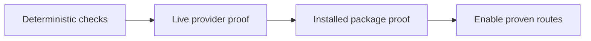

# Acceptance and release evidence

## TL;DR

- **Goal:** Prove one safe attempt and the complete allowed repo scope through startup, failure, and upgrade.
- **Key decision:** Keep deterministic, live-provider, and installed-package evidence separate.
- **Impact:** Release readiness, capability enablement, and the MI implementation tracker.

## Scope

### In scope

| Item | Readiness | Outcome |
|---|---|---|
| Contract/integration/process checks | **Ready** | Disposable data/repos; explicit failure, retry, and contention evidence. |
| Live probes and package checks | **Ready** | Versioned commands/results with secrets removed. |
| Route enablement | **Blocker** | All applicable provider/OS/profile gates must pass first. |

### Out of scope

- Unit tests, screenshots, production task creation, external publishing, and fabricated cross-OS evidence.

## Gate 1 — Deterministic behavior

| ID | Scenario | Required result |
|---|---|---|
| IC-01 | Fresh startup and first dispatch | Startup A1/A3 and pool P1/P3/P11 pass; first task completes Intake then implementation without manual dispatch or warm-up. |
| IC-02 | Two claimers / direct plus bulk / duplicate request | Exactly one run per task; same key/payload returns the original claim, changed payload conflicts; Intake replay requires no repo. |
| IC-03 | Cap and unresolved processes | Eight running/retained/uncertain attempts prevent a ninth; config below eight is respected across connections/engines. |
| IC-04 | Overlapping scopes, aliases, busy roots | A task needing repos A+B cannot overlap another B writer; no partial locks, ancestor grant, or alias bypass. Independent C progresses. |
| IC-05 | Structured final output | Valid final accepted once; prose, Markdown fences, mixed/unknown outcomes, conflicting finals, bad repo/provider, and missing result never start a writer. |
| IC-06 | Lost event/start/result ACK or SSE disconnect | Retry keeps run/result identity; no double spawn, double message, double activation, or parsing of transient logs. |
| IC-07 | Engine restart before/after final output or commit | Recovery respects run purpose and durable outcome; Intake cannot become task `done` through generic finalize. |
| IC-08 | Backend/adapter restart and unavailable process evidence | No guessed stop or duplicate successor; uncertain reservation remains. A committed result is discoverable after backend restart. |
| IC-09 | Deadline, natural exit, crash, cancel, shutdown | Persisted deadlines reach adapter unchanged; surviving descendants prevent release; error callbacks alone are not stop proof. |
| IC-10 | Stale owner/input/policy/grant or changed retry | Reject before effects or receipt disclosure; terminal retry still checks authority and payload identity. |
| IC-11 | Intake versus implementation HITL | Intake releases its stopped slot; one matching task/request reply creates one fresh attempt. Implementation retains its full lock set; no privileged tool auto-approval through chat. |
| IC-12 | Staged children and terminal delegation | Bad/old result cannot activate children; handoff is atomic/idempotent; omitted staged children are cancelled; parent never resumes after child failure. |
| IC-13 | Verification and shared conversation | Waits for every prerequisite to be terminal; no slot while waiting; outcome receipts exist first; no cross-conversation history or ambiguous HITL reply. |
| IC-14 | Restricted token and scope revocation | Full-conversation authorization checked; parent/child links do not widen grants; revoked roots block execution. |
| IC-15 | Legacy migration and protocol mismatch | Existing messages/runs/receipts/locks remain; no duplicate initial Message; old waiting parents keep semantics; incompatible services cannot admit. |

Run `bun run test:startup` and `bun run test:pool` from fresh temporary data/services **three consecutive times** after the final runtime change. Failure output must preserve diagnostic identities and reservation state. Every implementation interval assertion must distinguish Intake runs from writer runs.

Then run typecheck, lint, format check, full service/UI build, and applicable existing contracts, DB, API, runs, events, MCP, projection, services, supervisor, harness, adapter, engine, UI/workflow, and distribution suites. Keep deterministic checks independent of real CLI availability; separate any live cases currently embedded in a broadly named suite. Browser verification uses interactions only. No unrelated cleanup to make the baseline green: record inherited failures with evidence and their impact.

## Gate 2 — Real provider permission and lifecycle proof

Use disposable registered repos and the installed harness skill during implementation. Record exact provider version, OS, execution profile, command arguments with secrets removed, result envelopes, MCP access, filesystem changes, process intervals, and stop evidence. Check versioned official docs/local help before choosing flags. Do not change user auth/model settings.

For **Codex and Claude separately**, prove:

1. Message-only single-repo flow: default Intake provider can differ from the validated implementation provider; explicit title/priority remain fixed.
2. All three Intake outcomes: implement, request input/reply/fresh Intake, and bounded delegate with optional verification.
3. Intake denies shell/edit/write attempts and ambient MCP while allowing only managed `create_task`/`get_task`. `request_input` is a final result, not an Intake MCP tool. Registered repos and forbidden sibling remain unchanged.
4. One harness writes allowed A+B while attempts to write forbidden sibling C fail. The complete canonical lock set remains held throughout the writer interval.
5. Cancel, timeout, normal/error exit with descendants, reconnect, and engine restart preserve deadlines and verify process-tree stop before release.

Audit existing Agy routes with the same capability gate if exposed. Unsupported Agy routes stay disabled; adding or promising a new Agy integration is outside this work. Resume is reported independently from fresh-task support.

A provider/OS failure blocks that route, not deterministic implementation of unrelated work. A single-repo macOS proof does not establish multi-repo or Linux/Windows support. Full MI completion still requires the mandatory Codex/Claude routes; a disabled required route is an explicit remaining blocker.

## Gate 3 — Installed payload and upgrade

- Build/package locally, install into disposable app data, start through the public CLI, and submit through public REST/MCP. Do not publish.
- Prove bundled routing policy version/hash and run protocol match source; service skew blocks admission before a provider starts.
- Upgrade legacy task/chat data once and twice; check message identities/order, active-run safety, generations, and waiting-parent behavior. Never open the new DB with old service binaries.
- Prove single-repo execution, enforced multi-repo execution, terminal delegation, same-conversation verification, and detached supervisor stop from the installed payload.
- Record backup/restore rollback against a stopped instance. Preserve post-backup work explicitly; do not claim binary-only downgrade safety.
- Capture macOS first. Linux/Windows remain unverified and disabled where required safety is not proven until their own package/process checks run.

## Evidence and completion rules

During implementation save evidence under this plan's `evidence/` directory. Each record includes slice/check IDs, baseline revision, exact command, actual result, artifacts, provider/OS/profile, and limitations. Use `pass`, `fail`, `not run`, or `blocked`; never collapse these into a single green summary.

Update the MI delivery tracker from evidence. MI-05 is not complete with only one primary cwd; MI-07 is not complete with only a Vite build. Final reporting separates application behavior, deterministic results, live proof, packaged proof, and unsupported routes.

**Planning verification:** Source/docs inspected; no application suite, provider probe, migration, or package execution was run for this plan.
