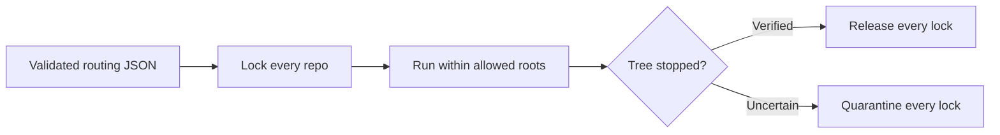

Use **one immutable repository scope per run**. The backend locks that scope, the engine uses it for instructions, and the adapter enforces it for every launch and resume. Release the whole scope only after verified stop.

This completes **MI-05 / IR-06**, with fixes to IR-03/04/05/09 where the current code leaves gaps.



**Scope and current findings**

Your decisions supersede the older docs:

- Support **Darwin arm64 only**. Remove Linux, Windows, and macOS x64 release gates.
- Intake is a normal, tool-free LLM call with structured JSON. Its sandbox and managed-MCP probes are no longer release requirements.
- Keep backend, engine, and adapter ownership unchanged.
- Cross-repo edits are supported; cross-repo Git transactions and automatic rollback are outside scope.

The current implementation has more gaps than the prompt:

| Inspected code | Gap |
|---|---|
| [Claim usecase](/Users/tungle/Desktop/workspace/anthony-lewis/task-aside/src/backend/domains/task/usecases/claim-task-usecase.ts) | Missing resolved repos are filtered out. Scope reads precede the transaction. The run fence is derived from the maximum tree generation. |
| [Admission service](/Users/tungle/Desktop/workspace/anthony-lewis/task-aside/src/backend/domains/task/services/admission-service.ts) | Claim replay can reconstruct only the primary tree’s generation. |
| [Recovery](/Users/tungle/Desktop/workspace/anthony-lewis/task-aside/src/backend/domains/task/recovery.ts) and event ingestion | Heartbeat and events validate one lock. Quarantine clearing can update paths without checking their current owner. |
| [Dispatcher](/Users/tungle/Desktop/workspace/anthony-lewis/task-aside/src/execution-engine/dispatcher.ts) | Initial dispatch carries all roots; HITL resume drops secondary roots. |
| [Adapter manager](/Users/tungle/Desktop/workspace/anthony-lewis/task-aside/src/agent-adapter/manager.ts) and drivers | Close, error, timeout, and cancel paths can record stop proof without a successful tree check. |
| Adapter start and capabilities | I found no explicit Codex/Claude multi-root capability gate in the inspected start path, despite the docs describing execution as disabled. |

**1. Define the admitted scope**

Persist a versioned scope on each implementation run:

| Field | Meaning |
|---|---|
| `primaryRepoId` | Repository used as `cwd`. |
| `repositories` | Exact registered IDs, canonical paths, and per-path lock generations. |
| `runFence` | Independent run ownership counter. Never derived from tree generations. |
| `scopeHash` | Stable identity for the admitted scope. |
| `inputRevision`, `deadlineAt` | Existing values, fixed for the attempt. |

Within one immediate transaction:

1. Read the current task, registration, grants, revision, and claim receipt.
2. Require **every** resolved repository to exist and remain authorized.
3. Require the primary repository to belong to that set.
4. Validate capacity and every path conflict.
5. Acquire every lock, create the run, and persist the claim response—or change nothing.

Keep canonical alias handling. Also treat ancestor/descendant working trees as conflicting; string equality alone cannot protect nested repositories. Reject ambiguous path identity rather than granting a common parent.

Claim retries return the original scope, fences, and deadline. A changed payload using the same identity returns a conflict.

**2. Expose the full context and fix both prompt rules**

Add `resolvedRepositories: Repository[]` to a shared `TaskContext` contract. Retain `repository` as the primary repository for compatibility.

- Intake: `repository: null`, `resolvedRepositories: []`; authorized catalog remains separate.
- Implementation: primary repository plus every admitted repository.
- Claimed execution: obtain context bound to `runId`, using the persisted admitted scope. Never rebuild permission scope from a later task edit.
- Missing or changed registration/grants block execution; do not silently shorten the list.

Replace both the Repository Scope paragraph and “Working Tree Isolation” guideline with:

> Primary working directory: `<repo-alpha path>`.  
> Allowed project roots: `<repo-alpha path>` and `<repo-beta path>`.  
> You may inspect and edit project files within these roots. Use an explicit working directory for commands in each repository. Do not inspect or modify unrelated project directories, follow links outside this scope, or request broader permissions. If another repository is needed, stop and report the missing scope.

Repository instructions and conversation text cannot extend this list. Report results and verification per repository.

The prompt expresses policy; provider permissions enforce writes. Do not claim complete filesystem read isolation from these settings.

**3. Use explicit provider permission profiles**

Local help was checked on **Codex 0.164.0**, **Claude 2.1.267**, **Darwin arm64**. These checks verify available flags, not live enforcement.

| Provider | Verified behavior and selected profile |
|---|---|
| Codex | `exec --add-dir` adds writable roots. Use explicit `workspace-write` and `approval_policy="never"`. Remove the current `--approve-for-me`, which enables automatic approval review. Retain controlled configuration and explicit managed MCP configuration. [CLI reference](https://learn.chatgpt.com/docs/developer-commands?surface=cli), [configuration reference](https://learn.chatgpt.com/docs/config-file/config-reference) |
| Claude | `--add-dir` extends file access; `acceptEdits` accepts edits within working directories. Keep `--permission-prompts none`, so actions requiring permission are denied. Use `--restricted` with an explicit built-in tool list to confine file tools and avoid user/project settings. This flag is supported by the installed version. [CLI reference](https://code.claude.com/docs/en/cli-reference), [permissions](https://code.claude.com/docs/en/permissions) |

Codex launch shape:

```text
codex exec --cd <primary>
  --sandbox workspace-write
  --add-dir <secondary>
  --ignore-user-config --ignore-rules
  -c 'approval_policy="never"'
  --ephemeral --json -
```

Repeat `--add-dir` for each secondary root. Explicitly exclude broad `/tmp` and `$TMPDIR` grants; provide task-local temporary storage within an allowed root. These exclusions are documented settings. [Configuration reference](https://learn.chatgpt.com/docs/config-file/config-reference)

Claude launch shape, with process `cwd` set to the primary:

```text
claude -p --restricted
  --tools Read,Edit,Write,Glob,Grep,Bash
  --add-dir <secondary>
  --permission-mode acceptEdits --permission-prompts none
  --settings <run-profile>
  --strict-mcp-config --mcp-config <managed-config>
  --output-format stream-json --verbose
```

Claude’s shell needs a separate profile:

```json
{
  "sandbox": {
    "enabled": true,
    "failIfUnavailable": true,
    "allowUnsandboxedCommands": false,
    "autoAllowBashIfSandboxed": true,
    "excludedCommands": []
  }
}
```

Claude’s shell sandbox includes additional directories but does not cover file tools, hooks, or MCP. Verify the effective profile and runtime exceptions; reject settings that widen writes or permit unsandboxed execution. Current docs include behavior newer than 2.1.267, so these settings require version-specific runtime proof. [Sandbox documentation](https://code.claude.com/docs/en/sandboxing)

Two implementation details matter:

- Claude’s `--add-dir` is variadic. Place another option after it, or send the instruction through stdin, so the prompt cannot become another directory argument.
- Keep authentication and model selection explicit. Do not introduce `--bare` as a shortcut or change user credentials.

Neither provider may use permission bypass or a shared ancestor grant.

**4. Fence every lifecycle operation**

For heartbeat, events, HITL, cancellation, finalization, and recovery:

- Validate `runId`, owner, and independent `runFence`.
- Load the expected lock set from backend state.
- Require every expected path to retain the recorded owner and generation.
- Perform validation and mutation in the same transaction.
- Never trust a caller-supplied subset of roots.

Heartbeat refreshes all leases. An expired lease never frees a tree. One run consumes one global slot, regardless of repository count; uncertain runs retain that slot.

For launch and resume:

- Require `cwd`, prompt scope, `writeRoots`, and fence-map keys to match the admitted scope.
- Persist a launch identity and start-payload hash.
- Deduplicate starts by run and launch identity; changed payloads conflict.
- Journal launch intent before spawn. An unresolved start after a crash cannot spawn again.
- A new HITL turn requires proof that the prior launch stopped. Reapply every root and the original deadline.
- Stop proof must identify the launch, so an earlier turn’s proof cannot release a resumed writer.

**5. Make stop proof real**

Use one stop path for normal completion, failure, cancellation, timeout, and shutdown:

1. Retain the launch’s process identity and group.
2. Stop remaining managed processes with bounded TERM/KILL handling.
3. Verify the group and owned descendants are gone.
4. Publish stop evidence only after verification succeeds.
5. Commit the terminal result and release every lock atomically.

Remove unconditional `verifiedStoppedAt` assignments from close/error callbacks. Await timeout cancellation. Missing adapter state, a successful signal, and top-level exit are not stop evidence.

**Process-group emptiness proves only that group.** Include reparented and detached descendants in the process checks. If ownership or termination cannot be established, quarantine the complete scope and retain the slot.

Quarantine recovery must check current ownership and generations. A stale recovery request must never clear a successor’s locks. Operator confirmation alone must not manufacture verified stop.

Partial edits remain visible when a run fails. Do not attempt automatic cross-repo rollback.

**6. Implement these ordered task cards**

Paths below are relative to the repository.

| Card | Touched files | Input → output contract | Acceptance |
|---|---|---|---|
| **MR-01 — Align scope and close enablement** | `AGENTS.md`, constitution, architecture, specification, runtime plan, README; `capabilities.ts`, `manager.ts` | User decisions → Darwin arm64 policy and explicit scoped-write capability | Linux/Windows gates removed. Intake treated as structured routing. Unproven multi-root starts rejected. |
| **MR-02 — Persist complete admission** | `contracts/run.ts`; task schema, migrations, claim/admit usecases, admission service, run/lock/claim-receipt repositories, canonical path service | Valid resolution → immutable admitted scope and independent fences | Missing repo fails. Direct/bulk claims share rules. Busy secondary leaves no partial reservation. Replay preserves exact fences. |
| **MR-03 — Carry context into instructions** | New shared `contracts/task-context.ts`; context usecase, internal runs API, engine client/types/instruction builder | Run-bound context → full repository list and bounded prompt | Both single-root restrictions removed. Prompt scope equals admitted scope. Intake context stays separate. |
| **MR-04 — Fence all operations and resumes** | `contracts/event.ts`, run contracts; backend runs/recovery/event ingestion/MCP tokens; engine dispatcher/runtime/reconciler/scheduler; adapter manager/types | Owner plus run fence → validated complete lock set | Unequal tree generations work. Missing/stale secondary fails. HITL and restart preserve all roots, deadline, and reservations. |
| **MR-05 — Enforce provider profiles** | `drivers/codex.ts`, `drivers/claude.ts`, adapter manager/capabilities/service | Validated scope → explicit argv, environment, and permission profile | Both roots writable; forbidden roots denied through file tools and shell. No bypass, ambient widening, or prompt-as-directory parsing. |
| **MR-06 — Verify stop and safe recovery** | Driver close/cancel paths, `drivers/process-group.ts`, manager, engine reconciler, backend recovery; supervisor lifecycle where required | Launch identity → verified stop receipt or uncertainty | Descendants prevent release. Timeout awaits stop. Lost start ACK never causes a duplicate launch. Stale quarantine clear cannot affect a successor. |
| **MR-07 — Prove deterministic behavior** | Existing contract, run, event, adapter, safety, engine, startup, pool, and DB check suites | Disposable DB/repos/process fixtures → recorded assertions | All cases below pass through integration/process checks. No unit tests or screenshots. |
| **MR-08 — Prove live and packaged execution** | Provider checks, distribution checks, runtime-plan evidence and trackers | Exact binary/profile/package → supported capability record | Codex and Claude each pass on Darwin arm64. Installed payload matches source. Enable only the proven versions and profiles. |

Use a coordinated internal protocol revision with mandatory scope and fencing fields; reject mixed binaries. Migrate a stopped instance, preserve existing lock generations, and never invent scope or stop evidence for active legacy runs.

**7. Run concrete acceptance checks**

Use disposable registered repositories `repo-alpha`, `repo-beta`, and forbidden `repo-gamma`. Pre-seed different lock generations for alpha and beta.

| Check | Required result |
|---|---|
| **Two-root work** | One task creates a file and edits an existing file in both alpha and beta. Verify actual files and per-repo Git diffs. |
| **Boundary enforcement** | Direct Edit/Write and shell attempts against gamma, the common parent, and a symlink into gamma fail. Record tool denials; a model merely declining is insufficient evidence. |
| **Contention** | While alpha+beta runs, tasks targeting alpha, beta, or both cannot start implementation. Independent gamma work can proceed within capacity. |
| **No partial claim** | With beta busy or quarantined, alpha+beta acquires no lock, run, or slot. |
| **Complete fencing** | Heartbeat/events work with unequal generations. Altering either tree’s owner/generation rejects mutation without partial effects. |
| **Stop and release** | Normal completion, failure, cancel, and timeout release both roots only after stop proof. Subsequent alpha and beta tasks can claim them. |
| **Uncertain stop** | Surviving, reparented, or detached descendants prevent release. Both roots remain quarantined and the slot remains occupied. |
| **Retries and restart** | Lost start/finalize ACKs, SSE loss, and engine/backend/adapter restart create no second writer and lose no scope. |
| **HITL** | Both locks remain held while waiting. Resume can edit both repos, cannot gain gamma, and cannot reuse old stop proof. |
| **Path and grant changes** | Missing registration, revoked grant, aliases, nested paths, and changed path identity cannot narrow or bypass admission. |
| **Installed package** | Public task submission completes routing and two-root execution through the detached supervisor; package stop safely clears or quarantines the full scope. |

Run deterministic checks first. Repeat cold-start `test:startup` and `test:pool` three times after the final runtime change, then run the relevant existing checks, typecheck, lint, formatting check, and build.

For each live provider, record exact argv with secrets removed, binary version, macOS version, profile hash, file diffs, denial events, lock intervals, process identities, and stop proof. Mark evidence separately as **pass**, **fail**, or **not run**.

I inspected the required docs and call paths and checked local CLI help plus upstream documentation. No files were changed, and no integration or live-provider tests were run; this session is read-only.