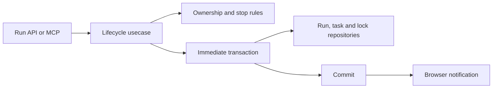

# Lifecycle audit and next backend slices

## TL;DR

- **Goal:** Extract heartbeat, finalize, yield, and recovery around the whole admitted scope.
- **Key decision:** Put policy in services, SQL in concrete repositories, and transaction ownership in usecases.
- **Impact:** Task domain, internal run API, managed MCP yield, Intake acceptance, and existing integration checks.

## Scope

**In scope — Ready:** LC-05b–e extractions and their named safety prerequisites, subject to the contract review for durable scope/launch evidence. **Out of scope:** provider protocol redesign, product changes, new unit tests, and generic transaction abstractions. See [overview](00-overview.md) for authority and readiness.

## Advanced: inspected audit

Paths below identify current code, not proposed files.

| Inspected source                                                    | Finding                                                                                                                                                                                                                                  | Consequence / slice                                                                                                                           |
| ------------------------------------------------------------------- | ---------------------------------------------------------------------------------------------------------------------------------------------------------------------------------------------------------------------------------------- | --------------------------------------------------------------------------------------------------------------------------------------------- |
| `src/backend/domains/task/recovery.ts:22`                           | Heartbeat checks `runs.owner_token/lock_generation`, then reads locks before a default transaction. Any nonempty owned set passes; expected scope/generations are not compared.                                                          | A missing or changed secondary lock can escape validation. LC-05a-r1 and LC-05b.                                                              |
| `src/backend/domains/task/recovery.ts:47`                           | Finalize guards Intake `done`, terminal replay, and stop fields. Reads precede a default transaction; release is by owner plus a redundant single-key update. Pending yield overrides any requested terminal task status.                | Retain error ordering and idempotency; explicitly resolve yield versus error/cancel precedence in LC-05c.                                     |
| `src/backend/domains/task/recovery.ts:170`                          | Uncertain marking updates all owned locks and also scope paths without owner/generation predicates.                                                                                                                                      | Stale path-based updates can quarantine a successor. LC-05e needs full-set fencing.                                                           |
| `src/backend/domains/task/recovery.ts:218`                          | Clearance ignores operator/reason after validation; accepts an empty owner without checking generation; always cancels the linked task.                                                                                                  | Owner-only filtering is insufficient for old receipts after successor release. Add guarded recovery, audit, and active-task checks in LC-05e. |
| `src/backend/domains/task/runs.ts:359`                              | Fence helper compares only run fields. Duplicate SQL/types coexist with repositories and cyclic re-exports. Old occupancy excludes `uncertain`.                                                                                          | Use one run model and explicit repository reads. Do not move callers onto the obsolete counter.                                               |
| `src/backend/domains/task/runs.ts:34`                               | Legacy heartbeat lease is 30 seconds; admission service uses 60 seconds.                                                                                                                                                                 | Record both timings; keep heartbeat at 30 seconds during extraction. Any unification is a separate behavior decision.                         |
| `src/backend/domains/task/tasks.ts:110`                             | Parent readiness scans blocked `todo` rows, keeps failed/cancelled children blocked, and publishes while updating. Shared verification tasks use this same mechanism.                                                                    | Extract a transaction-safe readiness action in LC-05d; retain both uses and version/no-op behavior.                                           |
| `src/backend/api/runs.ts`                                           | Lifecycle routes call recovery directly; finalize intentionally uses shape-only validation; MCP-token route contains SQL.                                                                                                                | Route to usecases. Preserve `VERIFIED_STOP_REQUIRED`; remove token SQL in LC-06a.                                                             |
| `src/backend/domains/task/usecases/claim-task-usecase.ts`           | Writes all locks in `.immediate()`, but resolves task/repo paths before it, picks `repos[0]`, and derives the run fence from max tree generation. Persisted `admitted_scope` contains only paths. Replay reads current lock generations. | Missing durable independent identity. LC-05a-r1 is a safety repair, not an LC-05a status reset.                                               |
| `src/backend/domains/task/usecases/admit-next-task-usecase.ts`      | Bulk receipt replay rebuilds only a primary generation map. Its outer transaction invokes a publishing claim action.                                                                                                                     | Exact replay and outer-commit publication need repair; checking the direct claim path alone misses both.                                      |
| `src/backend/usecases/ingest-events-usecase.ts`                     | Implementation ingress validates one lock against the run generation before its transaction. Intake JSON is skipped for DB chat but still published in the generic post-commit loop.                                                     | Unequal generations can reject valid events; scope tampering can escape detection. LC-05a-r1/r2 include this already-extracted caller.        |
| `src/backend/domains/task/usecases/commit-intake-result-usecase.ts` | Direct callers do not independently enforce the stop fields; route schemas do. Commits use default transactions. Finished-result replay compares action only.                                                                            | Preserve all three outcomes; add direct guards, full retry identity, and immediate acceptance in LC-05c's Intake sub-slice.                   |
| `src/execution-engine/runtime.ts` / `scheduler.ts`                  | Admission returns full claim but step/result drops its scope/fences/deadline. Runtime dispatch and resume pass only run ID/generation; rehydration uses mutable task context.                                                            | Dispatcher fallbacks can narrow writes to primary and reset Intake deadlines. LC-08b/c/d must carry one immutable scope.                      |
| `src/agent-adapter/manager.ts` and Codex/Claude drivers             | Close/error callbacks stamp proof without group verification. Cancel stamps proof even on a negative check; timeout does not await cancel. Repeated start checks owner/generation only.                                                  | LC-05c-p must repair proof production; launch identity and payload conflict handling cannot be invented by a backend extraction.              |

The existing multi-repo dispatch check manually injects `writeRoots`; it does not exercise the runtime's lossy claim handoff. Its lease check asserts two rows exist, not that every timestamp advanced. Add assertions in the existing suites at the appropriate slices.

## Common contract and checks

All paths below are repository-relative. `task/` means `src/backend/domains/task/`. All usecases accept the existing backend `Database` connection; repositories share it synchronously. No `await` inside a transaction, independent connection, or process spawn in backend. Services receive typed snapshots and return decisions; they do not publish or query SQL.

Each code slice runs `bun run typecheck`, `bun run lint`, `bun run build:services`, plus its listed suites. No new unit tests. Extend existing `*-checks.ts` integration/process fixtures only for missing guarantees. Use disposable repos/data dirs and fake providers; never the live app.

### LC-00p — Align scope and baseline

- **Touch:** `AGENTS.md`, `specs/CONSTITUTION.md`, `specs/ARCHITECTURE.md`, `specs/2026-10-18-initialize-project/SPECIFICATION.md`, `README.md`; original layer plan/tracker/cards and runtime release matrix.
- **Input → output:** Current user decisions plus inspected state → one dated Darwin arm64 policy, corrected progress, and explicit safety backlog. Do not rewrite historical pass claims or remove dormant platform helpers merely to satisfy policy.
- **Accept:** Distinguish implemented mapping, deterministic proof, and live capability evidence. Preserve 18 suite entrypoints; record clean baseline or exact failures.
- **Verify:** `bun run check:deterministic`; `bun run typecheck`; `bun run lint`. Record pre-existing failures separately. Inspect isolation first, including `TASKASIDE_DATA_DIR`, ports, provider flags, and cleanup.

### LC-05a-r1 — Durable scope and complete ownership

- **Touch:** `src/contracts/run.ts`; `src/backend/domains/task/schema.ts`; `src/backend/db/migrations.ts`; `task/usecases/{claim-task-usecase,claim-intake-usecase,admit-next-task-usecase,get-task-context-usecase}.ts`; `task/repositories/{run-repository,lock-repository,claim-receipt-repository}.ts`; `task/services/admission-service.ts`; `src/backend/usecases/ingest-events-usecase.ts`; `src/backend/api/runs.ts`.
- **Create:** `task/services/run-ownership-service.ts`; a runtime-neutral `src/contracts/task-context.ts` for shared context and admitted execution projection. Keep actual lookup SQL in existing repositories.
- **Input → output:** Task resolution + claim request → immutable primary repo, registered IDs/canonical roots, recorded generation for every tree, independent run fence, input revision, deadline, and exact replay identity. Persist scope on the run and return the original admitted data on direct and bulk retry. Use additive storage, not current locks as historical receipts.
- **Boundary:** Re-read task/repo authorization, primary membership, capacity, path identity, and receipts inside the immediate transaction. Do not grant a common ancestor. Reject aliases/nesting within scope and conflicting held/quarantined ancestor/descendant paths across runs. One run counts once, including Intake and uncertain runs.
- **Contract review:** Current `generation` is a legacy run token; retain it as an alias to the durable run fence. Never compare it to all tree generations. Specify compatible response/error deltas and mixed-binary rejection before changing schema/protocol. Version persisted scope; do not silently repurpose path-only JSON. Migrate a stopped instance; unknown active legacy scope stays held/quarantined, without fabricated generations or stop evidence.
- **Accept:** Secondary owner/generation tampering or a missing lock fails the full mutation without partial effects. Distinct generations succeed. Claim replay stays exact after task edits or later claims; changed request identity conflicts. Events validate the same complete scope in their write transaction. Terminal event receipt replay remains an ACK without reapplying effects after lock release.
- **Verify:** `bun run test:db`; `bun run test:contracts`; `bun run test:runs`; `bun run test:events`; `bun run test:engine`; `bun run test:pool`. Add unequal-generation, secondary tamper, replay-after-release, missing registration, and path-conflict integration cases.

### LC-05a-r2 — Outermost commit and Intake projection

- **Touch:** `task/usecases/{claim-task-usecase,admit-next-task-usecase}.ts`, `src/backend/usecases/ingest-events-usecase.ts`, `src/backend/{run-checks,event-checks,projection-checks}.ts`; later readiness extraction reuses the same explicit effect pattern.
- **Input → output:** One admission/event action → committed state and notifications, or rollback and no notification. Return concrete effect records from transaction bodies; the outer action publishes them. Do not add a generic unit-of-work abstraction.
- **Accept:** Forced bulk-admission failure after inner claim emits nothing. Intake final JSON is execution metadata only; browser chat receives the accepted short summary. Durable retries do not reapply DB writes. Preserve existing hashes, ordering, bounded deltas, and receipt errors.
- **Verify:** `bun run test:runs`; `bun run test:events`; `bun run test:projection`; `bun run test:pool`.

### LC-05b — Heartbeat ownership action

- **Create:** `task/usecases/heartbeat-usecase.ts`.
- **Touch:** `task/repositories/{run-repository,lock-repository}.ts`, `task/services/run-ownership-service.ts`, `task/{recovery,runs}.ts`, `src/backend/api/runs.ts`, `src/backend/run-checks.ts`, `src/execution-engine/engine-checks.ts`.
- **Input → output:** `(db, runId, HeartbeatRequest {ownerId, generation}) → {ok:true}`; keep `NOT_FOUND`/`STALE_GENERATION` behavior. Public shape unchanged after the prerequisite contract repair.
- **Steps:** Move route to the action; read run/expected scope/current locks and validate within `.immediate()`; update `heartbeat_at` and every matched lock lease atomically through repositories. Retain a forwarding export until all callers move. Use one timestamp pair; keep the current 30-second heartbeat lease.
- **Accept:** Intake updates only its run and holds no repo locks. Implementation missing/stale secondary rejects with no timestamp changes anywhere. A valid heartbeat advances every held lease, retains generation/owner/quarantine, and cannot renew a completed writer. Expiry never deletes/releases locks.
- **Verify:** `bun run test:runs`; `bun run test:engine`; `bun run test:pool`. Compare timestamps before/after, not just row counts.

### LC-05c-p — Trustworthy stop evidence prerequisite

- **Touch:** `src/agent-adapter/{manager,types,service}.ts`, `src/agent-adapter/drivers/{types,process-group,codex,claude}.ts`, `src/contracts/run.ts`, `src/execution-engine/{client,dispatcher,reconciler}.ts`, existing adapter/safety/engine/startup checks. Audit `drivers/agy.ts` for the same proof paths; retain its disabled Intake/multi-root behavior.
- **Create:** `src/agent-adapter/services/run-stop-service.ts`; add concrete process identity storage under `src/agent-adapter/state/launch-journal.ts` only for the required crash-safe launch identity. It stores process metadata, not task truth or SQLite.
- **Input → output:** Current launch identity and process fingerprint/group → verified receipt for that launch, or uncertainty. Keep existing `verifiedStopped` and `verificationMethod` fields; add launch binding only through the coordinated contract review. Backend stores/validates the active launch binding; missing legacy identity cannot become proof.
- **Accept:** Completion/error/cancel/timeout/shutdown await bounded termination and verification. `ESRCH` is distinct from permission errors. Group emptiness alone cannot cover escaped/reparented descendants; uncertain ownership retains all reservations. Missing registry/driver entry is unknown unless durable proof exists. A prior HITL turn's receipt cannot finalize a new launch. Lost start ACK inspects/retries the same identity; unresolved journal entries after adapter restart cannot spawn again. Changed start payload conflicts. No secret/prompt in the journal.
- **Verify:** `bun run test:adapter`; `bun run test:safety`; `bun run test:engine`; `bun run test:startup`; `bun run test:pool`. Add real disposable child-process checks for false cancel, deadline race, parent-exit-with-child-alive, and old proof after resume. Fake process proof stays explicitly fake.

### LC-05c — Finalize run action

- **Create:** `task/usecases/finalize-run-usecase.ts`, `task/services/run-lifecycle-service.ts`.
- **Touch:** `task/repositories/{run-repository,lock-repository,task-write-repository}.ts`, `task/services/run-ownership-service.ts`, `task/{recovery,runs}.ts`, `src/backend/api/runs.ts`, existing run/event/engine checks. Coordinate parent readiness through the explicit action delivered in LC-05d; retain a narrow bridge until then.
- **Input → output:** `(db, runId, FinalizeRunRequest) → {ok:true}`. Internal route keeps shape-only parsing, so absent/false proof reaches `VERIFIED_STOP_REQUIRED`, not a replacement Zod error. Keep ownership check before terminal replay; identical finalize has no extra task version, lock write, or notification.
- **Steps:** Validate active launch proof and complete owned scope inside `.immediate()`; coordinate terminal run metadata, task outcome, fenced release of every expected lock, and parent effects. Never reset tree generations, deadline, or admitted scope; do not clear another owner's key. Commit before publishing.
- **Accept:** Generic finalize cannot mark an Intake result `done`; cancel/error retain their explicit handling. Verified successful legacy yield becomes blocked `todo`; failure/timeout/cancel must not silently become a successful yield. This precedence repair is explicit and covered, not hidden as compatibility. Missing/mismatched proof leaves all roots/slot held. Duplicate terminal replay must not touch a successor's locks or newer task attempt.
- **Intake sub-slice:** Also touch `task/usecases/commit-intake-result-usecase.ts`, `src/contracts/intake.ts`, task-write/message repositories and relevant checks. Add direct stop/revision/identity validation inside immediate acceptance; persist full outcome retry identity, not only `action`. Keep `implement`, terminal `delegate`, task-level `request_input`, staged activation, token expiry, and shared verification conversation atomic. Use the same proof rules without requiring repo locks.
- **Verify:** `bun run test:runs`; `bun run test:events`; `bun run test:api`; `bun run test:mcp`; `bun run test:engine`; `bun run test:pool`. Cover rollback after one lock write, missing method, direct Intake invocation, duplicate finalize/commit, changed retry result, and yield plus failure/cancel races.

### LC-05d — Yield intent and child readiness

- **Create:** `task/usecases/yield-task-usecase.ts`, `task/usecases/reconcile-blocked-parents-usecase.ts`, `task/services/child-wait-service.ts`.
- **Touch:** `task/{runs,tasks}.ts`, `task/repositories/{run-repository,task-query-repository,task-write-repository}.ts`, `task/usecases/{finalize-run-usecase,commit-intake-result-usecase,admit-next-task-usecase,list-runnable-tasks-usecase}.ts`, `src/backend/mcp/tools.ts`.
- **Input → output:** Authenticated managed run/task scope + optional `childTaskIds`/reason → unchanged `{ok:true,status:'yield_requested',taskId,blockedOnChildIds}`. Do not accept caller-supplied exit proof. Re-read scoped run ownership in the immediate action instead of trusting an old auth snapshot.
- **Steps:** Move child lookup/default-set checks and identical-intent comparison out of MCP/runs; persist only intent. Move blocked-task selection/updates to repositories and rules to the child service. Return concrete readiness effects to a caller transaction, or commit/publish in a standalone readiness action. No publication from the service/repository.
- **Accept:** Explicit children belong to the task; identical intent is idempotent; changed scope conflicts with the existing error shape. No children is rejected; an empty default wait set follows current behavior when children already ended. Wait status and lock release occur only in verified finalization. Only all-success prerequisites unblock; missing/failed/cancelled children stay blocked with stable reasons and no repeat version bumps.
- **Distinction:** Legacy yield returns the parent to blocked `todo` and later creates a new run. Intake `delegate` finishes the parent `done`, activates staged children, and gates the optional verification task. Never route `delegate` through yield, revive its parent, or treat every prerequisite as a direct child: verification may wait on siblings. Intake tokens cannot call `yield_task`.
- **Verify:** `bun run test:mcp`; `bun run test:runs`; `bun run test:engine`; `bun run test:pool`; `bun run test:projection`. Include legacy wait, terminal delegation, omitted staged children, shared-conversation verification, failed child, and rollback/no-notification cases.

### LC-05e — Uncertainty and quarantine

- **Create:** `task/usecases/mark-uncertain-usecase.ts`, `task/usecases/clear-quarantine-usecase.ts`.
- **Touch:** `task/recovery.ts`, `task/services/{run-ownership-service,run-lifecycle-service}.ts`, run/lock/task repositories, `src/backend/api/runs.ts`, run/API/pool/startup checks.
- **Input → output:** Existing mark request → `{ok:true}` with whole-scope quarantine; existing supervisor-only clear request → `{ok:true}` only after authorized safe recovery. Retain operator/reason and record recovery evidence. If stronger evidence needs a request delta, document it as a safety change before implementation.
- **Accept:** Immediate fencing protects every update, including empty-owner rows by recorded generation. Reject a stale run affecting a successor or cancelling its linked task's newer attempt. Terminal no-op/rejection never reopens a run. Intake uncertainty retains its slot despite zero locks. Admin identity is authorization, not process-stop evidence. Keep uncertainty until actual proof; no TTL release, operator-fabricated proof, or swallowed malformed-scope JSON.
- **Verify:** `bun run test:runs`; `bun run test:api`; `bun run test:pool`; `bun run test:startup`; `bun run test:engine`. Cover stale clearance after a successor both holds and releases its locks.

### LC-05e-q — Finish run reads and control markers

- **Create:** `task/usecases/get-run-status-usecase.ts`, `list-active-runs-usecase.ts`, `request-timeout-usecase.ts`.
- **Touch:** `task/runs.ts`, `task/repositories/run-repository.ts`, `task/services/run-lifecycle-service.ts`, `task/usecases/{cancel-task-usecase,claim-task-usecase,claim-intake-usecase,admit-next-task-usecase}.ts`, `src/backend/api/runs.ts`.
- **Input → output:** Existing run ID/list read → same status projection with the durable purpose/scope/deadline required for restart; timeout/cancel intent → idempotent marker without terminal task mutation or release. Move remaining settings/provider/run SQL into existing settings/task/run repositories. No duplicate RunRow or legacy occupancy implementation survives as a second authority.
- **Adjustment:** Startup enumeration must account for unresolved `uncertain` attempts, not silently omit them. The current list projection also omits `purpose`, unlike the individual get route. Make the purpose/scope projection consistent through shared contracts and record this response delta explicitly. Preserve each intent route's authentication and current error behavior; markers do not attest stop.
- **Verify:** `bun run test:runs`; `bun run test:api`; `bun run test:startup`; `bun run test:pool`; `bun run test:contracts`. Cover an uncertain Intake attempt and a multi-root attempt in restart enumeration before admission.

## Exit and rollback

Every card records exact files, command/results, remaining gaps, and next ID under the existing evidence directory. A refactor reverts only its own patch. Safety storage/contract changes require a separate migration/recovery note; never roll an older binary over a changed DB or active writer. No real worktree rollback or user checkout cleanup.
