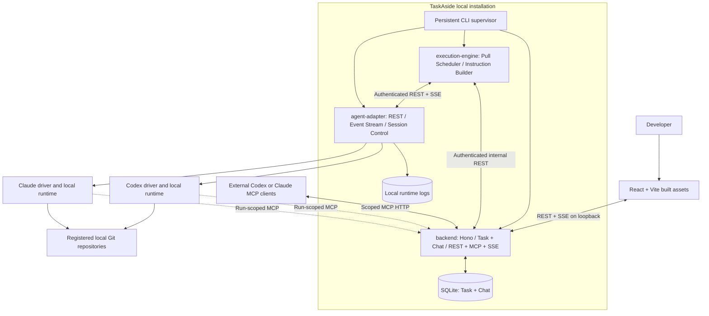
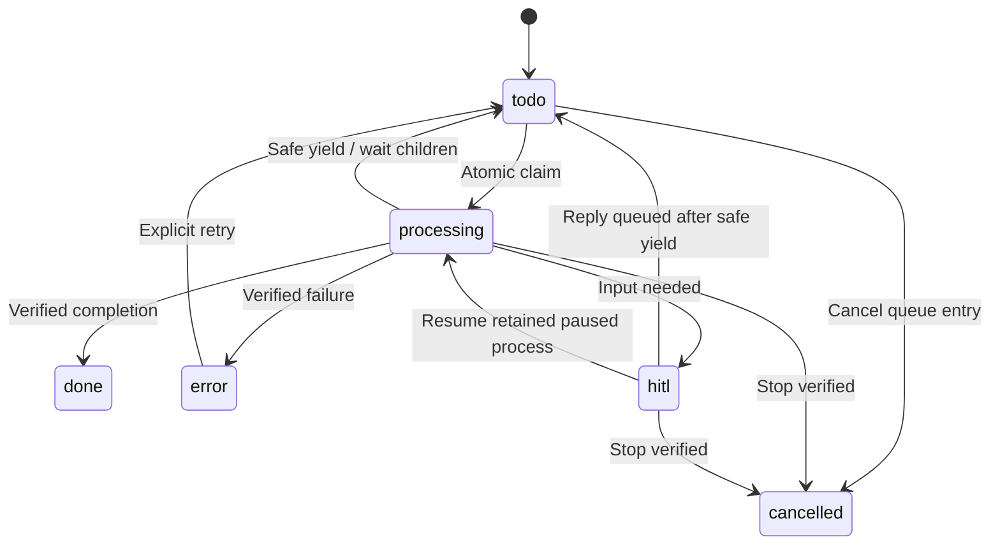
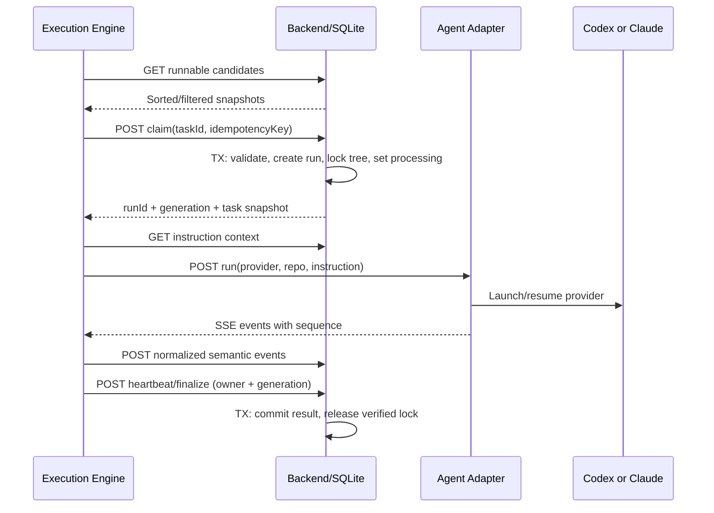
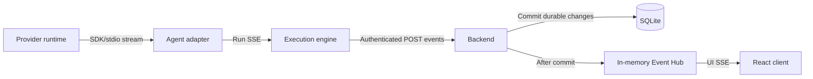
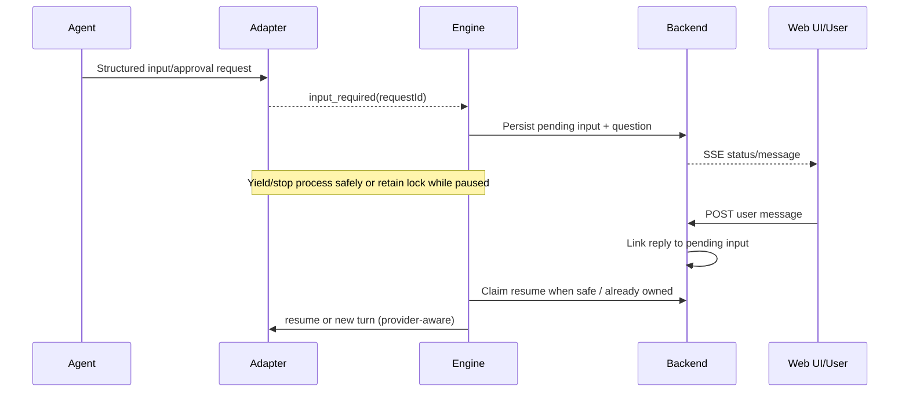
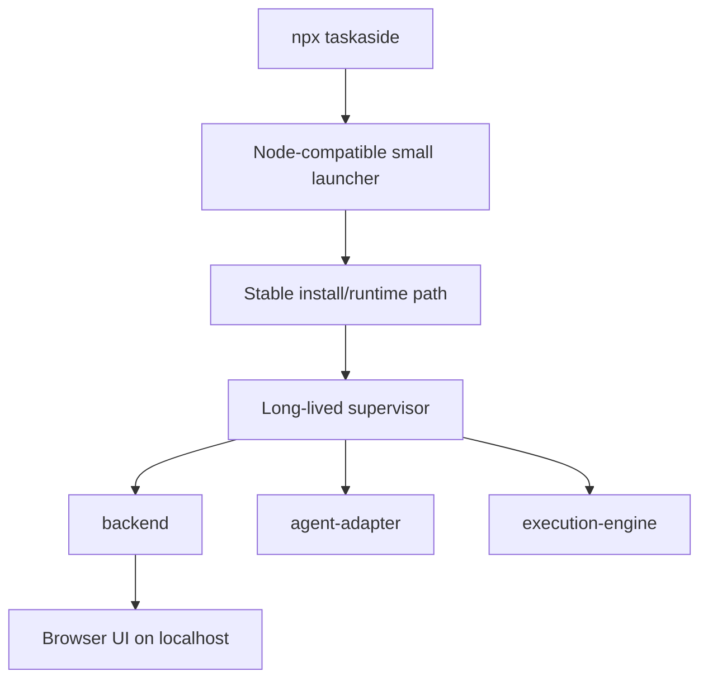

# TaskAside — Technical Architecture

> **Status:** Architecture v0.4, agreed boundaries and contracts unified with SPECIFICATION.md after M0 (see [T05 evidence/decision record](2026-10-18-initialize-project/evidence/T05-feasibility-and-contract-gaps.md)); some agent/runtime capabilities remain POC-gated per that record  
> **Date:** 2026-10-18 · **Style:** Local-first modular system, three CMD service processes + one CLI supervisor  
> **Companion:** [CONSTITUTION.md](CONSTITUTION.md) · [SPECIFICATION.md](SPECIFICATION.md) · [PLAN.MD](PLAN.MD)

## 1. Architecture decisions (fixed for MVP)

| ADR | Decision | Why |
|---|---|---|
| A-01 | One TaskAside npm package, Bun/TypeScript app + Node-compatible bootstrap | Cross-OS one-package release with `npx` entrypoint |
| A-02 | Persistent CLI supervisor with 3 independent processes | Separate lifecycle and diagnostics without separate deployment |
| A-03 | `backend` is only process with SQLite access | One authoritative state transition/transaction boundary |
| A-04 | `execution-engine` pulls and atomically claims from backend REST | Priority and repo-safe scheduling in a dedicated worker |
| A-05 | One `agent-adapter` REST service with Codex & Claude drivers | Stable orchestration contract, provider-specific internals |
| A-06 | `backend` exposes public REST + MCP Streamable HTTP + SSE and serves React assets | Minimal deployment and agent/tool integration |
| A-07 | Single SQLite DB, separate Task and Chat domain schemas; local log files | Persistence without infrastructure; independent domain responsibilities |
| A-08 | Adapter SSE → engine; engine POST → backend; backend Event Hub SSE → UI | Cross-process live delivery without shared memory or Redis |
| A-09 | One TaskAside writer per working tree; atomic claim, fenced locks, conservative recovery | Prevent duplicate code modifications |
| A-10 | Plain conversation, two-level task grouping, no task-specific widgets/tabs | Minimal UX and MVP scope |

**Tradeoff:** These are three separately launched service processes plus a long-lived supervisor, not a one-process monolith. This costs additional local IPC and lifecycle handling, but each process has a clear responsibility. It is *not* a microservice deployment architecture.

## 2. Context and components



### 2.1 `backend` (state owner)

- Owns SQLite connection and migrations; no other service receives DB file path/credentials.
- Task domain: repository registry, tasks, runs, claims, lock fencing, state machine, idempotency, parent relationships.
- Chat domain: conversations, messages, pending human input linkage.
- Public REST for frontend; **internal REST** for execution engine with service credentials.
- MCP Streamable HTTP at `/mcp`, exposing *scoped task/chat tools*, not admin controls.
- SSE endpoint `/api/events` and process-local Event Hub for UI fan-out.
- Serves static React build from app installation; enforces safe SPA fallback without exposing logs/db.

### 2.2 `execution-engine` (scheduling owner)

- Pulls candidates and invokes backend atomic claim API; maintains global concurrency and priority/FIFO dispatch decisions.
- Builds instruction from task description, safe repo context, parent metadata, relevant conversation and system execution policy.
- Calls `agent-adapter` REST to start/stop/resume; consumes adapter SSE; normalizes/coalesces and POSTs events to backend.
- Performs reconciliation after disconnect/restart; no database access and no directly spawned provider subprocess.
- Parent yielding and child readiness are based on backend wait conditions, not a generic workflow DSL.

### 2.3 `agent-adapter` (agent runtime owner)

- REST-controlled single service with two drivers: **Codex** and **Claude**.
- Owns subprocess/session handles, provider-specific streaming, permission prompts, cancellation and raw log writing.
- Normalizes provider event stream; exposes `GET /runs/:id/events` as SSE to engine, and status inspection separately.
- Does not decide task priority, mutate task status or connect to SQLite.
- Tracks all managed child processes for safe cancellation and stale run reconciliation.

### 2.4 `frontend` (projection only)

- React/Vite/Tailwind/shadcn UI. Build-time static assets are served by backend; no standalone production frontend server.
- Displays state/priority nested groups with collapses; selects task -> conversation; settings modal from avatar.
- REST read snapshot is authoritative; SSE provides incremental updates and triggers query invalidation. Does not subscribe to raw logs.
- UI is never the owner of a scheduling decision or agent process.

### 2.5 CLI supervisor

- Public `taskaside` command and internal `backend`, `execution-engine`, `agent-adapter` subcommands.
- **Supervisor remains alive** as a persistent local process; CLI launches or attaches to it. Service processes are its managed children (or adopt a platform service-management approach if later justified).
- Start order: backend -> adapter -> engine; readiness gating prevents engine claiming tasks before other services are healthy.
- Single-instance lock, stable runtime installation, health checks, crash detection, log rotation, explicit `status` and `stop`, guarded restart policies.
- Never claims tasks or directly restarts agent runs. If adapter crashes, engine/backend quarantine affected runs until process state is verified.

## 3. Processes and trust boundaries

```text
Browser (public local API) ──► backend :127.0.0.1:<api-port>
External/managed MCP ───────► backend :127.0.0.1:<api-port>/mcp
execution-engine (internal) ─► backend /internal/v1/* [service credential]
execution-engine (internal) ─► agent-adapter :127.0.0.1:<adapter-port> [service credential]
agent-adapter ───────────────► Codex/Claude local runtime [stdio / SDK / subprocess]
backend ─────────────────────► SQLite (sole owner)
agent-adapter ───────────────► Local logs (write), engine reads events (not logs)
```

Keep browser auth and internal service auth separate. Loopback alone does not establish trust (DNS rebinding and browser-origin attacks exist). Managed MCP credentials are short-lived, scoped to `taskId/runId`; external MCP clients require an explicit pairing grant with narrow permissions. Do not leak service credentials through agent environment unless strictly necessary.

### 3.1 Local auth and service roles (T05 decision)

- Every listener binds `127.0.0.1` only and rejects requests whose `Host`/`Origin` is not exactly `127.0.0.1:<port>` or `localhost:<port>` for that service's own port.
- **Six service roles:** `supervisor`, `engine`, `adapter`, `browser`, `mcp-managed`, `mcp-external`.
- **Browser bootstrap token:** supervisor generates `auth.token` (256-bit random, `chmod 0600`) in the app-data directory on first run; `taskaside start` opens the browser at `http://127.0.0.1:<port>/?token=<token>`. Frontend reads the token once, stores it in `sessionStorage`, strips it from the visible URL, and sends `Authorization: Bearer <token>` on REST calls; SSE (no custom headers in `EventSource`) accepts the same token as `?token=`.
- **Internal inter-service credential:** a separate `internal.token` (0600), passed to `backend`/`execution-engine`/`agent-adapter` via environment at spawn, never logged or written to a browser-reachable path. Every `/internal/v1/*` call requires both `X-TaskAside-Role: engine|adapter|supervisor` and `Authorization: Bearer <internal.token>`. Browser tokens cannot reach internal routes and vice versa.
- **External MCP pairing:** an unrecognized `/mcp` caller gets `401` plus a one-time pairing code; the user approves it from Settings (avatar → Settings modal, no new surface) to mint a revocable, scope-limited bearer token. **Managed MCP** tokens are minted per run by the backend, scoped to `taskId`/`runId`, auto-expire at finalize, and are never user-approved.

## 4. Data model and schema ownership

**One SQLite database, two domain folders/schemas in code.** Use foreign keys and migrations, not separate SQLite files. Suggested schema (illustrative, not final SQL):

```text
Task domain
  repositories(id PK, name, display_path, canonical_path UNIQUE, default_provider, created_at)
  tasks(id PK, repository_id FK, conversation_id FK, parent_id FK nullable,
        title, description, priority 0..3, status, agent_provider,
        block_kind nullable, blocked_reason nullable,
        depth INTEGER DEFAULT 0, blocked_on_child_ids TEXT nullable (JSON array),
        origin_run_id nullable, origin_key nullable,
        created_at, enqueued_at, updated_at)
  runs(id PK, task_id FK, provider, provider_session_id nullable,
       status, owner_token, lock_generation, process_state,
       pending_input_request_id nullable, log_path nullable,
       started_at, heartbeat_at, ended_at, exit_code nullable)
       -- owner_token is the DB-side binding for the wire-contract `ownerId` field (ARCHITECTURE.md §5);
       -- status includes `uncertain` as an internal value distinct from the public task state (§4 state machine note)
  run_locks(working_tree_key PK, owner_run_id, generation, lease_expires_at)
  run_event_receipts(run_id, sequence, event_hash, PRIMARY KEY(run_id, sequence))

Chat domain
  conversations(id PK, created_at, updated_at)
  messages(id PK, conversation_id FK, role, content, source_run_id nullable,
           source_event_seq nullable, created_at,
           UNIQUE(source_run_id, source_event_seq) when non-null)
```

Caveats and invariants:

- Child task creation should be deduplicated with a unique `(origin_run_id, origin_key)` on records where both present; external user create gets request idempotency key at API layer if needed.
- Provider session IDs belong to `runs` or an explicitly task-bound session record; provider IDs are not shared interchangeably.
- Foreign key cycles in `parent_id` require **application transaction validation**, not merely FKs.
- Only one writer per normalized working tree. A raw path string is not a safe equivalence key; canonicalize real paths, normalize case where filesystem semantics require, and reject uncertain aliasing.
- `blockedReason` is human-readable UI copy; `blockKind`/wait-condition is scheduler-readable.
- `run_locks` must persist uncertain locks across restarts until reconciliation.
- WAL mode for concurrent readers; DB still has one logical writing process. Enforce transactional state mutations and migrations before daemon becomes ready.

### State machine



When a run is **uncertain** due to process disappearance/network break, the public task state may show `processing`/`error` and a clear blocked reason, while internal run state uses `uncertain`. Never permit a second writer until process reconciliation. This is deliberate conservative behavior, not an extra visible task status.

## 5. Scheduler and repo locking

**Algorithm:** engine reads candidate todo tasks, sorts by priority then enqueue time, respects configured max concurrency, asks backend to atomically claim. Backend revalidates task eligibility and working-tree exclusivity in a transaction. Engine treats a 409 claim conflict as normal contention and tries another candidate.



Default `maxConcurrency=3`, `maxPerWorkingTree=1`. Higher priority never preempts already running work. Siblings do not automatically run in declared order. A parent yields and becomes blocked on all children only when explicitly requested by agent/system policy via the `yield_task` MCP tool (§8). If a child fails, parent waits for human intervention. **Child limits are fixed MVP ceilings (T05 decision): `depth(root)=0`, `depth(child)=depth(root)+1`; `create_task` is only permitted when the caller's own depth is 0 (a child cannot spawn a grandchild); at most 5 children per task.** Locks coordinate TaskAside processes only; do not guarantee a separate IDE or tool isn't touching the repo.

### Lease/fencing and recovery

- A claim creates monotonically increasing **fencing generation** for the working tree. Every mutation from the owning run is checked against that generation.
- **Owner/fencing fields (T05 decision):** `claim`, `heartbeat`, `events`, `finalize`, `input`, and `cancel` all carry `ownerId` (the active execution-engine instance's identifier, stable for its process lifetime) and `generation` (the working-tree lock's fencing counter, incremented on every claim/retry). Backend checks `runs.owner_token == ownerId AND run_locks.generation == generation` on each call; a mismatch returns `409 {code:"STALE_GENERATION"}`.
- Engine refreshes heartbeat. Heartbeat expiration initiates investigation; it does **not** automatically free lock.
- **Turn completion is not lock release.** A clean process exit, `turn.completed`, or provider `stop`/`result` event proves only that the provider's own turn ended — not that every descendant process is gone (T04 §1a demonstrated reparented, still-running descendants after a naive top-level kill). `POST /internal/v1/runs/:id/finalize` therefore requires `verifiedStopped: boolean` and `verificationMethod: "process_group_empty" | "ps_fingerprint_absent"`, populated from the adapter's process-group kill-and-confirm check (T04 §1b/§2). Backend rejects a terminal (`done`/`error`/`cancelled`) finalize with `verifiedStopped:false`; such calls must go through `mark-uncertain` instead.
- If reconciliation cannot demonstrate that an old writer stopped, the engine calls `POST /internal/v1/runs/:id/mark-uncertain`; the run moves to `uncertain` and its lock to `quarantined` (T04 §4's `held → quarantined → released` state machine). Quarantine clears only via verified termination or an explicit `POST /internal/v1/runs/:id/clear-quarantine` admin override — never by heartbeat expiry or a timer.
- Lost ACKs to events/finalization are retried with an **identical** `(runId, sequence, type, data)` tuple; backend's event-hash receipt table (§6) makes the retry a no-op if the original attempt already landed.

## 6. Agent adapter implementation choices

**Initial evidence path:** Use installed Codex and Claude CLIs with existing local login/configuration, following `z-agent-non-interactive`. Confirm flags with local help, keep configured model defaults and use least-privilege harness modes. These choices do not prove authentication or runtime capability. M0–M5 target macOS first; Linux/Windows evidence remains mandatory in M6 before cross-OS release.

### Codex driver (MVP)

Candidate: **Codex App Server**, controlled via JSON-RPC over stdio; use session/thread/turn IDs, JSON notifications for message deltas and turns, and explicit approval handling. This is better suited to a managed coding-session UI than scraping colored terminal text. Verify exact protocol version against the installed Codex binary in POC.

Official references: https://developers.openai.com/siwc/token-sharing-open-source/codex-app-server and https://developers.openai.com/blog/codex-as-a-platform

### Claude driver (MVP)

Selected path for POC: **Installed Claude Code CLI subprocess**, using print mode, structured output and existing login/configuration. Verify Bun process control, streaming, MCP, permission handling and cancellation against the installed version. SDK comparison is deferred unless a required CLI capability fails. Release requires start/stream/complete/cancel for **both** providers; session resume/HITL remain POC-gated.

Reference: https://platform.claude.com/docs/en/cli-sdks-libraries/overview

### Shared agent contract

```ts
type Provider = 'codex' | 'claude';
interface StartRun {
  runId: string;
  taskId: string;
  provider: Provider;
  cwd: string;
  instruction: string;
  ownerId: string;
  generation: number;
  sessionId?: string;
  mcp?: { endpoint: string; accessToken: string };
}
type AgentEventType =
  | 'message.delta' | 'message.completed' | 'input_required'
  | 'completed' | 'failed' | 'cancelled';
// `data` shape is discriminated by `type`:
//  message.delta     -> { messageId: string; delta: string }
//  message.completed -> { messageId: string; content: string }
//  input_required    -> { requestId: string; question: string }
//  completed         -> { summary: string }
//  failed            -> { errorCode: string; message: string }
//  cancelled         -> {}
interface EventEnvelope {
  runId: string;
  sequence: number;   // strictly increasing per runId, starting at 1
  type: AgentEventType;
  timestamp: string;
  data: Record<string, unknown>;
}
```

**One flat envelope (T05 decision):** `type` and `data` live at the envelope's top level — no nested `event` object. Validation is a Zod discriminated union keyed on `type`. Persistent event types (`message.completed`, `input_required`, `completed`, `failed`, `cancelled`) are deduplicated by backend on `(runId, sequence)` using a stored `event_hash = sha256(canonical_json({runId, sequence, type, data}))`: same hash on retry → `200` ACK, no repeated side effect; different hash at the same `sequence` → `409 {code:"SEQUENCE_CONFLICT"}`. `message.delta` is transient and not subject to this dedup guarantee.

`start`, `inspect`, `cancel` are baseline. `resume`, interactive permissions and safe suspension are **capability-discovered**. `GET /capabilities` must report known support; unsupported operations return typed errors, not fake success. Per T01/T02: Claude's print-mode CLI can honestly report `resume: true` (verified cross-process via `--session-id`/`--resume`) and `mcp: true` (verified via `--mcp-config`/`--strict-mcp-config`) today; Codex's `exec` baseline must report `mcp: false` and `resume: unverified` until a dedicated POC exercises `exec resume`/`app-server`.

## 7. Realtime event architecture: no shared memory across services



**Why:** Streaming is a property of open sockets and incremental messages; processes need not share an address space. Adapter-to-engine SSE provides live events; engine POSTs semantic changes (deltas may be coalesced); backend owns commit and fan-out. Event Hub is an in-memory broadcaster in the **backend process only**, not persistent queue infrastructure.

### Delivery contract

- Adapter emits monotonic per-run `sequence` and supports status inspection after dropped connections. A bounded replay buffer is useful but not a durable guarantee.
- Engine POSTs `message.completed`, `input_required`, run/task outcome with `(runId,sequence)` idempotency; backend checks active owner and deduplicates.
- Backend persists authoritative changes then broadcasts. `message.delta` may be sent transiently without per-token SQLite writes; no guaranteed delta replay.
- Browser uses **REST snapshot + SSE invalidation/live deltas + REST reconciliation on every reconnect**. To cover snapshot/subscribe races, expose entity versions or event high-watermark and refetch on connect/gaps.
- Apply bounded per-subscriber buffers, heartbeats, stale connection teardown, event batching. If UI misses deltas, subsequent authoritative `message.completed` must converge.
- Logs go to files; browser chat never becomes raw stdio log viewer in MVP.

### Event failure scenarios

| Failure | Required behavior |
|---|---|
| Browser closes | Adapter/engine continue; backend persists completions; UI catches up via REST |
| UI SSE disconnect | Reconnect and refetch; drop partial deltas if necessary |
| Engine loses adapter stream | Inspect run; resume from sequence if possible, else reconcile; no duplicate spawn |
| Engine loses backend POST ACK | Retry with same idempotent envelope |
| Backend restart | Load authoritative DB; event hub resets; clients reconnect and refetch |
| Adapter dies but child still alive | Mark uncertain, retain lock, inspect/terminate process tree safely |

## 8. HITL and child task flows

### HITL



**HITL pairing is atomic (T05 decision):** the backend's event-ingestion transaction for `input_required` persists the question as an agent message, sets `tasks.status = "hitl"`, and sets `runs.pending_request_id = requestId` all in one transaction. A reply (`POST /api/conversations/:id/messages` with optional `inReplyToRequestId`) that matches the current `pending_request_id` atomically inserts the user message, clears `pending_request_id`, and sets `tasks.status = "processing"`. A reply whose `inReplyToRequestId` does not match (already resolved, or stale) is rejected idempotently with `409 {code:"REQUEST_ALREADY_RESOLVED"}` — no second resume is triggered.

Neither provider demonstrated a process that can accept input on a held-open stdin mid-turn (T01 §9/§11, T02 §10/§11). MVP therefore always stops the turn once `input_required` fires; **the working-tree lock is retained through `hitl`** regardless (another run must not edit that tree), and resume uses provider capability: Claude via `--resume <session-id>` (verified cross-process in T02 §10), Codex via `exec resume <thread-id>` (contract-shaped, not yet end-to-end verified — gate behind `GET /capabilities`). If resume is unsupported, the engine queues the reply and keeps the task in `hitl` rather than starting a second concurrent writer; a human-visible fallback is a fresh turn with the reply folded into instruction context, explicitly labeled in chat. For plain task question and answer, use normal messages, not interactive cards. Provider tool permission prompts are *security-sensitive*, use a separate channel from ordinary chat text, and must not be silently approved as if they were ordinary chat.

### Parent delegation

Agent uses MCP `create_task({ parentId: currentTask, ... })`, backend validates scoped permission + dedup key + child budget, inserts child task and conversation. **`create_task` is only permitted when the caller's own `depth` is 0** — a child (`depth 1`) cannot spawn a grandchild — and each task may have **at most 5** children (fixed MVP ceilings, not configurable upward).

Parent yields via the 7th MCP tool, **`yield_task({ childTaskIds?: string[], reason?: string })`** (T05 decision — the original six tools had no such signal). `childTaskIds` defaults to all non-terminal children. The engine verifies the parent's process tree is fully stopped (same verified-stop proof as the lease/fencing section) before committing; on success the run finalizes (lock released), `tasks.status = "todo"`, `blockKind = "children"`, and `tasks.blocked_on_child_ids` (new nullable JSON array column) records the wait set. When every ID in that set reaches a terminal state (`done`/`error`/`cancelled`), the engine schedules a **new claim** (new `runId`) for the parent, with instruction context carrying a structured `{childTaskId, status, summary}` list; failed/cancelled children surface as a structured error list, and the parent is not auto-retried or auto-replaced. Task links provide minimal navigation; no Subtasks tab.

## 9. REST, MCP and security

Three independent protocol purposes:

1. **Browser REST + SSE:** task CRUD, chat and live presentation.
2. **Internal REST + adapter SSE:** engine/backend and engine/adapter control/telemetry, authenticated by internal role.
3. **Backend MCP `/mcp`:** task/chat tools available to user-paired external agents and managed run-scoped agents.

MCP tools (seven — `yield_task` added by T05 decision): `list_tasks`, `get_task`, `create_task`, `get_messages`, `post_message`, `request_input`, `yield_task`. Tools use backend domain services. No direct SQL, filesystem shell, scheduler controls or implicit permission grants. Managed token is bound to task/run, expires/revokes after run. External pairing explicitly grants scopes and can be revoked. Bound loopback listeners need Host/Origin checks, nontrivial session auth and strict input validation. See §3.1 for the token/role contract.

Subprocess safety: command + argument arrays, never shell interpolation of prompt text; sanitize working directory by registered canonical path; restrict environment variable propagation; provider permission profiles must default to conservative behavior. Local services are not a security sandbox, and TaskAside's lock does not protect against unrelated local processes.

## 10. Distribution and application lifecycle



- **One TaskAside npm package**; React build and server bundles shipped together; upstream npm `bun` runtime dependency resolves platform-specific executable under the hood. Node/npm needed for `npx`, Bun needed for `bunx`; do not claim the machine needs no runtime/bootstrap.
- Avoid `bun build --compile` as the **only** release artifact, because an actual executable is OS/arch-specific. An npm package can be platform-agnostic source/bundle that installs per-platform upstream runtime.
- Before detach, ensure server bundle, runtime, config and launcher paths exist in stable user application-data location; the launched service cannot depend on npx's ephemeral cache.
- `taskaside start` launches or connects, waits for health, opens browser and exits the *caller*; supervisor persists. `status` and `stop` send safe local control requests. `npx taskaside` maps to `start`.
- One supervisor lock/endpoint per user; prevent duplicate services. On startup check DB schema compatibility; never run two incompatible versions on same DB. Graceful shutdown respects task safety; if forced, leave recovery markers and retained locks.
- Default bind `127.0.0.1` with port selected/validated at startup; only authorize expected Host/Origin values. UI should not expose internal URLs or credentials.
- Target OS: macOS (x64/arm64), Linux (x64/arm64 where supported), Windows (x64/arm64 where supported). Release compatibility is a tested matrix, not assumed parity.

## 11. Filesystem/code layout

```text
taskaside/
├── src/
│   ├── cmd/{cli,backend,execution-engine,agent-adapter}.ts
│   ├── supervisor/{process-manager,health-check,install,control}.ts
│   ├── backend/
│   │   ├── api/{public,internal,sse}/
│   │   ├── mcp/
│   │   ├── domains/
│   │   │   ├── task/{schema,repository,service}.ts
│   │   │   └── chat/{schema,repository,service}.ts
│   │   ├── events/{event-hub,event-types}.ts
│   │   └── database/{connection,migration}.ts
│   ├── execution-engine/{scheduler,instruction-builder,executor,reconciler}.ts
│   ├── agent-adapter/{api,drivers/{codex,claude},session-manager,process-manager}/
│   ├── contracts/{task,chat,execution,agent,mcp}.ts
│   └── frontend/{components,hooks,App}.tsx
├── migrations/
├── docs/ (optional future decision records)
├── README.md
├── PRD.md
├── SPECIFICATION.md
├── CONSTITUTION.md
├── ARCHITECTURE.md
├── AGENTS.md
├── PLAN.MD
├── package.json
└── vite.config.ts
```

This is a **recommended layout**, not an instruction to generate empty layers. Create folders as needed and keep modules small.

## 12. Testing and observability

- Unit: priority selection, task state machine, instruction builder, parent-depth checks, event deduplication, lock path normalization.
- Integration with fake adapter: atomic claims under concurrency; cancellation; HITL; chat message persistence; duplicate POST; SSE/REST reconciliation; process death.
- Contract tests per provider: start/stream/success/fail/cancel/inspect and explicitly report resume/permission capabilities.
- End-to-end: browser grouping, task chat, both drivers, MCP external/managed scopes, close/reopen browser, process restart.
- Cross-platform: installer/bootstrap, daemon detach, signal/process-tree cancellation, data paths, static asset serving, localhost hardening.
- Logs include `taskId`, `runId`, `provider`, `eventType`, timestamps with configurable rotation; redact credentials and avoid logging full prompts by default.

## 13. Open risks and proof gates

| Risk | Decision / gate |
|---|---|
| Codex provider RPC changes | Pin/test supported versions; inspect official protocol and implement adapter fixtures |
| Installed CLI compatibility and credentials | Verify existing login/configuration and Bun subprocess control; no silent switch to SDK/API auth |
| HITL safe yield across drivers | Verify by POC; retain lock if running process cannot stop safely |
| Parent-child context/resume | Confirm session transfer limitations; do not promise seamless resume unsupported by provider |
| One-command detached local startup | Build and test platform-specific launcher paths/process supervision before beta |
| Crash-created stale writer | Quarantine uncertain locks; process reconciliation; manual release behind explicit warning |
| Event delivery gap | Idempotent semantic events, snapshot + SSE reconcile; no per-token durable guarantee |

**T05 closed the following gaps (decisions now binding, see the linked record for rationale):** event envelope shape (§6), owner/fencing field names and verified-stop-before-release rule (§5), uncertain/quarantine trigger and clearance endpoints (§5), HITL pending-request atomicity and duplicate-reply rejection (§8), the `yield_task` MCP tool and fixed child depth/count limits (§8/§9), and the local auth token/role contract (§3.1). Codex resume and true mid-turn process-retained HITL remain open POC gates per that record, not blockers for M1.

See [PLAN.MD](PLAN.MD) for milestones and go/no-go criteria.

## 14. Architecture boundaries that must not drift

> **Backend owns state. Execution engine owns scheduling. Agent adapter owns provider runtimes. Frontend owns presentation. Supervisor owns service lifecycle.**

Any proposal that crosses these boundaries or adds a new infrastructure service must demonstrate a present MVP requirement, a failure mode not solved by the existing architecture, and migration/testing consequences.

## 15. Source references for implementation verification

These are supporting technical references, not substitutions for TaskAside's own requirements:

- Codex App Server: https://developers.openai.com/siwc/token-sharing-open-source/codex-app-server
- Codex architecture overview: https://developers.openai.com/blog/codex-as-a-platform
- Claude SDK/tooling distinctions: https://platform.claude.com/docs/en/cli-sdks-libraries/overview
- Bun executable builds (OS-targeted): https://bun.sh/docs/bundler/executables
- Bun runtime npm package: https://www.npmjs.com/package/bun
- MCP specification: https://modelcontextprotocol.io/specification

Verify current upstream contracts against the dependency versions chosen during implementation.
